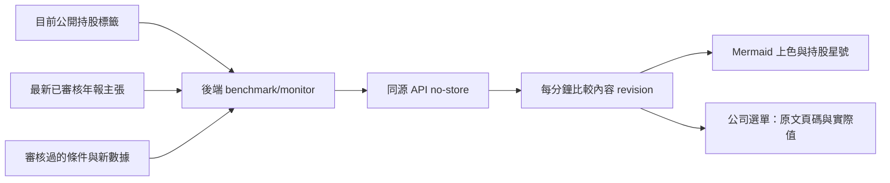

# Benchmark 強弱研究圖

首頁市場總覽使用同一張供應鏈 Mermaid，移除重複公司表。年報方向為已審核原文的順風／逆風／多空並存／中性／未知，圖上文字與顏色並用。金框與星號表示持股；非 benchmark 持股仍會顯示，沒有已核對角色就標為尚未定位。定位虛線明確註明非供貨關係。

## 資料流程

支持／反駁／未知是條件權重占比，不是報酬率或預測機率，未知留在分母。指標讀數保留期別、單位、門檻理由與來源。圖中不發布持股數量、成本或損益。

## 開發方法

1. 先測未知不可當中性、年報多空並存、海外同碼、持股星號，以及新快照自動刷新與導覽後停止輪詢。
2. 純 Mermaid 組裝放 `benchmarkMonitor.ts`，資料讀取與 DOM 更新放 `benchmarkMonitorClient.ts`。名稱與角色轉義；證據用 textContent，來源連結限 HTTPS。
3. SSR 盡力取得初始圖，可見頁面每分鐘重取 no-store API；revision 未改不重畫。失敗保留舊圖並明示更新失敗。這不是 server push，也不是每筆持股異動保存歷史圖。
4. 圖的文字與證據選單提供觸控及鍵盤讀取，不只靠顏色或 SVG title。語意量化、萃取限制、schema、憑證與正式盤點見 `../../maya-sawa/docs/BENCHMARK_MONITOR.md`（工作區另一 repo）。
5. 上線先後端初始化與未知基準，再前端與人工審核條件。API 餘額不足、未審年報與缺產品指標不能用假的分數填滿。

## 測試

`vitest run tests/market/benchmarkMonitor.test.ts tests/market/benchmarkChain.test.ts tests/market/benchmarkDiagram.test.ts tests/market/benchmarkReports.test.ts`

實際年報主張仍依後端審核結果，測試資料的百分比不是正式產業判斷。
