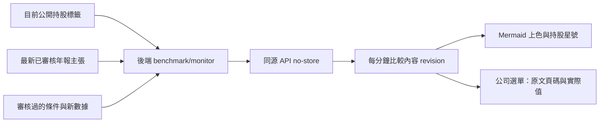

# Benchmark 強弱研究圖

首頁「探索研究圖」直接連到市場總覽的供應鏈 Mermaid。圖固定展開，載入期間顯示狀態。年報方向為已審核原文的順風／逆風／多空並存／中性／未知，圖上文字與顏色並用。金框與星號表示持股；非 benchmark 持股仍會顯示，沒有已核對角色就標為尚未定位。定位虛線明確註明非供貨關係。

## 資料流程

支持／反駁／未知是條件權重占比，不是報酬率或預測機率，未知留在分母。指標讀數保留期別、單位、門檻理由與來源。圖中不發布持股數量、成本或損益。

## 開發方法

1. 先測未知不可當中性、年報多空並存、海外同碼、持股星號，以及新快照自動刷新與導覽後停止輪詢。
2. 純 Mermaid 組裝放 `benchmarkMonitor.ts`，資料讀取與 DOM 更新放 `benchmarkMonitorClient.ts`。名稱與角色轉義；證據用 textContent，來源連結限 HTTPS。
3. SSR 盡力取得初始圖，可見頁面每分鐘重取 no-store API；revision 未改不重畫。失敗保留舊圖並明示更新失敗。這不是 server push，也不是每筆持股異動保存歷史圖。
4. 圖的文字與證據選單提供觸控及鍵盤讀取，不只靠顏色或 SVG title。語意量化、萃取限制、schema、憑證與正式盤點見 `../../maya-sawa/docs/BENCHMARK_MONITOR.md`（工作區另一 repo）。
5. 上線先後端初始化與未知基準，再前端與人工審核條件。API 餘額不足、未審年報與缺產品指標不能用假的分數填滿。
6. 正式頁面檢查發現二十三個節點縮圖時文字太小，沿用研究圖既有縮放與捲動控制；快照重繪時先移除舊控制再建立，避免新 SVG 沿用舊控制的事件閉包。

## 測試

`vitest run tests/market/benchmarkMonitor.test.ts tests/market/benchmarkChain.test.ts tests/market/benchmarkDiagram.test.ts tests/market/benchmarkReports.test.ts`

實際年報主張仍依後端審核結果，測試資料的百分比不是正式產業判斷。

## 年報折減與分歧標示

- 年報方向（`annual.recency`）在財年結束滿 12 個月後，12 個月內線性降到 25%，之後維持；方向保留，直到新年報取代，不會變成未知。基準日用該年 12 月 31 日，非曆年財年的公司有幾週誤差，不改計算。
- 圖上：`recency` 為 1 或沒有年份時維持飽和色；小於 1 時色相不變、填色往灰靠（`strength_*_faded`，只有兩階），並在節點寫「（參考力 xx%）」。持股金框不動。
- 圖下覆蓋句多一行「其中幾家年報已開始折減」；節點細節寫財年、基準日與「方向保留，直到新年報取代」。
- 分歧標示（`monitorConflicts`，不合成分數）：年報順風但驗證反駁過半且多於支持＝「敘事正在破」；年報已折減且驗證幾乎全未知（未知占比 ≥ 80% 或無條件）＝「不能當結論」。節點加「⚠ 分歧」，圖下列清單。
- 年報參考力與驗證加權百分比分開顯示。
