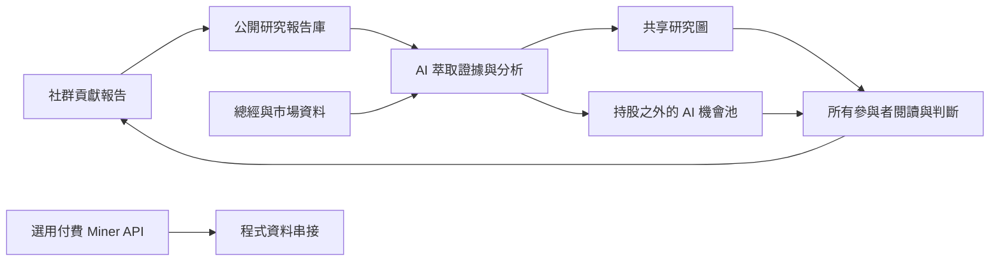

# 共同研究平台與 AI 機會池

2026-11-02：首頁定位為互利共生的共同投資研究平台。社群貢獻重視的報告，AI 串接證據、技術、供應鏈與總經，形成可追蹤的研究圖與候選標的。
主動作導向報告庫與研究圖；Miner 是選用的付費市場資料 API，以預設摺疊的小型區塊呈現。
Custom 改標示為 AI 機會池，保留既有擁有者手動自選功能及權限，公開讀者不用取得管理權限。
每週 GPT 排程的後端與雲端狀態見 [GPT_WEEKLY_OPPORTUNITIES.md](../../maya-sawa/docs/GPT_WEEKLY_OPPORTUNITIES.md)。

## 開發方法

1. 先新增首頁行為契約測試，重現主要動作仍導向試用、平台精神不明與 Miner 過度醒目的現況。
2. 更新中英文 i18n 與 Astro SSR 的相同文字，避免載入時閃出舊文案。新定位取代舊版以創辦人背景為主的 hero 契約，保留 SEO、聯絡入口與語言同步測試。
3. 主動作直達既有報告庫，第二動作導向研究圖；付費 API 的 Email 留在 Miner details，使用既有聯絡工具。
4. 機會池沿用 custom 資料與 ai-watch 理由顯示，不把一般使用者變成管理者，也不把尚未啟用的排程寫成已在執行。
5. 本次不新增前端憑證。後端 agent key 維持既有安全注入，不放在頁面、任務文字或 Git。
6. 先跑聚焦測試，再跑全套 Vitest；正式 build 交給 Jenkins，部署後仍須核對桌面／手機中英文、Miner 展開收合與研究入口。

測試：以 Codex 隨附 Node 執行 `node_modules/vitest/vitest.mjs run tests/seo/communityPlatform.test.ts tests/seo/homeSeo.test.ts`。
新增／調整：共同研究主軸、Miner 次要入口、AI 機會池標籤、中英文 SSR 同步與 SEO 契約。
已知缺口：本機瀏覽器控制服務不可用，尚未做視覺驗證或正式部署。
