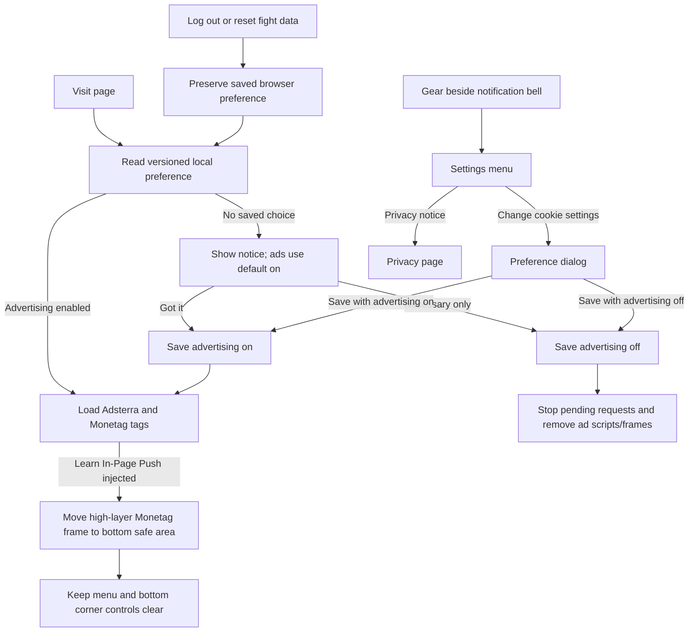
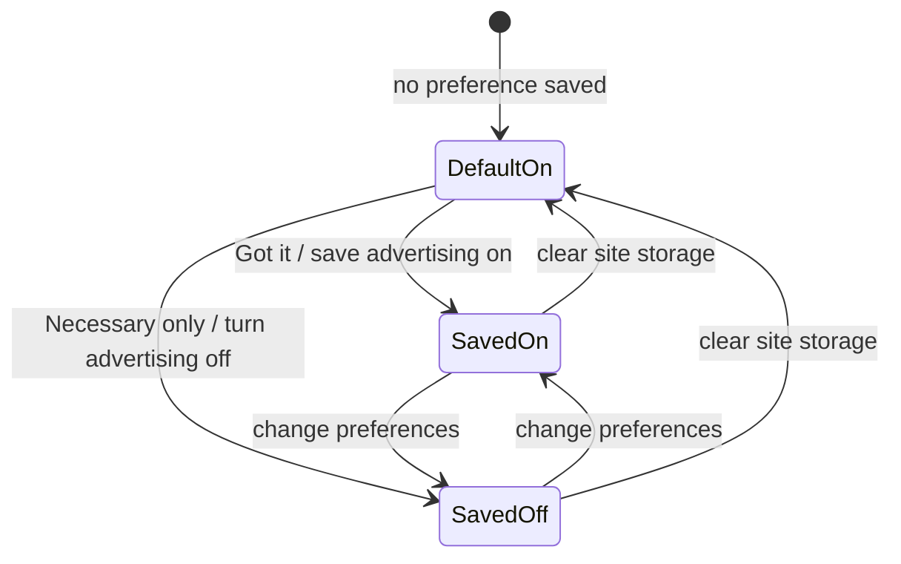

# Cookie preferences and advertising controls

The navigation gear beside the notification bell opens `變更 Cookie 設定` and `隱私權說明`. Advertising is on by default as requested; the first-visit notice is informational and does not block the ad tags. Visitors can choose `僅必要 Cookie` or uncheck advertising in the preferences dialog.

## Flow

Necessary storage is always on. Since 2026-11-10 the analytics choice controls first-party anonymous usage statistics for the north star metric (see [NORTH_STAR.md](NORTH_STAR.md)): it is on by default, "Got it" saves it on, "Necessary only" saves it off, and turning it off deletes the reader id (`tym-reader-id-v1`) at once. No third-party analytics tool is loaded. Preferences saved before that date have analytics off, because the notice used to save it that way. The privacy page describes current providers and explains that turning ads off stops new requests; third-party cookies already stored may need to be removed through browser settings.

## 開發方法

1. Added characterization tests for preference serialization, default behavior, the gear placement, privacy link, responsive banner selection, and ad removal before changing loaders.
2. Stored consent as a versioned object under `tym-cookie-consent-v1`; malformed or obsolete data is ignored. Required storage is fixed on, analytics defaults off, and advertising defaults on.
3. Kept provider keys in `src/scripts/ads/consentAds.ts` and responsive size selection in `src/scripts/ads/responsiveBanner.ts`. The ad component contains placeholders only; the loader adds third-party scripts at runtime and listens for preference changes.
4. Turning advertising off invalidates in-flight loader generations, removes provider scripts and frames, and clears the loaded state. Re-enabling it lets the normal page-load hook mount the tags again.
5. Monetag's Learn In-Page Push injects a top-level, high-z-index fixed iframe after its tag loads. `src/scripts/ads/monetagPosition.ts` recognizes that frame by its observed dimensions and inline position, then uses important inline offsets plus a MutationObserver to keep it 112px above the viewport bottom (including the device safe area). This leaves the bottom theme and AI controls clear while keeping the navigation clear. Other iframes are not modified.
6. No credentials or secrets are needed. Rollout is a frontend build and site deploy; after release, verify ads appear by default, the Learn push sits above bottom controls, and unrelated frames are unchanged. Choose necessary-only and confirm provider tags/frames disappear. Re-open settings from the bell-side gear to confirm preferences persist.
7. A returning visitor does not need an account: saved choices remain in the browser. Tests first covered returning visits and cleanup; logout (including failure recovery) and the fight reset preserve the consent record while clearing the other data. Clearing browser site data or using another browser starts a new choice.

## Tests and checks

- `& $node node_modules\vitest\vitest.mjs run tests/cookies tests/ads tests/home/adPlacements.test.ts tests/about/teamHeading.test.ts`
- Targeted placement regression: `& $node node_modules\vitest\vitest.mjs run tests/ads/monetagPosition.test.ts`
- Build and browser rollout checks are recorded with the release commit.
