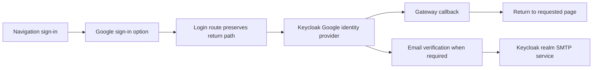

# Google sign-in and email verification

## 開發方法

1. First test that the account control is at the right of navigation and Google login is selected only when requested. Preserve the normal sign-in route and the return-path validation.
2. Route the Google option through `/login?provider=google`, adding `kc_idp_hint=google` to the existing Keycloak authorization request. The identity provider configuration and credentials stay in Keycloak; no provider secrets are sent to the frontend.
3. The menu opens on hover and keyboard focus. Signed-in users retain the existing logout action. Browser-managed Google account selection is handled by Google during the OAuth flow.
4. Email verification remains required. Keycloak's PeopleSystem realm settings contain its email/SMTP configuration. OCI mail infrastructure and the owner inbox routing are described in `../peoplesystem-terraform-oke/mail/docs/MAIL_OPERATIONS_RUNBOOK.md` from the workspace root; the correct sender, credentials, TLS and realm settings need verification before a production test message.
5. Validate with `node_modules/vitest/vitest.mjs run tests/navigation tests/home/authNavLanguage.test.ts tests/home/navStyle.test.ts`. Before deploying, verify the configured Google identity provider alias, actual OAuth redirect, keyboard and mobile interaction, and email delivery in Keycloak. No credentials are stored in this document.
