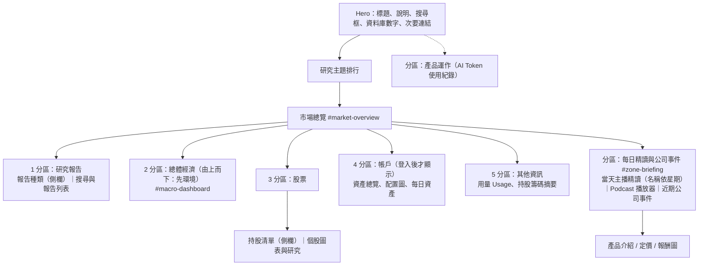
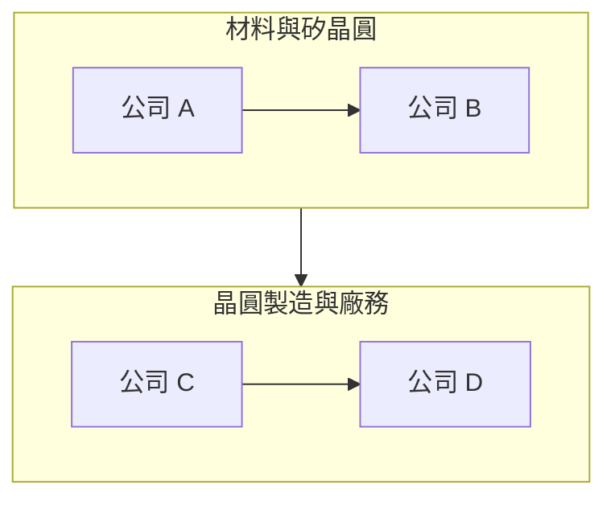

# 首頁版面：分區（zone）結構

首頁的每一塊內容都放在一個有標籤的分區（`.home-zone`）裡：上方是小標題加一條線，裡面是原本的卡片。新增內容時先決定它屬於哪個分區，沒有合適的才新增分區。

- **總體經濟分區在股票之前（2026-11-10）。** 使用者是由上而下投資：先看總經環境，再看個股。11-10 早上曾被排到帳戶之後，已移回；順序由 `tests/home/zones.test.ts` 鎖住。
- **Hero 搜尋框每打一字就篩選報告列表**（輸入事件寫入報告區的搜尋欄，不捲動頁面）；按 Enter／搜尋才捲到報告區。除了標題與主張，也會查報告全文（停頓 250ms 後問伺服器，命中的卡片顯示「全文 p.N」摘錄）；流程圖與規則見 `maya-sawa/docs/REPORT_FULLTEXT_SEARCH.md`。
- **每日精讀卡片的主播名稱依該篇 `day` 的星期決定**（`dailyPresenterName`，對照 maya-sawa `market-presenters.json`；雙人日由 Uiobbeci 朗讀，與語音開場一致），不再寫死 Maya。

- **導覽列以報告為首（2026-11-10）：報告、總體、個股各有一頁**（`/reports/`、`/macro/`、`/stocks/`）。三頁都是 `index.astro` 加上 `view` 屬性：同一份標記與腳本，用 CSS（`.home-page[data-view=...]`）只顯示該分區，隱藏的分區不會觸發延遲載入。首頁維持完整儀表板。要改某一區的內容，改 `index.astro` 一處即可。
- **導覽列搜尋（Ctrl/⌘+K）**：`SiteSearch.astro` + `scripts/search/sitePalette.ts`。輸入時篩選頁面連結並查報告全文；點結果開 `/reports/?q=…`，報告頁會自動套用同一組字。首頁 Hero 的搜尋框保留。
- **頁尾**：品牌、產品、關於、開發者、追蹤五欄（只放已存在的頁面），加每日精讀 Email 訂閱表單。訂閱流程見 `maya-sawa/docs/BRIEF_SUBSCRIPTIONS.md`。

## 規則

- **兩個側欄同款同寬。** 持股清單（`#market-watchlist`）與「報告種類」都用 `.market-side-panel`，寬度都是 `--side-panel-w`（`clamp(15rem, 20vw, 18rem)`）；手機版改為橫向捲動的膠囊。
- **產業篩選共用。** 持股側欄的產業按鈕與報告種類互相連動（`market/holdingsFilter.ts`）。
- **Custom instruments 的「編輯」只給登入的擁有者**：`canEditCustomSelection`，以擁有者專用的 `candidates` 端點確認；公開的清單端點回 200 不代表有編輯權。
- **用量與持股籌碼摘要放在「其他資訊」分區，位於研究報告之後。**
- **AI Token 使用紀錄**沿用網站的灰階語言（變數 `--gray-*`），只有各家模型的系列色保留語意色。
- **Hero 只放標題、說明、搜尋框、資料庫數字與次要連結（2026-11-10）。** 搜尋框是主動作，送出後寫入報告區既有的搜尋欄並捲到報告區。原因與指標見 [NORTH_STAR.md](NORTH_STAR.md)。
- **研究報告排在市場總覽的第一區**，其後是股票、帳戶、總體經濟、其他資訊。
- **Podcast 播放器、Maya 每日精讀與近期公司事件**移到 `#zone-briefing`，位於市場總覽之後；播放器與事件在寬螢幕（≥900px）並排（`.home-briefing-row`）。
- **數字列與主題排行只由伺服器資料輸出**（`getReportStats`）；取不到資料時不輸出，不寫死任何數字。
- **「上傳報告」連結標 `data-report-owner-only`**，與上傳表單同一條規則，只有擁有者登入後顯示。

## 開發方法

1. 先用深度計數腳本確認 `index.astro` 的標籤層級（這個頁面有 500 多行巢狀標記，直接搬區塊很容易錯位），依行號搬移並對每個錨點先驗證再改。
2. 用結構測試鎖住版面意圖：`tests/home/zones.test.ts`（分區存在與順序、帳戶分區登入才顯示、Hero 只有標題與搜尋、事件與播放器在每日精讀分區、兩個側欄同類別與同寬）、`tests/market/watchlistBoundary.test.ts`（sticky 側欄不蓋住後面的區塊）。
3. 先改版面、再改樣式；樣式集中在 `src/styles/index.css` 檔尾的區塊，舊的重複規則一併移除，避免兩套寬度。
4. 部署後在實站用 1100px 以上與手機寬度各看一次（尚待驗證）。

## Benchmark 是研究報告的骨幹（2026-11-10）

研究報告區先放「台灣半導體 Benchmark」，再放報告清單：先定出供應鏈每一環的代表公司，再依這些公司與環節找報告來讀。兩段的說明文字都寫明這層關係。

供應鏈圖由 `src/scripts/market/benchmarkChain.ts` 的 `supplyChainDiagram()` 產生，公司清單來自 `/market/benchmark`（不寫死）。排版是每個環節一列、環節由上往下：

開發方法：同一環節內的公司用箭頭依序相連、排成一列；跨環節的箭頭只連環節（subgraph）。若節點直接連到別的 subgraph，Mermaid 會忽略該 subgraph 自己的 `direction`，整張圖又會擠成一長條。

## 主選單（2026-11-10）

順序為 Reports、Macro、Stocks、Blog、About、API、Learn。沒有 Home：品牌字樣本身連回首頁。`/work/` 的英文標籤是 Blog。桌面版 nav 格線為 `minmax(max-content, 1fr) auto minmax(max-content, 1fr)`，兩側不會被擠到中間連結底下；社群圖示 80em 以上才顯示且不換行，50em–80em 之間隱藏頁名與搜尋鈕文字。

## 研究路線與 Benchmark 版本（2026-11-10）

Benchmark 區塊開頭寫明研究路線三步：Benchmark（建立產業基準）→ 總體（判斷循環階段，連到 `/macro/`）→ 個體（用 Benchmark 定下的指引與景氣位置檢查預計買進的公司，連到 `/stocks/`）。

名單有版本，資料來自 maya-sawa `GET /market/benchmark/versions`（定義與換版方法見 maya-sawa `docs/TW_SEMICONDUCTOR_BENCHMARK.md`）。頁面顯示目前版號、名稱與理由，「先前版本」可展開。圖由 `lineupDiagram()` 依版本的分層與流向產生：每層一列；第三版起每個環節只有龍頭一家（Benchmark 只用來定調指引與景氣，不是買進標的），環節之間不連線；列與列之間是帶說明的箭頭。兩列之間若沒有流向，補一條隱形連結讓它們仍然上下排列。版本資料取不到時退回 `supplyChainDiagram()`。

版本定義帶有 `links` 時（第三版起），`lineupDiagram()` 改畫公司關係圖：由左到右，每個節點是「環節＋公司」，箭頭上寫一家公司交給另一家什麼（投片、矽晶圓、機台、晶圓送封測），`terminals` 是終端產品這類非公司終點。沒有 `links` 的舊版本仍用分層畫法。

## 2026-11-11 每日精讀顯示閱讀版

首頁「主播每日精讀」原本把朗讀稿（只有逗號與句號、沒有分段）整塊放進一個段落，很難讀。現在 `dailyReadingBlocks`（`src/scripts/home/dailyReading.ts`）優先用 API 的 `reading` 閱讀版：空行分段、單獨一行的 `## 小標` 變成小標題；舊稿沒有閱讀版時，把朗讀稿每三句切成一段。語音仍只用 `content`。兩版的來源、檢查與流程圖見 maya-sawa `docs/DAILY_MAYA_BRIEF.md`「朗讀稿與閱讀版分開」。

開發方法：先在 `tests/home/dailyReading.test.ts` 寫閱讀版切塊、舊稿切段（切完接回去等於原文）與首頁接線三個測試，確認紅再實作；文字一律用 `textContent` 放進節點，不解析 HTML。測試：`node node_modules/vitest/vitest.mjs run tests/home/dailyReading.test.ts`。
