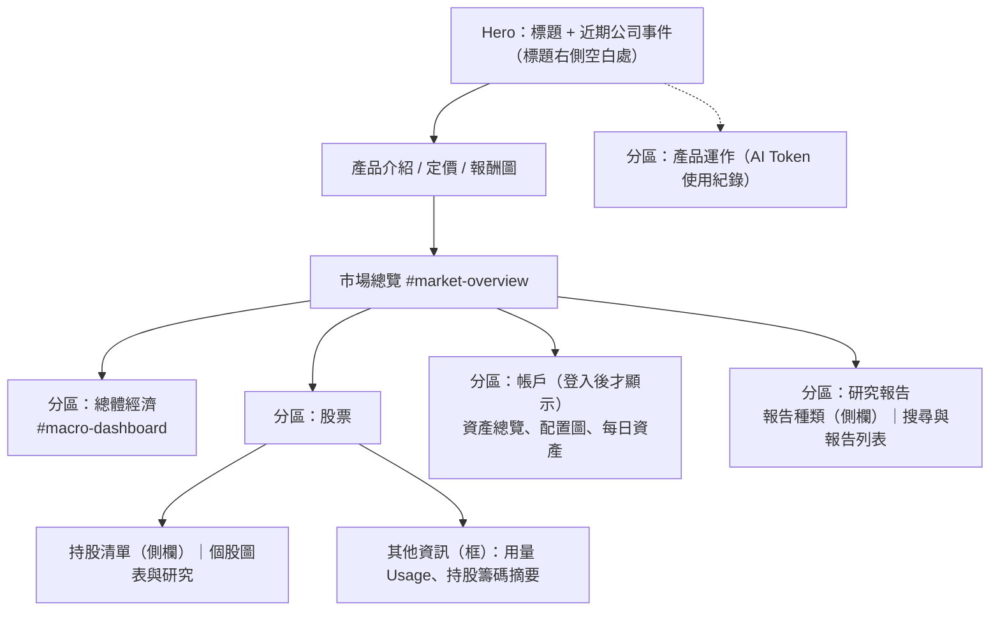

# 首頁版面：分區（zone）結構

首頁的每一塊內容都放在一個有標籤的分區（`.home-zone`）裡：上方是小標題加一條線，裡面是原本的卡片。新增內容時先決定它屬於哪個分區，沒有合適的才新增分區。

## 規則

- **兩個側欄同款同寬。** 持股清單（`#market-watchlist`）與「報告種類」都用 `.market-side-panel`，寬度都是 `--side-panel-w`（`clamp(15rem, 20vw, 18rem)`）；手機版改為橫向捲動的膠囊。
- **產業篩選共用。** 持股側欄的產業按鈕與報告種類互相連動（`market/holdingsFilter.ts`）。
- **Custom instruments 的「編輯」只給登入的擁有者**：`canEditCustomSelection`，以擁有者專用的 `candidates` 端點確認；公開的清單端點回 200 不代表有編輯權。
- **用量與持股籌碼摘要不放在首屏，而是股票分區最下方的「其他資訊」框。**
- **AI Token 使用紀錄**沿用網站的灰階語言（變數 `--gray-*`），只有各家模型的系列色保留語意色。
- **近期公司事件**放在 Hero 標題右側，寬螢幕（≥1100px）才並排，窄螢幕在標題下方。

## 開發方法

1. 先用深度計數腳本確認 `index.astro` 的標籤層級（這個頁面有 500 多行巢狀標記，直接搬區塊很容易錯位），依行號搬移並對每個錨點先驗證再改。
2. 用結構測試鎖住版面意圖：`tests/home/zones.test.ts`（分區存在、帳戶分區登入才顯示、事件在 Hero、兩個側欄同類別與同寬）、`tests/market/watchlistBoundary.test.ts`（sticky 側欄不蓋住後面的區塊）。
3. 先改版面、再改樣式；樣式集中在 `src/styles/index.css` 檔尾的區塊，舊的重複規則一併移除，避免兩套寬度。
4. 部署後在實站用 1100px 以上與手機寬度各看一次（尚待驗證）。
