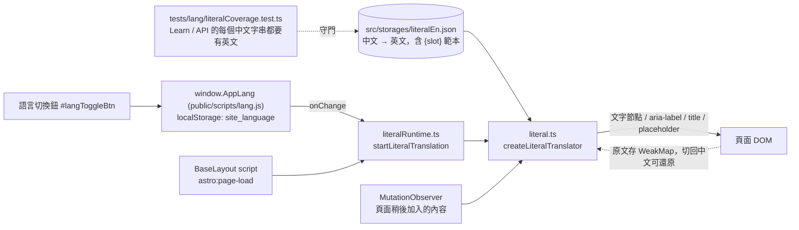

# 英文層（Literal layer）：中文寫的分頁如何在 EN 模式顯示英文

## 為什麼有這一層

首頁、部落格等分頁用 `data-i18n` + `src/storages/i18n.json`；About 由伺服器依 `?lang=` 輸出兩種語言。但 Learn、API 分頁與問答機器人面板的文字是直接寫在程式裡的中文（含執行時組出來的句子），逐字加 `data-i18n` 不現實。這一層用一份審過的字典在瀏覽器端把已知字串換成英文，**不認得的文字（報告、AI 分析、通知等使用者內容）一律不動**。

## 架構

About 是例外：它由 `aboutLanguage.ts` 向伺服器要另一種語言的 HTML 後換掉 `main.about-mono`；切換時會先顯示「Switching language…」並設 `aria-busy`，20 秒沒回應就中止並顯示失敗訊息（伺服器冷啟動時一次要 1–5 秒，過去切換期間完全沒有回饋，看起來像「沒換英文」）。

## 字典規則

- 鍵是完整中文字串；含 `{name}` 的鍵是範本（`已完成 {n} 輪` ↔ `{n} rounds completed`），被捕捉的值若本身有字典條目會一併翻譯。
- 用 `｜` 串起來的組合句會拆開逐段翻譯，再用 ` | ` 接回。
- 只做完全比對（含範本），不做模糊比對；英文版本的同一個鍵不能有兩種意思（例如「主題」固定為 Topics）。

## 開發方法

1. **先量缺口。** 在 EN 模式逐一開每個分頁，掃出仍含中文的文字節點與 aria/title，區分「頁面自己寫的」與「資料內容」（只處理前者）。
2. **純函式先行。** `translateLiteral`（完全比對、範本、`｜` 拆段）與 `createLiteralTranslator`（可還原、跳過 script/code、頁面改寫文字後視為新原文）先寫測試（`tests/lang/literal.test.ts`）再寫程式。
3. **守門測試。** `tests/lang/literalCoverage.test.ts` 從 `learn.astro`、`api-reference.astro` 抽出所有中文字串（markup、屬性、字串與樣板字面值），逐一要求字典有英文；新增中文字串忘了翻譯會直接失敗。抽取器刻意簡單、會略過像程式碼的片段，是防呆不是剖析器。
4. **加新頁面時：** 把頁面加進 `literalCoverage.test.ts` 的檔案清單、補字典、在 EN 模式實際看一遍；動態組句時用 `｜` 或把標籤與資料放在不同節點，讓字典能對上。
5. **測試指令：** `node_modules\vitest\vitest.mjs run tests/lang tests/about`（用 Codex 附的 Node 24）。

## 已知缺口

- 首頁大部分是資料內容（AI 分析、通知、報告），本來就不翻譯；首頁自己的介面字串仍以 `data-i18n` 為準，尚未全面稽核。
- `<title>` / meta description 在 SSR 時是中文，不會被這一層改。
