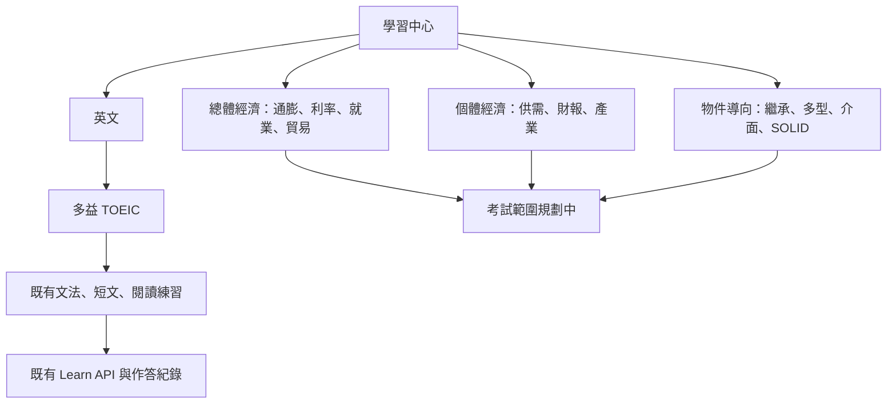
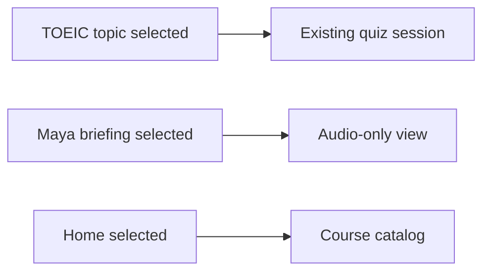

# 學習中心：領域與考試架構

## 開發方法

1. 檢查正式 `/learn/`，發現側欄題目清單被全域導覽樣式排成橫向，造成裁切；先新增單欄回歸測試，並以既有 TOEIC ID 與未知 ID 測試題庫分類。
2. 依首頁總經與股票資料、`/work/` 的繼承多型、抽象類別與介面、SOLID、Java 存取修飾詞訂出第一批主題。新增獨立目錄資料，規劃中的主題只連參考資料，不建立題庫、題目或測驗 API。既有多益主題仍由後端載入，維持作答、續寫、歷史與權限流程。未識別的新題庫保留在其他練習，不因分類遺失。
3. 修正側欄為明確的單欄 grid，並加入響應式領域卡與回總覽入口。既有登入 token 與訪客識別沿用原本請求流程，不新增憑證。
4. 先以 Codex 隨附 Node 執行 `node_modules/vitest/vitest.mjs run tests/learn` 作本機基準；部署需透過 Jenkins 建置。上線後檢查桌面／手機、語言切換、TOEIC 續寫與作答；目前未在正式環境部署。未來新增真實課程時，先定義後端題庫 ID 與目錄對應並測試未知及空題庫，切勿將規劃中標為已開放。

## Learn sidebar navigation

## ????

1. Reproduced the mixed view: the course catalog and Maya audio list were both rendered inside the initial overview. Added a regression test requiring a separate audio view and sidebar control.
2. Moved the existing audio list intact into its own phase and added the Maya sidebar action. Existing quiz topic buttons continue to open their matching quiz workflow; the home control returns to the catalog.
3. No credentials or external services are involved. Audio fetching remains read-only and uses the existing public API.
4. Verified with `node_modules/vitest/vitest.mjs run tests/learn tests/portfolio/aboutLayout.test.ts` (13 passed). No deployment run in this change; deploy through the existing Jenkins frontend pipeline and confirm selecting Maya hides the course overview, while selecting a TOEIC topic opens only that quiz.
