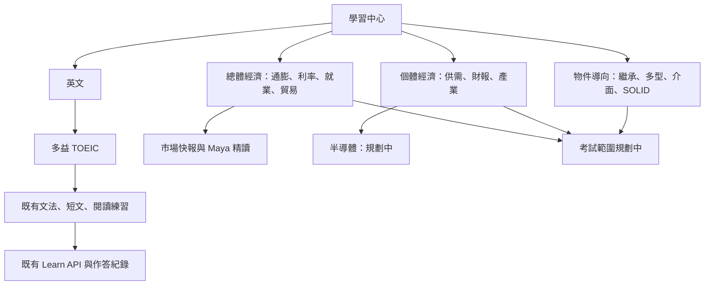
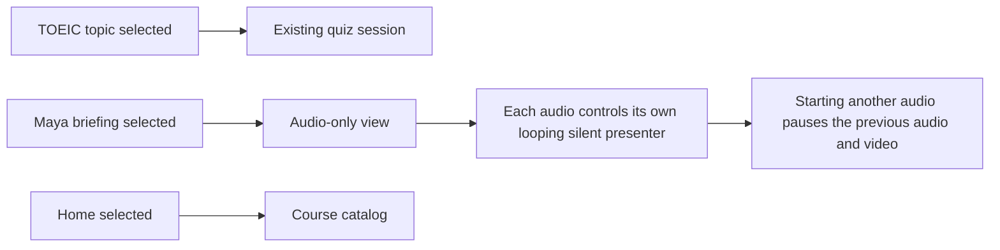

# 學習中心：領域與考試架構

## 開發方法

側欄依既有 `learnCatalog` 產生英文、總體經濟、個體經濟與物件導向；選取分類時只顯示對應的課程，半導體只顯示該規劃項目，Maya 則開啟既有音訊畫面。先以目錄測試固定半導體為規劃中，再檢查選單歸屬及隱藏樣式；沿用原登入 token 與公開音訊 API。先在本機以 `node_modules/vitest/vitest.mjs run tests/learn` 驗證，經 Jenkins 部署後需再檢查桌面及手機切換。沒有新增題庫或半導體教材；新增教材時應先定義來源和可用狀態。

1. 檢查正式 `/learn/`，發現側欄題目清單被全域導覽樣式排成橫向，造成裁切；先新增單欄回歸測試，並以既有 TOEIC ID 與未知 ID 測試題庫分類。
2. 依首頁總經與股票資料、`/work/` 的繼承多型、抽象類別與介面、SOLID、Java 存取修飾詞訂出第一批主題。新增獨立目錄資料，規劃中的主題只連參考資料，不建立題庫、題目或測驗 API。既有多益主題仍由後端載入，維持作答、續寫、歷史與權限流程。未識別的新題庫保留在其他練習，不因分類遺失。
3. 修正側欄為明確的單欄 grid，並加入響應式領域卡與回總覽入口。既有登入 token 與訪客識別沿用原本請求流程，不新增憑證。
4. 先以 Codex 隨附 Node 執行 `node_modules/vitest/vitest.mjs run tests/learn` 作本機基準；部署需透過 Jenkins 建置。上線後檢查桌面／手機、語言切換、TOEIC 續寫與作答；目前未在正式環境部署。未來新增真實課程時，先定義後端題庫 ID 與目錄對應並測試未知及空題庫，切勿將規劃中標為已開放。

## Learn sidebar navigation

多益的「開始練習」會在登入且題庫載入後開啟第一個多益主題；未登入則顯示登入提示。Maya 音訊清單在每次 Astro 頁面切換完成後重新讀取，避免回到 Learn 時播放器空白。2026-11-04 驗證正式音訊清單回傳四筆，第一筆音檔的 HEAD 請求回傳 200、`audio/mpeg`；後端原始題庫檔案仍存在。測試 `node_modules/vitest/vitest.mjs run tests/learn`（19 passed）；部署後仍需實際登入確認完整作答和瀏覽器播放。

側欄的四個分類按鈕使用單欄排列；只有選取某分類時，才展開該分類的多益題目、Maya 或半導體次選單。`learn.css` 明確覆寫全站 `nav` 的桌面三欄與 sticky 設定，避免側欄文字重疊；回總覽會收起次選單。回歸檢查：`node_modules/vitest/vitest.mjs run tests/learn`。

## 開發方法

Maya 音訊卡片右側放置主播影片，各卡片建立獨立影片並由音訊 playing、waiting、pause 與 ended 事件控制；開始另一筆音訊時暫停其他音訊。先以 `tests/learn/marketAudioPlayback.test.ts` 重現多播放器需求，再抽出事件控制並測試；媒體資源使用公開 URL，不需新增憑證。執行 `node_modules/vitest/vitest.mjs run tests/learn`。2026-11-04 檢查指定的 `https://tymultiverse.cc/images/people/reporter.mp4` 回傳 404，影片檔案需上傳後才能驗證實際播放；部署後還須以瀏覽器測試音訊切換與窄螢幕版面。

1. Reproduced the mixed view: the course catalog and Maya audio list were both rendered inside the initial overview. Added a regression test requiring a separate audio view and sidebar control.
2. Moved the existing audio list intact into its own phase and added the Maya sidebar action. Existing quiz topic buttons continue to open their matching quiz workflow; the home control returns to the catalog.
3. No credentials or external services are involved. Audio fetching remains read-only and uses the existing public API.
4. Verified with `node_modules/vitest/vitest.mjs run tests/learn tests/portfolio/aboutLayout.test.ts` (13 passed). No deployment run in this change; deploy through the existing Jenkins frontend pipeline and confirm selecting Maya hides the course overview, while selecting a TOEIC topic opens only that quiz.
