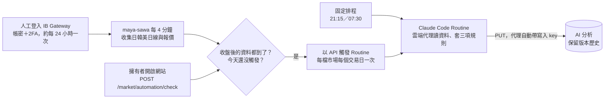

# 首頁市場儀表板與 About 語系修正計畫

規格日期：2026-10-14。以下納入最新使用者指示，優先於本文件先前紀錄及 `PLAN_TO_PRODUCTION_WORKFLOW.md` 的歷史紀錄。

> 2026-10-15 總體經濟功能開始實作：完整規格與進度見 [MACRO_ECONOMIC_DASHBOARD_PLAN.md](MACRO_ECONOMIC_DASHBOARD_PLAN.md) v4。使用者已授權實作至正式驗收；正式環境須使用獨立的`BLS_API_KEY`與`FRED_API_KEY`。BLS已存Jenkins並已加入runtime注入程式碼，FRED key尚未取得，因此正式收集維持停用，待keyed API驗證後啟用。

## 執行授權與完成標準（最新決議）

- 使用者已授權從來源查證、定案、開發、migration、建置一路做到正式部署與 UI 驗證，不需再次等待「開始開發」指示，也不能在畫面骨架或 build 後結束任務。
- 前置來源、費用、權限與可行性查證均屬 plan 階段。先盡合理查證責任；確認在現有免費來源／既有帳號權限內無法取得的指標，記錄證據與原因後排除本次範圍，繼續其餘工作。不得把「尚未查證」當成「確認缺少」，也不得把未實作的 API 當成外部阻礙。
- 不另購資料或引入新付費／授權依賴。必要新帳號、付費或未取得供應商授權的資料，列入排除清單；除非使用者另行明確同意。
- 完成必須同時滿足：新不可變 image 已上線、rollout 成功、正式站 UI 驗證完成、登入使用者帳號後確實看到自動五大部位，並與有效持倉快照核對排序及去重。API 200、build 通過、觸發 Jenkins 或停用分頁均不足以宣告完成。
- 訪客須看見與登入者相同的公開市場標的與行情；原 Portfolio 與管理員操作維持既有授權，公開回應不得包含持倉數量、金額、方向或帳戶識別。
- 本輪已依使用者授權接續實作及準備部署；不得將先前「只更新 plan」的歷史狀態視為目前限制。

## 畫面與互動

首頁市場區使用全寬，依序顯示固定台指期近月、自動五大持倉與管理員自訂五格，共最多 11 檔。每檔摘要顯示代碼、名稱、現貨／期貨、價格、漲跌、成交量、資料時間；點選任一檔，在摘要下方展開該檔完整儀表板。避免同時渲染 11 組大型圖表。手機摘要換行，明細分頁可切換。

明細分頁：

| 分頁 | 呈現 |
| --- | --- |
| 行情 | 三個月價格與成交量，日 K 為預設；報價與盤後資料各自標時間 |
| 法人 | 外資／投信／自營商買賣超柱圖＋收盤價，5／10／20 日累計與逐日表；持股存量另列，不由買賣超冒充 |
| 資券與借券 | 融資、融券每日增減柱圖＋收盤價；餘額線圖；借券與借券賣出分開 |
| 分點與主力 | 買超／賣超 TOP15 橫條與分點表，買賣張數、淨額、可驗證的均價；主力淨額及 10 日累計走勢 |
| 持股結構 | 各類持股張數／比例的橫向比例條與表格；集保級距分布與每週變化；董監持股、質押、轉讓列表 |
| 期貨籌碼 | 法人多空交易與未平倉、淨額歷史；大額交易人資料另列。商品彙總與特定到期契約明確區別 |

股票沒有期貨未平倉、期貨沒有股票發行股數等，依商品類型顯示適用分頁。個股期貨可另顯示其標的股票籌碼，必須標示為「標的現貨」，不可當成該期貨資料。董監與外資等分類可能重疊，故不做總和必須等於 100% 的持股圓餅圖；集保級距依原始定義呈現。

上述為原始需求全集；交付以來源定案後的納入／排除清單為準。排除項目不要以停用按鈕、空圖或假資料冒充交付。若採本站計算的主力指標，必須明示公式與涵蓋的分點數，且與來源原指標分開；未核對原定義前，不聲稱與券商 App「主力成交力」相同。

市場區下方放全寬 AI Token Usage。Portfolio 維持既有保護。About 依 URL lang 決定初始語系，修正硬編碼、localStorage 衝突與頁面切換不同步。

## 選股與權限

固定台指期近月不可編輯。自動五大持倉依每個新有效持倉快照重算，股票按市值、期貨按絕對名目曝險，統一幣別；固定指數與自動清單去重。自訂上限預設五格，設定、順序與選擇存 PostgreSQL，由管理員操作，其他人唯讀。搜尋股票／期貨代號、公司／商品名稱，顯示到期月份並由後端驗證；排除已有標的。Mini TSMC Futures 不預填。若自訂標的後來進入自動清單，只呈現一次並保留原自訂偏好。

訪客與登入者看到同一組標的與市場資料。公開 API 不含持倉數量、金額、方向及帳戶識別。

## 來源優先與免登入／費用查證

以下「免登入」指實際讀取範例時沒有提交帳密；不等於已驗證所有日期、所有股票或公開轉載權。

| 優先 | 來源與範圍 | 帳號／費用 | 查證結果 |
| --- | --- | --- | --- |
| 1 | TWSE T86、MI_QFIIS、MI_MARGN | 範例請求免登入、無付款步驟 | 已取得三個月前法人買賣超、外資持股、融資融券 JSON |
| 2 | TPEX dailyTrade | 範例請求免登入、無付款步驟 | 已取得 2026/07/13 上櫃法人明細；外資持股與資券其他介面仍待逐項驗證 |
| 3 | TAIFEX 公開法人及未平倉 | 公開頁免登入、無付款步驟 | 已取得 2026/07/13 TXF；公開下載有近三年範圍，不能與付費申購混淆；個股期貨範圍待驗證 |
| 4 | Shioaji 報價／歷史／合約／私有持倉 | 使用既有券商 API key 與帳戶，非匿名 API | 已有專案整合；部署前確認既有權限與額度，不要求另辦新帳號 |
| 5 | TDCC、MOPS | 有公開查詢入口；不可先保證所有介面免登入且自動化可用 | TDCC 最新週 OpenAPI 可免登入讀取；官方歷史查詢表單 GET 公布日期選項與同步 token、一般 POST 可查指定股票／日期，已實測最新及三個月前資料。MOPS 董監相關端點仍待核實 |
| 6 | 富邦公開籌碼頁 | 已讀頁面免登入、無付款步驟 | 分點最新與 2026/07/01 皆在瀏覽器取得；後端直接 HTTP 回 403。需驗證正常瀏覽器收集工作在 OKE 可用；不能說已完成 API 化 |
| 排除 | 三竹 SDK | 有免費部分試用，但完整額度不明且未取得資料 URL | 依使用者決定排除 |
| 備援線索 | SITCA、FinMind、TEJ | SITCA 有公開週期報表；FinMind／TEJ 特定資料可能需帳號或付費 | 不偷偷引入帳號或付費依賴。SITCA 月前十大不能取代每日全部投信持股 |

### 2026-10-13 接續查證與本輪範圍決定

| 指標／商品範圍 | 本輪決定 | 端點與樣本 | 欄位、單位及頻率 | 費用／理由 |
| --- | --- | --- | --- | --- |
| 自動持倉選股及公開行情（台股／期貨） | 納入 | 既有 Shioaji portfolio 快照；新增 `/market/dashboard`、合約搜尋 | 完整快照才更新；公開只存代號、名稱、類型；行情快取 5 分鐘 | 沿用既有券商憑證與帳戶 |
| TWSE 三大法人每日買賣超 | 資料源納入後續收集；本輪尚未實作歷史圖表 | T86，`date=20261012`，stat=OK | 證券代號及法人買賣股數，單位「股」；日報 | 官方免登入 JSON；尚需欄位映射及三月回補測試 |
| TWSE 外資持股每日資料 | 資料源納入後續收集；本輪尚未實作歷史圖表 | MI_QFIIS，`date=20261012`，stat=OK | 持有股數、持股比例、法定上限；日報 | 官方免登入 JSON；尚未完成歷史 upsert |
| TWSE 融資融券每日資料 | 資料源納入後續收集；本輪尚未實作歷史圖表 | MI_MARGN，`date=20261012`，stat=OK | 信用交易欄位；來源單位／索引仍須按官方欄名映射 | 官方免登入 JSON；未完成明確 mapping 前不展示 |
| TPEx 三大法人每日買賣超 | 資料源納入後續收集；本輪尚未實作歷史圖表 | `dailyTrade?date=2026%2F10%2F12&type=Daily&sect=EW&response=json`，回應日期 115/10/12 | 25 欄含法人買進、賣出、淨額；重複名稱依欄群標頭解讀 | 官方免登入 JSON；上市櫃欄位結構不可共用索引 |
| TAIFEX 法人與大額交易人 | 法人日期資料源納入後續；大額交易人延後 | Official OpenAPI `MarketDataOfMajorInstitutionalTradersDetailsOfFuturesContractsBytheDate` 現行樣本日期 2026-10-13；官方日期查詢頁可指定 `2026/10/12` | 每日按指數類／股票期貨「商品種類」×法人，含交易及未平倉口數／契約金額；「股票期貨」不是個別 2330/QFF 契約 | 公開免登入；日期查詢範圍官方頁稱近三年。API 無日期參數，需以歷史網頁端點實測後才納入三月 collector；不可宣稱個股期貨法人資料 |
| TDCC 集保級距 | 納入選定股票逐週回補及增量 | `/v1/opendata/1-5` 最新全市場樣本 2026-10-08；官方表單 `https://www.tdcc.com.tw/portal/zh/smWeb/qryStock` POST 可查 2330、2026-07-09 | 15 級距，人數／股數／比例；按來源日期保存週報 | 匿名官方頁面，無登入／付款；歷史保存一年。已確認表單 token/date/POST，可接入選定標的回補 |
| MOPS 董監持股／質押／轉讓 | 延後，不展示 | 官方 MOPS 有相關分類；本輪未驗證可重現端點及日期 | 欄位、頻率及歷史範圍未核實 | 未查證不等同缺資料；完成端點驗證後再納入 |
| 分點、主力與逐分點均價 | 逐分點原始資料有 TWSE、TPEx 官方付費商品；均未購買／整合 | TWSE 不含權證日報，2012-10-25 起、外部 NT$80,000/月；TPEx 不含權證日報，2014-12-01 起、外部 NT$50,000/月。TPEx S32 格式列證券代號、券商代號／名稱、成交價格、買進股數、賣出股數 | 日報欄位可支援分點買賣排行與各方向成交加權均價；仍須確認 TPEx 檔案交付與外部傳輸條款。券商自營併總公司 | 本計畫未授權新增付費資料，故未購買／未整合；富邦免費 TOP15 網頁不是本系統資料 API，且後端請求 403 |
| Shioaji 三個月 K 線歷史 | 延後，本輪不回補 | [官方歷史行情文件](https://sinotrade.github.io/zh/tutor/market_data/historical/) | 文件描述單次區間上限與 API 頻寬使用 | 尚未實作分段回補及額度監控，不能用即時 snapshots 冒充歷史行情 |
| 固定 TXF、自訂五格 | 納入本輪應用功能 | Shioaji 合約目錄及 Redis 行情 | 開高低、成交量、時間與漲跌 | 沿用既有 Shioaji session |

本輪程式已落地公開安全的自動五大標籤快照、管理員自訂設定 PostgreSQL 表、合約搜尋與即時行情 proxy。TWSE／TPEx JSON 僅驗證端點樣本，尚無籌碼歷史 collector、三月回補、來源日報資料表或歷史 UI。上表標註後續／延後者不算本輪交付。

### 正式站檢討：目前看不到原始籌碼頁面的原因

使用者回看正式站時確認只有市場摘要和即時行情，沒有原先要求的歷史籌碼頁。這是當時的驗收落差：來源研究及畫面規格已有紀錄，但籌碼歷史資料模型、排程、API 和圖表尚未交付。以下記錄那次檢討時的缺口；後續狀態以 2026-10-14 本文件末尾更新及部署證據為準。

「分點」功能仍未完成。TWSE Data E-Shop 有逐分點日報，2012-10-25 起，外部使用 NT$80,000/月；TPEx Data E-Shop 也有「買賣日報表-全部(不含權證)」，2014-12-01 起、每日 EXE/CSV、外部使用 NT$50,000/月。TPEx 官方 S32 格式 PDF 已確認欄位為證券代號、券商代號／名稱、成交價格、買進股數、賣出股數，單位元／股，因此也能按買進／賣出分別計算股數加權均價。兩邊都有排除權證的付費商品，符合使用者不看權證的偏好；但尚未購買或接入，本站目前仍無逐分點資料。仍需確認訂購、對外傳輸授權與日檔取得／解壓流程。富邦 TOP15 網頁僅為頁面來源，後端 HTTP 403，不能當成本系統的合規 API。未授權前不要抓富邦網站或冒稱已交付。

下一輪先完成來源關卡，不可再由摘要功能直接跳到部署驗收：

| 缺少資料／功能 | 目前狀態 | 下一步需要取得的證據或實作 |
| --- | --- | --- |
| 上市個股法人買賣超歷史 | TWSE T86 collector、coverage、API 與圖表已部署；選中上市股票有 63 個交易日，圖表 hover 顯示外資／投信淨股數，沒有資料表 | 例行日增量持續監控；依使用者要求維持 hover 呈現 |
| 上櫃個股法人買賣超歷史 | TPEx dailyTrade collector、coverage、API 與圖表已部署；選中上櫃股票有 63 個交易日，日期及單位由 API/圖表顯示 | 例行日增量持續監控；法人累計週期沒有另行實作或宣稱 |
| 外資持股（上市／上櫃） | TWSE 與 TPEx 外資持股來源已映射、收集並接入 Ownership 圖；外資持股比例、股數、法定上限 hover 顯示，無資料表 | 正式 API/API coverage 例行監控；TDCC 為獨立週持股級距，不與外資持股混用 |
| 融資融券（上市／上櫃） | TWSE MI_MARGN 與 TPEx margin/balance 已收集及部署；每日餘額、增減圖已顯示在圖表 hover，無資料表 | 正式 API/API coverage 例行監控 |
| 借券、借券賣出 | TWSE TWT93U 與 TPEx margin/sbl 已映射、收集及部署；每日餘額／流量圖 hover 顯示，無資料表 | 正式 API/API coverage 例行監控；與融券餘額分開 |
| 分點買進／賣出及排行（使用者特別關注） | TWSE 官方商品「買賣日報表(全部不含權證)」每日、2012-10-25 起，外部 NT$80,000/月；TPEx 官方「買賣日報表-全部(不含權證)」每日 EXE/CSV、2014-12-01 起，外部 NT$50,000/月。TPEx S32 格式 PDF 確認代號、券商代號／名稱、成交價、買進股數、賣出股數 | 兩市場皆有官方排除權證付費來源，欄位足以計算分點買賣量與買賣加權均價；均未購買／接入，本站仍無資料。仍需確認日檔交付、EXE 解壓與對外傳輸授權 |
| 分點均價與券商「主力」 | 逐分點均價及主力定義未核實、未實作 | 必須得到買進與賣出逐分點成交金額/張數才能計算均價；主力公式需先定義，並標示涵蓋家數，不能冒稱券商相同指標 |
| TDCC 集保級距歷史 | 官方逐檔歷史 GET token/date 解析、POST parser、週回補、ownership API/UI 已部署；選中股票有 13 週，TDCC 級距可選，週圖 hover 顯示股數／人數／比例，無資料表 | 例行週增量監控；各檔歷史週數依已入庫資料顯示 |
| 董監持股、質押、轉讓 | 只找到 MOPS 分類入口；端點、歷史、欄位未查證且未實作 | 找可重複查詢的正式端點/檔案，確認公告日、持股、質押與轉讓數量和修正公告規則 |
| 台指期法人及大額交易人 | TAIFEX 類別法人交易／未平倉來源已接入；目前 TXF 只有 17/66 個工作日 coverage 成功，餘 49 日 HTTP 429。此資料為商品類別彙總，不是個別合約部位；大額交易人未實作 | 驗證 #91 的 5 分鐘錯誤重試及回補到完整有效交易日；大額交易人來源另查證 |
| 個股期貨法人籌碼 | TAIFEX `STF` 類別法人彙總已接入並映射到股票期貨商品；QFFJ6 對應仍為股票期貨類別彙總，非 QFFJ6 個別合約部位，現有 coverage 僅 17/66 成功、49 日 429 | #91 後續回補驗證；個別合約部位若官方不提供，維持明確標示類別彙總 |
| 三個月 K 線與成交量 | 股票日 OHLCV 有 63 個交易日；期貨價量日資料已收集。依使用者要求 QFFJ6 圖表以現貨 2330 ticker 顯示 63 個現貨交易日；OHLCV hover、點日固定、拖曳區間顯示報酬，沒有常駐表格 | 持續監控來源日期及缺口；正式站及本機頁已驗證圖表資料 |
| 統一 DB／排程／覆蓋狀態 | Market daily history 與 source/code/date coverage、migration、92 日回補、每日排程與跨 pod advisory lock 已部署；股票 sources 有約 63 交易日，TAIFEX 仍在回補。錯誤重試修正 `798a906` 已推送，Jenkins #91 待上線 | 驗 #91 建置與 rollout，確認 coverage 會重試錯誤日並往後推進 |
| 籌碼圖表及 hover | 行情、法人、融資融券、借券、外資持股、TDCC ownership 圖均已上線；指標值在 hover/readout，不用 OHLC／法人／資券／借券／持股表，也移除重複大型即時報價卡 | 正式頁已驗證價格圖與持股類圖；法人 hover 需在本輪完成正式頁再驗 |
| 手機及互動驗收 | 390px 正式頁 document scroll width = viewport；圖表使用窄側留白；桌面及手機無水平溢位。單日定位與拖曳區間 handler 及 range 百分比在正式頁驗證過 | 仍需在已部署最新 UI 的正式頁補做完整 view 重驗；權限保護的 custom 管理編輯因沒有有效 token 未驗 |

下一階段收尾標準為：#91 部署後持續確認 TAIFEX 無錯誤的回補覆蓋，正式站複核法人 hover 與來源日期、行動版及現有圖表；付費分點資料、MOPS 董監歷史與個別股票期貨法人部位若沒有合法可用來源則維持未完成，不能以市場摘要或類別彙總冒稱完成。圖表資料依使用者要求只在 hover/readout 顯示，不新增重複表格。管理員 custom 編輯需有效權限才能驗，未使用假 token。

### Telegram bot 查證狀態（2026-10-13）

使用者指定在 Telegram bot 頻道 `https://web.telegram.org/a/#-1001432508962` 問三項問題，並曾提醒該頁面可能被瀏覽器安全政策拒絕且不可繞過。後續使用者明確要求可用方式與 Telegram、Discord 互動；沿用已登入 Chrome 中正常可見的 Telegram/Discord UI 操作，未使用私有 API 或繞過安全控制。

| 問題 | 本機 repo 已確認 | 尚不能確認／後續需問 bot |
| --- | --- | --- |
| 搜尋台積電為何沒出現小型台積電期貨 | repo 原搜尋是部分比對 code/name；混合搜尋的股票權證曾可能佔滿 20 筆。測試 QFFR1 不是正式目錄證據。 | Bot 以 Shioaji 1.7.8 模擬目錄查到 QFF：`api.contracts.futures("QFF")` 可取月份合約，例如 `code=QFFJ6`、`name="小型台積電期貨 202610"`、`delivery_month="202610"`；近月別名 QFFR1 的 `target_code=QFFJ6`、名稱為「小型台積電期貨 近月」，並有 `underlying_code="2330"`。名稱部分比對「台積電」應命中；搜尋、filter 與 20 筆上限是應用端邏輯，Shioaji 沒有搜尋 API。仍沒有正式站當時目錄快照，不能回溯證明當時具體漏掉原因。 |
| 排除權證但讓期貨出現 | 原實作曾錯用 category/name 推測權證。 | Bot 確認合約欄位 `security_type`：股票／ETF=`STK`、權證=`WRT`、期貨=`FUT`；排除 `WRT`。股票和期貨分開查、分開排序即可避免互相擠掉。 |
| 十個清單候選商品保留在 table | repo 已有候選 table 雛形，但只記錄搜尋結果，來源是 `shioaji-search`，未接十個清單 batch ingestion。 | Bot 指出「十個清單」由產品方自行定義，並稱六種 scanner 僅當下排行、無歷史成員；但[Shioaji 官方 scanner 文件](https://sinotrade.github.io/tutor/market_data/scanners/)的 `api.scanners` 有 `date` 交易日期參數，預設今日。是否可穩定查回過去日期、最長回溯深度與資料是否完整，文件尚未說清，需實測，暫不採 bot 的「無歷史」作最終定論。六種 scanner 為成交量、成交值、漲跌幅、漲跌價、振幅、成交筆數。候選身份以合約 `code` 為準，期貨月份已在 code；R1/R2 是會換月的別名，不適合作為歷史 key，應解析 `target_code` 後記錄實際月份合約。每次來源觀測另存 source membership / first_seen / last_seen；bot 未指定過期政策。產品方仍須明確列出十份清單，並決定是否以六種 scanner 加四個自有清單構成。 |

#### 實際詢問結果（2026-10-13 23:38 Asia/Taipei）

- Telegram 已向 `@ShioajiSupportBot` 發送以上三題。Bot 原文回覆：「💤 Bot 休息中（值班時段 07:00-21:00），緊急或錯誤訊息我會處理；一般問題明天早上回覆，或到 Discord #python / #技術問答 發問（那邊 24 小時可討論）。」因此 Telegram 尚未提供三項技術答案；等待值班時段後續回覆。
- Discord 已在既有 `#python` 討論串「台股與期貨完整籌碼資料來源確認」補問相同三個技術主題，避免另開重複 thread。送出後即時檢查尚無 bot/社群答覆，故目錄內容、權證分類欄位及十個清單資料可得性仍待確認。
- 本機 repo 可確認：`_search_contracts` 遞迴搜尋當前 `api.Contracts.Futures` 目錄內 code/name，按代碼排序後最多回 20 筆；測試中的 QFFR1 假合約不能證明正式當下目錄狀態。Shioaji 搜尋結果目前無權證專門排除邏輯；十來源候選歷史資料表目前不存在。
- 候選 table 的 `productType + code + deliveryMonth` 身份鍵、來源 membership 分開保存、跨清單去重及 last-seen 過期策略，目前只是本文件提出的設計建議，尚未經 Shioaji/Discord 確認。

本輪只做查證、對外提問與文件紀錄，沒有修改搜尋程式、資料表或部署，也未提交。等待 Telegram 值班回覆及 Discord thread 回覆後，再補錄 bot/社群原文重點、結論與仍未確認項目；不要把 repo 推論當成對方確認。

#### 2026-10-13 晚間先行實作（10/14 客服答覆前的暫定版本）

依使用者指示，先完成不依賴 bot 技術答案的搜尋改善與候選表雛形，整體籌碼歷史 collector／圖表及部署等工作留待明日再決定。

- **上面兩項為當時假設，已由 2026-10-14 客服答覆修正**：權證改看 `security_type == "WRT"`；期貨 alias 改解析 `target_code`；唯一鍵改以商品類別＋合約 code；候選永久保留，不採 90 天 expiry。更新內容見下方「2026-10-14 客服答覆與結論」。
- **範圍限制：**「十個清單」仍未列出實際十來源，故候選 table 目前只累積 Shioaji 搜尋實際回傳的商品，並非完整抓取十張清單；尚無來源清單 batch ingestion，也沒有把未曾搜尋到的完整合約目錄自動加進 table。客服答覆已確認 Shioaji scanner 不提供歷史成員。
- 驗證：前端使用 workspace Node v24.19.0 執行 `npm run build` 通過；後端 Python `compileall` 及兩 repo `git diff --check` 通過。後端 pytest 未能執行，因系統 Python 沒有 pytest。未部署、未提交。既有未提交的本文件與 `docs/PLAN_TO_PRODUCTION_WORKFLOW.md` 均保留。

#### 2026-10-14 客服答覆與結論

- 使用者開啟已登入的 Telegram 與 Discord 頁面後，透過正常 UI 檢查並在 Telegram 跟進原提問；10/14 10:39 `@ShioajiSupportBot` 回覆下列技術內容。Discord 指定 thread「台股與期貨完整籌碼資料來源確認」仍未見後續訊息。
- Bot 原文重點：`api.contracts.futures("QFF")` 可列出 QFF 月份合約；模擬目錄範例為 `QFFJ6` /「小型台積電期貨 202610」/ `delivery_month="202610"`。近月 alias `QFFR1` 的 `target_code="QFFJ6"`、`underlying_code="2330"`。搜尋是應用邏輯；API 沒有搜尋端點。
- Bot 原文重點：依合約 `security_type` 辨別 `STK`、`WRT`、`FUT`，排除權證應用 `WRT`；股票和期貨各自搜尋、排序。
- Bot 原文重點：Shioaji scanner 有六種排行（成交量、成交值、漲跌幅、漲跌價、振幅、成交筆數），bot 稱只有當下排行、沒有歷史成員；「十個清單」需由產品方自行定義。唯一身份用合約 code；月份已含在期貨 code，R1/R2 會換月，應解析到 `target_code`，不能以 alias 作歷史 key。
- 官方文件交叉核對：`api.scanners(scanner_type, date=None, ...)` 和 HTTP scanner endpoint 都有交易日期參數，日期預設今日，並列明六種 scanner 類型。這代表可以指定日期查詢的介面存在，但文件沒有給回溯期限，也未保證舊日期一定可查；與 bot 的歷史可得性說法有落差。實際查詢過去交易日、休市日和較早日期並記錄回傳日期/空結果前，資料可得性維持「待實測」。
- 官方合約文件也說明 1.7.0 仍相容舊式 `api.Contracts` 存取；回傳物件改為包含 `security_type` 的 `StockInfo`／`FuturesInfo` 等。因此現行舊式目錄遍歷不應單因 1.7 升版就失效；仍須以正式執行環境目錄實測確認。
- 結論及未確認：目前未取得原搜尋當下的正式站合約目錄，故不能判定 10/13 正式站實際漏列根因。十個來源的確切名稱仍要由產品方定義；若採六種 scanner，還要指定另外四個清單及每份清單的公開/授權來源。Bot 未提供股票代碼變更、下市後保留期限的規則；本計畫決定曾觀察到的候選永久保留、下市狀態另作後續 metadata，不因當日排行缺席刪除，讓「曾出現即可隨時加入」成立。過去 scanner 成員能否由 Shioaji 日期查詢回補，待官方端點實測後決定。
- **使用者 2026-10-14 最新決議：**使用者表示「不管十個清單了，繼續開發完成」。因此不做 Shioaji 六種 scanner 加四個來源的十清單匯集，也不再要求使用者定義來源。已經要求的歷史候選 table 仍保留，收錄本站實際搜尋或觀察到的商品，供管理員之後加入 custom；不把它描述成已涵蓋十個來源。
- 已依答覆修正實作：用 `security_type == "WRT"` 排除權證；R1/R2 alias 解析 `target_code`，候選唯一鍵為合約 `code`（月份已含在 code，`delivery_month` 僅供顯示）；移除 90 天候選期限，並新增 migration 合併同 code 重複列、調整唯一鍵和清除 expiry。已知歷史候選可在合約目錄缺席時仍加入 custom，但即時報價可能為空。
- 候選 ingestion 目前記錄實際搜尋回傳的合約；依使用者最新決議，不新增 scanner 或十來源批次匯集需求。
- 驗證：`poetry run pytest tests/test_shioaji_market.py tests/test_market_dashboard.py -q` 通過（27 passed）；後端 compileall、前後端 `git diff --check` 通過；workspace Node v24.19.0 下 Astro production build 完成。未執行 migration、未部署、未提交。Build 有既有背景圖片解析與 sitemap `site` 設定警告，build 本身成功。

#### 2026-10-14 持續開發：第一批股票歷史資料管線

使用者要求繼續完成計畫，並詢問是否已具備全部資料來源。答案是否；但已具備足夠證據先交付一批正式免費來源，其他來源同步查證，不因來源不齊停止已可完成部分。

- TWSE 樣本日 `2026-10-12`：`MI_INDEX` 個股日收盤行情、T86 法人、MI_QFIIS 外資持股、MI_MARGN 資券均返回 `stat=OK`。已用 2330 實際回應驗證代碼、行情、單位及欄位 mapping；T86／MI_QFIIS／MI_MARGN 都接受日期參數。
- TPEx 同日樣本：官方日期 API `afterTrading/dailyQuotes`、`insti/dailyTrade`、`margin/balance`、`margin/sbl` 均返回 `stat=ok` 及所請日期。已用 6488 真實回應核對行情、法人、資券欄位與借券賣出餘額。法人 JSON 重複通用欄名依官方開放資料欄位順序對應，淨買賣欄位確認為外資及陸資合計 index 10、投信 index 13、自營商 index 22、總計 index 23。
- 新增 `maya_sawa_market_daily_history` 與 `maya_sawa_market_history_coverage`：依 source/code/trading date 保存原始單位明確的 normalized JSON、來源 URL、抓取時間，以及 `ok`／`no_data`／`error` 覆蓋狀態。新增 SQL migration `maya-sawa/scripts/sql/20261014_market_history.sql`。
- 新增每日 collector：自動／custom 選股中的股票首次回補近 92 個曆日、之後每日更新；最近數日重新抓取以吸收來源修正；以 PostgreSQL advisory lock 避免多 pod 重複下載。選擇新的 custom 股票時排入背景回補。新增公開且只回傳公開交易資料的 `/market/dashboard/history/{code}`，Maya Sawa 關閉時取消排程。
- 前端新增行情、法人、資券與借券分頁、圖表和每日表格；借券股數與融資融券張數分開標示。歷史候選維持搜尋來源，不再追十清單批次匯集。
- 本輪驗證：真實 API 樣本八種 parser 全數命中目標商品；`poetry run pytest tests/test_market_history_collector.py tests/test_shioaji_market.py tests/test_market_dashboard.py -q` 通過（32 passed）；Astro build 以 Node 22.12.0 通過；前後端 `git diff --check` 通過。build 仍有既有背景圖解析與 sitemap `site` 設定警告。
- 尚未執行 production migration、尚未部署或正式站 UI 驗收。這批資料管線目前涵蓋股票價量、三大法人、TWSE 外資持股、兩市場資券及 TPEx 借券賣出餘額，不涵蓋 TWSE 逐檔借券餘額、分點逐券商交易、TDCC 歷史級距、MOPS 董監事件、TAIFEX 歷史籌碼、個股期貨歷史 K 線與上述各項 UI。這些仍是後續工作，來源不足的欄位須逐項查證並附證據。

#### 2026-10-14 持續開發：TWSE 借券及 TDCC 歷史來源

- TWSE `TWT93U` 公開日期端點 `https://www.twse.com.tw/rwd/zh/marginTrading/TWT93U?date=20261012&response=json` 實測返回 2026-10-12、`hints: 單位：股`、2330 列及融券與借券賣出分開欄位。官方商品商店另有 TWT93U 訂閱檔並標價月費；本站只使用免登入報表端點，不使用訂閱檔。已加 `twse:borrow-short` collector、parser 和借券圖表來源，增加 parser fixture。
- TDCC `/v1/opendata/1-5` 實際免登入返回 2026-10-08 的全市場每檔 15 級距資料；官方 `qryStock` 頁 GET 可取得 session cookie、同步 token、最新/歷史日期，下行一般 POST 帶代碼與日期可查單檔。已實測 2330 最新週 2026-10-08 與三個月前 2026-07-09，均回傳正確日期、15 級距及股數/人數/比例；parser 亦對 2026-07-09 真實 HTML 完整抽取 15 級。已接入逐週 collector、coverage、ownership view API 及持股結構表，按官方真實週日期保存，只有選定股票才查詢及入庫。官方頁說歷史保存一年。
- TAIFEX 官方 OpenAPI `DailyMarketReportFut` 及 `MarketDataOfMajorInstitutionalTradersDetailsOfFuturesContractsBytheDate` 可匿名讀當日全集；2026-10-13 樣本的法人資料依「臺股期貨／股票期貨」商品種類 × 自營商/投信/外資分組，沒有將個股期貨細分到 2330/QFF。官方網頁日期查詢可查 2026-10-12，且說明僅提供交易日前三年。故市場商品種類法人可做為單獨市場頁，個股期貨逐合約法人仍不納入；本輪尚未接 collector/API/UI。
- 首頁 ownership tab 的 TDCC 展示已按最新要求改為選級距週線圖，hover 顯示日期、人數、股數與比例，不顯示表格；目前 production 資料只有 2337、3081 各 13 週，2330 尚無資料，待修 collector 選取／回補並驗收。
- TAIFEX 當日 OpenAPI 樣本沒有 date 參數；官方日期查詢頁雖可查舊日，但個股商品粒度仍是類別彙總，不可當 QFF 等個別合約法人。TXF/個股期貨歷史價量與期貨籌碼 UI 仍未完成，未將即時 TXF quote 當日 K 線。
- 驗證：`poetry run pytest tests/test_market_history_collector.py tests/test_shioaji_market.py tests/test_market_dashboard.py -q` 36 passed；TDCC 公開表單真實 2026-07-09 樣本解析 15 級通過；後端 compileall 通過。Astro production build 通過（有既有背景圖解析及 sitemap `site` 設定警告）；兩 repo `git diff --check` 通過。production migration/deploy/UI 均未執行。

已驗證 URL：

- `https://www.twse.com.tw/rwd/zh/fund/T86?date=20260713&selectType=ALLBUT0999&response=json`
- `https://www.twse.com.tw/rwd/zh/fund/MI_QFIIS?date=20260713&selectType=ALLBUT0999&response=json`
- `https://www.twse.com.tw/rwd/zh/marginTrading/MI_MARGN?date=20260713&selectType=ALL&response=json`
- `https://www.tpex.org.tw/www/zh-tw/insti/dailyTrade?date=2026%2F07%2F13&type=Daily&sect=EW&response=json`
- `https://www.taifex.com.tw/cht/3/futContractsDate?queryType=1&goDay=&doQuery=1&dateaddcnt=&queryDate=2026%2F07%2F13&commodityId=TXF`
- 富邦最新分點：`https://fubon-ebrokerdj.fbs.com.tw/z/zc/zco/zco_2330.djhtm`
- 富邦歷史單日（由可見 UI 查詢得到）：`https://fubon-ebrokerdj.fbs.com.tw/z/zc/zco/zco.djhtm?a=2330&e=2026-7-1&f=2026-7-1`
- 富邦當前持股結構：`https://fubon-ebrokerdj.fbs.com.tw/z/zc/zcj/zcj_2330.djhtm`

## 還缺的查證如何處理

先做來源小型驗證，不先建完整畫面：上市與上櫃各一檔、台指期與個股期貨各一檔，分別測最近已公布日、三個月前日期、休市日。核對實際回傳日期及商品身份，禁止查不到指定日期時偷偷用最新值頂替。

必須在 plan 階段逐項定案（可用則納入；確認不可用則記錄後排除）的來源關卡：上櫃持股／資券、借券歷史、TDCC 歷史、MOPS 新入口及董監持股／質押／轉讓、富邦 OKE 收集可行性、逐分點均價、主力公式、投信／自營商存量方法與歷史、個股期貨法人資料範圍。已取得網頁不等於全部關卡已過。

若遇新帳號、付費或供應商授權需求，plan 階段列清供應商、缺少欄位、所需方案及可取得的價格／授權證據，依最新授權排除本次範圍，不需為此停下等待使用者。若免費源無法提供完整資料，明確列出不能取得的項目，不用缺值圖或推估假裝完成。

## 三個月回補與 DB

只有標的進入有效選定集合時啟動背景回補：往前三個曆月至最新已公布交易日；缺少十日累計前置資料時多抓必要交易日。日期報表同日共用一次下載，只保存選中標的資料。週／月資料保留原頻率，不製造每日點。

資料表至少包含設定與選定標的、收集任務／覆蓋範圍、日行情；法人、資券借券、分點、持股觀測與董監事件表依最終納入的來源建立。以來源＋標的＋日期＋分類建立唯一鍵，重跑 upsert，保留來源時間、抓取時間、單位與必要原始回應以供追溯。

新增時回補，既有標的補缺漏，移除後停止增量但保留歷史。每日收盤後按各資料公布時間更新；接受上一交易日。重試有退避與檢查點，休市、未公布與抓取失敗分開記錄。頁面讀 DB／Redis，不由每個訪客觸發爬蟲。

## 開發到部署與驗收

使用者已授權開始至部署完成；來源逐項納入／排除定案後直接進入開發。依序完成資料模型／migration、收集器及 API、介面、About i18n、相關測試與建置。驗收涵蓋三個月覆蓋、無重複／假日期、單位與淨額公式、權限、搜尋與五格上限、手機與桌面、直接中文網址及轉場。

優先使用 `ssh oke-node` 部署新不可變 image＋經驗證的 manifests／migration，確認 rollout、Pod image、資料筆數、公開／受保護端點與實際 UI。Jenkins 作備援。僅 apply 舊 image 不算新程式上線。若失敗自主修復／回滾，完成後回報正式站驗證證據。

### 本輪開發方法與正式站結果（2026-10-13）

1. 先讀本計畫、前後端及部署相關 `AGENTS.md`，查看兩個 repo 的 branch、status 和現有 diff；保留使用者原有修改與未追蹤文件。
2. 逐一查證候選來源的官方端點、實際回應、日期、欄位、單位、歷史深度及可部署存取方式。證據不完整者列入延後或排除表，不以「尚未查」當作來源不存在，也不把尚未實作寫成完成。
3. 先完成 API／儲存模型與可重跑 SQL migration，再做前端 UI 和 proxy；公開路由回傳 allowlist 投影，管理員路由沿用後端權限檢查。有效持倉才更新五大快照，錯誤或不完整資料不清除舊快照。
4. 執行相關後端測試與編譯、前端正式 build、diff whitespace 檢查；全專案檢查既有錯誤獨立記錄，不以警告掩蓋 build 結果。
5. commit/push 到既有分支，沿用 Jenkins 發佈流程建置不可變 tag；用 OKE rollout、Pod image/digest 與 migration/table 查詢核實服務端狀態。再從已登入正式站驗 UI、端點授權、畫面快照時間與資料庫快照。

本輪實際完成前後端變更、migration、測試和正式部署。後端測試 37 項通過；前端 build 通過。部署為前端 Jenkins #244 / `papakao/ty-multiverse-frontend:244`、Maya Jenkins #77 / `papakao/maya-sawa:77`，兩 deployment 均 READY 1/1；叢集記錄 image digest。Jenkins #77 顯示 Success；#244 console 證明以本輪 commit 建置並產生 :244 image，job 摘要狀態欄當時仍未更新。DB 已初始化，快照 2 rows、自訂設定 1 row。正式公開 API 回 200，匿名管理員自訂 API 回 401，公開 payload 僅包含市場固定／自動／自訂選擇欄位。登入正式站後，首頁五大自動部位與資料庫快照時間及商品一致；中、英文 About 直接網址均正確，SSO session 持續有效。未在文件或回報輸出帳戶金額。

尚未完成的原始範圍：三個月籌碼回補及其 collector／歷史圖表、未通過證據關卡的來源，以及正式站手機尺寸與每個互動狀態完整驗收；不得因市場摘要已上線而標記整份原始需求全部完成。正式首頁 footer 目前顯示 `revision unknown`，需另查 Jenkins runtime build arg 傳遞及修正後再驗證。


## 來源定案紀錄規則

接續執行者須在本文件維護決策表：`指標／商品範圍／納入或排除／端點與樣本日期／欄位及單位／歷史頻率／存取與費用／證據及理由`。所有待查證項目須收斂為納入或排除；暫時 HTTP 失敗不能直接證明資料不存在。核心選股、五大部位、管理員設定、PostgreSQL、既有行情與 About 不因其他籌碼源不足而整組排除。

## 正式站驗收清單

- [x] 每項本輪候選來源已明確納入／排除並附證據；尚待證項目仍標示待證或延後。
- [x] 固定近月台指期、自動五大及管理員自訂完成；每個新有效快照更新，失敗快照不清空舊有效選擇。
- [ ] 後端搜尋、商品身份／到期月份、重複檢查、五格上限、排序及 PostgreSQL 持久化完成；重啟後設定保留。
- [ ] 納入資料完成三個曆月回補、累計所需前置資料與每日增量；來源日期、單位、唯一鍵、任務狀態及 DB 筆數可核對。
- [x] 相關授權／資料完整性測試與 build 通過；另有全專案檢查既有 206 項錯誤記錄，未宣稱全部檢查通過。
- [x] 各變更服務以新不可變 image 部署，migration、rollout 及實際 Pod image/digest 已驗證；上一版 ReplicaSet 保留。
- [x] 正式站匿名可讀公開市場摘要；API 不含帳戶資訊；匿名管理員設定 API 回 401。
- [x] 真實瀏覽器登入後看到五大部位，並與服務端快照商品及時間核對；未輸出 token、帳密或持倉金額。
- [ ] 桌面／手機、摘要展開、適用分頁、搜尋新增移除、五格上限、重新整理、深淺主題及 View Transitions 通過。
- [x] About 直接中文／英文 URL 正式站驗證成功；儲存語系衝突及離開返回尚未逐項測。
- [x] AI Token Usage 緊接市場區下方且全寬；既有 Portfolio 經登入後保護有效。
- [ ] 回報正式站 URL、image/digest、資料覆蓋、登入後 UI 驗證證據及排除項目後才結束。

## VS Code 接續狀態（不代表功能完成）

### 給下一個 session 的接續摘要

使用者指出正式站沒有看到原始要求的籌碼及分點功能。先承認目前只交付市場摘要/選股，不要把前一輪的 source research 或部署當成籌碼功能完成。先讀本文件「正式站檢討」及上述來源表，從逐項來源查證和歷史資料管線開始，優先釐清分點資料是否有合法、可部署、逐分點的日期資料；再完成至少一組真實多日籌碼 DB/API/UI，部署後登入正式站逐頁驗收。所有尚未查證、無法取得和未實作項目分開列清。保留現有 diff 和 `docs/PLAN_TO_PRODUCTION_WORKFLOW.md`。

使用者準備以 `codex --sandbox workspace-write --ask-for-approval never` 開新 session；授權其依 repo 規則自主執行，不需再次詢問是否開始。下一個 session 可直接貼：

```text
接續執行 ty-multiverse-frontend/docs/MARKET_DASHBOARD_PLAN.md。先讀「正式站檢討：目前看不到原始籌碼頁面的原因」、「缺少資料／功能」清單及最新執行狀態，再依 Root AGENTS.md 只讀必要子專案 AGENTS。使用者已授權直接查證、開發、migration、測試、Jenkins 部署及正式站登入驗收，不要停在來源研究或摘要 UI，也不要再次詢問是否開始。優先查清合法可用的逐分點資料；沒有證據前不可說資料缺少，也不可把 TOP15 聚合當逐分點資料。把真正查不到的來源附端點/HTTP/文件證據排除；其他可用項目實作三個月資料管線、API 與實際籌碼 UI。部署後登入正式站確認真實籌碼圖表、表格、日期與單位，並更新 plan 的每項完成狀態。保留既有工作樹修改與未追蹤文件。
```

### 未提交程式與驗證狀態

本輪修改前端 About 語系、全寬市場清單、自動五大及管理員自訂 UI、公開與受保護 API proxy；後端新增自動五大標籤快照表、管理員自訂表、SQL migration、公開儀表板與合約搜尋 API。歷史籌碼 collector、三月回補、日行情資料庫與歷史圖表尚未實作，依來源表延後。

About 已改用完整 URL reload，缺省語系正規化為英文；正式站 zh/en 直接語系 URL 已驗證。後端相關測試 37 項通過，前端 build 通過。`astro check` 全專案先前曾列 206 項錯誤；正式站本輪部署、migration、API 權限、登入後五大部位及快照均已驗證。原始資料歷史範圍仍未完成。

全專案 `astro check` 曾回報 206 項錯誤；未建立基準工作樹比較，不能據此宣稱全部都是既存或無關。先保存診斷、核對本次變更範圍，再處理相關問題。兩份 docs 原先為未追蹤檔案；各 repo 先查 git status，保留使用者所有既有變更。Maya Sawa 尚無本次功能程式修改。

### 架構與已確認環境

- 主要涉及前端及 `maya-sawa`，各讀對應 AGENTS；部署另讀 `peoplesystem-terraform-oke/AGENTS.md`，不要掃讀其他子專案。
- Maya Sawa `maya_sawa/services/shioaji_market.py` 有唯讀 wrapper、Redis cache 與背景刷新；`maya_sawa/api/market.py` 有公開 TXF 與 `require_manage_users_request` 保護的 Portfolio。公開選股 API 必須由服務端白名單投影，不可代理完整持倉 snapshot。
- `maya_sawa/databases/portfolio_history_db.py` 已使用 SQLAlchemy 與 `Config.DB_CONNECTION_STRING` 主 PostgreSQL，可參考其 DB 模式。新增選擇／歷史資料要有可重跑 migration，保留無關資料。
- 本機直接 HTTP 已取得 2026-10-12 的 TWSE T86、MI_QFIIS、MI_MARGN 及 TPEx dailyTrade JSON，回傳日期對應。TPEx 重複欄名需核對群組表頭，MI_MARGN 也不能只憑同名欄位猜融資／融券索引。
- TDCC 公開查詢 `https://www.tdcc.com.tw/portal/zh/smWeb/qryStock` 說明歷史保存一年；API 目錄 `https://openapi.tdcc.com.tw/` 列有 `/v1/opendata/1-5`。尚未完成實際三個月 dated ingestion。
- MOPS 新首頁 `https://mops.twse.com.tw/` 列有董監持股／質押／轉讓分類，實際查詢端點與歷史尚待驗證。
- 富邦 TOP15 頁面列的是所列家數合計淨金額／合計淨張數均價，不是逐分點買進／賣出均價；後端 403 與 OKE 正常瀏覽器收集尚待判定，不能繞過 CAPTCHA 或供應商存取控制。
- `ssh oke-node` 已成功；正式 Pod 為前端 image `papakao/ty-multiverse-frontend:244`、Maya Sawa `papakao/maya-sawa:77`。叢集節點沒有建置器；沿用 Jenkins job 建置與部署。Maya job #77 Success；前端 #244 console 已證明建置本輪 revision 並產生 image，摘要頁仍顯示執行中但 rollout/image 已驗證。
- 前端 manifest 含 secrets placeholders，禁止原樣 apply 或輸出秘密；server runtime secret 用 `process.env`，本站 client Astro API 帶 `/tymultiverse` base。
- 本機 shell Node 曾是 20；workspace Node 實測 v24.19.0，可將 `/Users/vinskao/.cache/codex-runtimes/codex-primary-runtime/dependencies/node/bin` 加入該命令 PATH 建置，或用 nvm 選符合專案版本。

### Terminal 與模型

- 已建立 `~/.local/bin/codex` 指向 app 內 CLI；`~/.zshrc` 已含 `~/.local/bin`。新的 interactive zsh 可執行，版本 0.162.0-alpha.17.2。舊 shell 先 `rehash`，必要時 `source ~/.zshrc`。
- `codex login status` 顯示 ChatGPT 登入；`codex exec --model gpt-6-luna --sandbox read-only --ephemeral ...` 已成功回覆 `LUNA_READY`。只驗證模型能啟動，沒有執行部署工作。
- 使用者希望簡單環節用 Luna、複雜環節用較強模型。互動 CLI 以 `/model` 選擇，需要使用者切換時給明確提示；不聲稱主對話模型已自動切換。若使用者授權將明確簡單工作交給獨立 CLI，可指定 `--model gpt-6-luna` 執行並檢查成果。
- Computer Use 禁止控制 Codex app，不能用 Terminal／其他 UI 自動化繞過；正常 CLI 模型參數是可用替代方式。
- VS Code shell 原位置 `/Users/vinskao/001-project/ty-multiverse` 是聚合目錄；先 `cd ty-multiverse-frontend` 再啟動 Codex。後端 sibling 的可寫範圍可在啟動時用 `--add-dir ../maya-sawa` 加入，保留正常授權流程。


## 2026-10-14 接續實作進度（本節優先於前述舊狀態）

使用者已取消「十個清單」候選來源範圍限制，並明確要求繼續完成計畫。候選歷史目前保留 Shioaji 合約目錄搜尋過的商品；沒有假設十份外部清單或做十份 list ingestion。台積電查詢排除 security_type=WRT 權證，並將 rolling alias R1/R2 正規化到 Shioaji 當前正式契約月；歷史候選以契約代碼去重且不因到期自動刪除，仍可被加回自訂名單。

目前已驗證並已實作的官方免費歷史來源：

| 資料 | 官方端點／日期樣本 | 實作範圍與限制 |
| --- | --- | --- |
| TWSE 日行情、法人、外資持股、資券、借券賣出 | TWSE `MI_INDEX`、`T86`、`MI_QFIIS`、`MI_MARGN`、`TWT93U`；2026-10-12 | 免登入 JSON；依上市股票代碼收集。借券餘額與融券餘額分開儲存，避免相互冒充。 |
| TPEx 日行情、法人、外資持股、資券、借券賣出 | TPEx `dailyQuotes`、`insti/dailyTrade`、`insti/qfii`、`margin/balance`、`margin/sbl`；2026-10-12 | 免登入 JSON。外資持股 `qfii` 使用 form POST；欄位 `發行股數(A)`、`持有股數(C)`、`持股比率(E=C/A)`、法令上限。 |
| TDCC 集保持股級距 | 官方 `/portal/zh/smWeb/qryStock`；2330、2026-07-09 | 一般 GET/POST + 公布日期與 session token 可重現；15 級距，人數／股數／比例，官方歷史約一年。只保存自動／自訂名單中股票的週資料。 |
| TAIFEX 契約日行情 | `https://www.taifex.com.tw/cht/3/futDataDown` POST；QFF、2026-10-12 | 免登入 Big5 CSV，欄位含契約、到期月、OHLC、成交量、結算價、未平倉口數與交易時段。collector 僅取「一般」時段，以契約代碼＋到期月映射 Shioaji 選定契約；固定 TXF 建近月連續日線（依第三個星期三到期日換月）。TAIFEX 的 `盤後` 不併入日 K。 |
| TAIFEX 三大法人期貨彙總歷史 | `https://www.taifex.com.tw/cht/3/futContractsDateDown` POST；TXF、2026-10-12 | 免登入 CSV；欄位含自營商／投信／外資之多空交易口數、交易淨額與金額、未平倉多空／淨額與金額。股票期貨選 `commodityId=STF`，其資料是所有股票期貨契約彙總，不能當個別 QFF 籌碼。 |

上述 collector 寫入 `maya_sawa_market_daily_history` 與逐來源／商品／日期覆蓋狀態表；股票首次選取回補 92 日，集保以官方已公布週日期回補；每日排程增量並重抓最近三日以吸收官方修正。匿名歷史 API `/market/dashboard/history/{code}` 只回市場資料。期貨目前提供官方日 K／成交量／結算價／未平倉合約，不等於 TAIFEX 法人分項籌碼。

| 尚缺原需求 | 最新證據與結論 | 本輪處理 |
| --- | --- | --- |
| 個股逐分點、主力 TOP15 | TWSE Data E-Shop 有官方逐分點原始日報；不含權證商品 NT$80,000/月外部使用；富邦頁面仍為 HTTP 403、不可拿它當資料 API | 付費來源雖可行但未授權採購，所以本輪不接入；官方欄位足夠時可按日計算排行／加權均價。主力公式仍需使用者定義 |
| MOPS 董監持股、質押、轉讓 | 官方 `https://mops.twse.com.tw/mops/web/t100sb02_1` 回導向頁；匿名請求 `ajax_t100sb02_1` 回傳「因安全性考量無法呈現」拒絕頁（錯誤碼 7641438222288617879）。公開分類頁不足以確認歷史查詢欄位和重現流程 | 本輪不自動抓取，不以未驗證資料呈現 |
| TAIFEX 個別契約法人歷史、大額交易人 | 日期下載可取得近三年三大法人 CSV；個股期貨資料為 `股票期貨` 類別彙總，不是特定 2330/QFF 契約。大額交易人另為不同來源 | 已收集 TXF 與股票期貨類別彙總的三法人交易／未平倉歷史，UI 清楚標示彙總類別；個別契約法人與大額交易人不冒充完成 |
| 期貨法人籌碼 UI | TAIFEX 類別 CSV 欄位及歷史已實測，解析與歷史 panel 已實作 | 固定 TXF 與自訂期貨可看相應 TAIFEX 類別彙總；不將未平倉口數冒充法人多空明細 |
| 券商主力成交力 | 沒有可驗證的逐券商原始資料與公式定義 | 排除，不自創指標 |

因此，**目前並非所有資料都有免費可部署來源**：上市櫃行情與多項籌碼、TDCC、TAIFEX 契約日行情有官方免費端點；逐分點有 TWSE 官方付費日報（外部 NT$80,000/月）及 TPEx 官方付費日報（外部 NT$50,000/月），均尚未購買／接入；MOPS 匿名歷史查詢及個別股票期貨法人歷史仍缺可重現來源證據。來源可用也不代表功能已正式交付，需以本文件最新驗收狀態為準。


### 本輪變更與部署狀態補記

- backend commit `0b23b2d`、frontend commit `1e42222` 已推送至各自既有分支。後端相關測試 40 項通過、Python compileall 通過；Astro build 使用 Node 24 通過；兩 repo `git diff --check` 通過。現有 Astro build warnings 為背景圖 runtime 路徑及 sitemap 未設定 site。
- 正式 PostgreSQL 已由本輪前段執行 candidate identity 與 market history migrations；需部署後再確認兩張 market history 表及資料收集覆蓋量。
- Jenkins frontend/backend deploy job 現行 SSO 保護要求已登入 PeopleSystem。無登入的 tokenized API requests 回 HTTP 403「Authentication required」，Jenkins job config 未設定匿名 remote trigger token。本機 Docker daemon 未啟動，不能以本機 build 代替既有發佈流程。程式推送不會自動部署；frontend 仍為 image `papakao/ty-multiverse-frontend:245`、Maya 為 `papakao/maya-sawa:78`，故本輪目前尚未上正式站。
- 後續需在已開啟的 Chrome Jenkins 分頁由使用者完成正常 SSO 登入；登入後立即觸發 `vinskao/ty-multiverse-frontend-deploy` 與 `vinskao/ty-multiverse-backend-deploy`，確認新 image／rollout，檢查三個月覆蓋及真正 DB 行數，再以登入正式站驗行情、法人、資券借券、持股週級距、期貨行情／類別法人 panel、搜尋 Mini TSMC Futures 且結果排除權證。

- 後續補強：行情 panel 已從收盤折線升級為 OHLC 蠟燭與成交量柱，上市櫃用股數、期貨用口數，並有日期與價格軸；Astro build 再次通過。正式站未登入狀態仍由 Jenkins SSO 阻擋，待正常登入後才可發佈。


### 2026-10-14 正式站增量驗證（本次 session）

- Jenkins `vinskao/ty-multiverse-frontend-deploy` #247 成功，正式 Deployment image 為 `papakao/ty-multiverse-frontend:247`；Maya `vinskao/maya` #81 已確認 checkout `7c9bf98e3428420beb463d42371335167d1d8378`，Kubernetes 已 rollout `papakao/maya-sawa:81` 且 Pod 1/1 Ready。工作樹乾淨，程式 commit 已推送。
- 已以正式瀏覽器登入首頁確認有 TXF 與 `QFFJ6 · 小型台積電期貨10 · 202610` 即時報價，QFFJ6 展開 panel 有 Price／Institutional、報價 OHLC／量；權證排除篩選由原有搜尋邏輯處理。候選歷史 API 需登入，匿名請求回 401；本次瀏覽器未帶有效市場 token，因此 custom 編輯按鈕隱藏，無法登入後驗收候選名單內容。
- 正式首頁掛載於 `/tymultiverse/`；歷史 API `GET /tymultiverse/api/market/dashboard/history/QFFJ6` 回 200，但本次查看仍為 `points: []`。panel 顯示「No stored history yet」。因此 UI 上線不等於歷史管線驗收完成。
- PostgreSQL 已見 `maya_sawa_market_daily_history` 與 `maya_sawa_market_history_coverage`，股票已至少累積 30 個交易日到 2026-08-24（選擇項有 TWSE／TPEx，現階段仍在回補，不足三個曆月）。`twse:borrow-short` 在上市標的回 `no_data`，須維持與融券餘額分開；不可將 no_data 解讀成來源整體不可用。當前尚未見 TDCC 或 TAIFEX 覆蓋資料。
- 部署修正已處理先前 `await` 同步方法及 HTTP IncompleteRead 導致排程中止的問題。曾經在人工診斷中短暫占用 PostgreSQL session advisory lock，已手動釋放；本次確認收集繼續寫入股票日期。TAIFEX collector 需再針對正式選擇清單確認啟動與持續回補，不能將該項勾為完成。
- 部署後正式 UI 尚未完成歷史圖表與籌碼實數驗收，TDCC、期貨回補、分點、MOPS 限制、三個月覆蓋、手機與互動狀態均仍未完成；原清單的相應驗收方框保持未勾。


### 2026-10-14 collector 修正追蹤（本輪）

- 從正式 DB 覆蓋狀態查到三個交易月回補確實持續寫入：上市櫃股至 2026-09-08 約 41 個交易日，TAIFEX 仍只有 QFFJ6 2026-10-13 一日；固定 TXF 及其餘選擇期貨尚未有紀錄。此前用 API 查 QFFJ6 一度空白，是 collector 仍持有 advisory lock；diagnostic session 曾錯誤持鎖，已在 2026-10-14 06:21 UTC 釋放。之後資料查到 QFFJ6 有 2026-10-13 價格及法人類別彙總。
- 正式 DB 的 TDCC 表單解析修正與 collector 來源優先回補已由 `c671e65` 部署 (`papakao/maya-sawa:82`)。部署後證實 parser 可寫入 TDCC 資料，但部分週次 no_data。進一步比較同一個 2337 的官方表單發現 token 一個新 session 可查多週；已改以每週/股票刷新 session 與 token，避免重複使用過期 token；本機對 2337 七個歷史週次 POST 均成功取得 15 級距。新增 token 更新測試，`poetry run pytest -q tests/test_market_history_collector.py` 18 passed。修正已推送 commit `db2c5e8` 並部署成 `:83`；正式 pod 獨立 POST 確認可解析 15 級，但 DB 舊 no_data 狀態不會自動重試。已修改覆蓋查詢只把 status=ok 視為已完成，讓 no_data/error 可以重試；修正 `2ce3be7` 已推送，Jenkins #84 部署與正式 DB 成功週數驗證待完成。
- 目前回補會對每檔股票逐交易日連續呼叫十個來源，且 TDCC 各週另逐股呼叫，導致工作時間很長。需調整成來源批次日期優先／縮短並重入回補區塊，確保股票、TDCC 與所有期貨皆能收完 92 日，而非把較早日期永遠留在佇列末端；程式與部署尚待處理。

### 2026-10-14 接續開發與 UI 指示

- 使用者取消「十個清單」範圍限制；候選清單沿用 Shioaji 搜尋過的商品並永久保留。仍不宣稱有十份 scanner/list ingestion。
- 使用者指定 Holdings 在左、選中商品圖表在右；窄螢幕清單在前、圖表在後且幾乎填滿左右寬度，減少手機左右留白。
- 行情圖表不用常駐 OHLC table。滑鼠／觸控 hover 顯示日期、OHLC、成交量；點擊固定單日，按住拖曳至另一日顯示起訖收盤價與百分比變化。實作已在前端工作樹，build 待最新互動修改後重跑。
- Source availability 問題的目前答案是「多數免費官方籌碼可完成，但逐分點原始資料需付費訂閱」：TWSE／TPEx 歷史行情、三法人、外資持股、融資融券及借券賣出；TDCC 個股週持股級距；TAIFEX 個別月份日行情和 TXF／股票期貨類別法人彙總有端點與樣本。TWSE 不含權證分點日報外部 NT$80,000/月、TPEx 同類商品外部 NT$50,000/月，兩者皆未購買故本站沒有分點資料；MOPS 董監持股歷史、個別股票期貨法人部位和大額交易人仍缺可重現免費部署來源證據。不能把 TOP15 聚合頁當本站逐分點資料。
- 正式 DB 在 `:84` 運行後，已見股票日期覆蓋到 2026-10-13（約 63 個交易日；選中股票目前為 TPEx 股票，因此 TWSE no_data 是市場分類差異），TDCC 成功週資料由 3 筆增至 26 筆。TAIFEX 仍只有 2026-10-13 一日；排查發現期貨回補與股票回補共用 advisory lock，先啟動的長回補可能使另一支工作錯過當日執行。此外自動持倉沒有儲存 delivery month，不能從 Shioaji code 後綴猜月份。後端工作樹已加 advisory lock retry、避免舊 exchange-holiday no_data 每輪反覆請求，並在 futures collector 啟動時由既有 Shioaji 報價取得實際 delivery month；後端測試因新增 service mock 正在修正，尚未重跑通過。
- 以上最新前端與後端修改尚未提交／部署；部署後需確認 TAIFEX 多日回補、QFFJ6 的 202610 對應、前端手機左右留白與 range selection 實際行為，再更新最終驗收狀態。

### 2026-10-14 圖表改用期貨標的現貨代碼

- 使用者要求 Market Overview 的 Price 與 Institutional 歷史圖表一律以標的現貨 ticker 查資料。例如 Shioaji metadata 的 QFFJ6 `underlying_kind=S`, `underlying_code=2330`，因此圖表使用 2330 的股票行情與三大法人歷史，而非 TAIFEX 個股期貨類別彙總。持倉列表及即時報價卡仍以期貨代碼和期貨即時報價呈現；明示 `2330 spot charts`／`2330 現貨資料` 避免誤認。
- 後端 dashboard quote/search payload 帶出 Shioaji underlyingCode；quote cache key 升版以免舊快取缺少 metadata。每日股票歷史收集把所選股票期貨的標的 ticker 納入收集集合，確保即使未另持有現貨也會回補其官方行情與法人歷史。
- 沒有股票標的的指數期貨（如 TXF）沒有可對應的單一現貨 ticker；保留現有 TAIFEX 指數期貨來源及明確類別標籤，不虛構個股映射。
- 前後端已分別推送：frontend `3c43d53`（Jenkins #249，`papakao/ty-multiverse-frontend:249`），backend `f69ecfe` + cache 修正 `df5011b`（Jenkins #86/#87；最終 deployment 應確認為 `papakao/maya-sawa:87`）。部署完成後，匿名正式站頁面可見 QFFJ6 即時報價卡仍以期貨單位顯示 `2,505`、口數 `18,345`；Price 圖標題為 `QFFJ6 · 小型台積電期貨10 · 2330 spot charts`，狀態為 `2330 spot data · 63 daily records · 2026-07-14 — 2026-10-13`。因此映射、現貨價格歷史與合約報價分開顯示已在正式站驗證。
- 初次檢查時 Institutional 表格較新日期顯示 `—`，但正式 history API 與資料庫繼續回補後再以忽略快取的頁面重載驗證：2330 價格、法人、外資持股、融資融券皆有 63 個交易日，2026-07-14 至 2026-10-13；Institutional 表格 10/13 顯示外資 -25,641,224 股、投信 +3,005,324 股、自營商 +2,491,739 股，合計 -20,144,161 股。先前的空值是舊頁面歷史回應，非當前資料庫覆蓋缺口。
- 借券目前仍未進入 2330 歷史 API。查官方 TWSE TWT93U 可在 JSON 根層取得 `fields/data` 且含 2330；舊 parser 僅讀 `tables`，因此不能解析。已在 backend `9276179` 修正根層結構解析、將無該代碼的 coverage 標為 `no_data`，並讓舊 `no_data` 借券日期重試；Jenkins #88 已啟動，待部署後核對新資料列。此修正也避免全市場有回應時把沒有該代碼資料誤標成該代碼 `ok`。
- 正式站手機寬度 390px 模擬曾見市場卡左右各約 20px 留白。已把 <=480px 的市場區加寬至螢幕全寬並縮至 0.35rem 內距，commit `61403ab` 已推送；Astro Node 22 build 與 Jenkins 前端 #250 成功，Deployment `papakao/ty-multiverse-frontend:250` 1/1 Ready。正式站忽略快取重載後市場卡邊界為 0–390px，`scrollWidth=390` 無整頁水平溢位；窄螢幕已實際展開 QFFJ6 並驗到 2330 現貨價格圖、63 筆歷史、法人圖及 10/13 實值表格。表格在自己的容器內可橫向捲動。
- Jenkins #87 已部署 backend cache key 修正，Deployment `papakao/maya-sawa:87` 為 1/1 Ready；#88 是本輪借券 parser 修正。覆核正式資料庫發現 Shioaji 連續代碼 TXF 被直接當 TAIFEX root 查詢，官方 CSV 實際使用 TX；已於 backend `5831d40` 修正日行情 root 映射，同時保留法人下載參數 `TXF`，待下一次 Jenkins 建置部署後重試 TAIFEX 日期。QFFJ6 現有價格只確認 2026-10-13 一筆，另有 2026-07-14 至 2026-10-13 的 29 筆股票期貨類別法人彙總；TAIFEX 三月價仍未完成。指數期貨使用自身類別資料。分點、MOPS 及個別股票期貨法人來源限制仍依前述證據列為未完成。
- 後續查驗 backend `:88` 起初因 OKE 節點 DiskPressure 啟動延遲，當時 history API 暫回 502；Pod 之後 Ready 1/1，正式 API 恢復 200，2330 回傳 63 筆、2026-07-14 至 2026-10-13。仍需確認 `:88` 的正式資料庫借券列與 `5831d40` TXF 根代碼修正的部署／回補結果。
- 使用者最新 UI 指示：Institutional、Margin & lending、Ownership 都不顯示表格，逐日資料改由各圖表 hover；Institutional 柱圖顯示日期、Foreign net shares、Trust net shares。資券買賣與借券賣還另有柱圖，餘額／外資持股比率等折線以 hover 顯示精確值；TDCC 可選級距，hover 顯示日期、人數、股數與比例。明細頁移除與 OHLC 圖重複的大型即時報價卡，左側商品摘要保留即時報價，OHLC/成交量由圖表 hover 查看。
- 圖表去重修改與對應 Astro build 已通過、`git diff --check` 通過；首次子集（Institutional hover + quote card removal）已 commit/push `86652c5`，完整 Margin/Ownership 純圖表修改尚未 commit/deploy。正式站尚未驗證 hover、無表格、無重複報價卡及窄螢幕版面。
- TWSE E-Shop 官方商品頁補證：不含權證的「買賣日報表(全部)」每日欄位為證券代號、證券商、成交單價、買進股數、賣出股數，資料自 2012-10-25 起，外部使用每月 NT$80,000。TPEx 同類商品含券商代號／名稱、成交價格、買進股數、賣出股數，2014-12-01 起、外部 NT$50,000/月。兩商品欄位可計算逐券商分點排行與方向別加權均價；計畫禁止未授權新增付費資料，因此均未購買且本站仍無分點收集資料。TPEx 日檔交付與外部傳輸授權仍須確認。

### 2026-10-14 正式站重驗與 TAIFEX 回補修正

- Frontend Jenkins #252 `SUCCESS`，Deployment `papakao/ty-multiverse-frontend:252` 1/1 Ready；backend #89 仍為 `papakao/maya-sawa:89`。正式站 API 在前端 pod 輪替時短暫回 503，rollout Ready 後恢復 200，非目前持續故障。
- 手機 390px 正式站重載：viewport 與 document scroll width 同為 390px。QFFJ6 價格圖標為 `2330 spot charts`，API 有 63 個現貨交易日（2026-07-14 至 2026-10-13）；即時報價仍留在左側摘要，明細區無重複大型 quote card。Institutional 圖為 2330 現貨股數資料，圖上 SVG hover title 有日期、外資及投信淨額，沒有明細 table。
- 正式站 2337 Margin & lending 四張餘額／流量圖均有逐日 SVG title，沒有 table；Ownership 顯示外資持股比例、持有股數、法定上限及可選 15 級 TDCC 週圖，hover title 帶日期與值，無 table。2337 TDCC 有 13 週（2026-07-17 至 2026-10-08）。手機頁展開上述面板仍無水平溢位。OHLC 圖點選 readout 有單日 O/H/L/C/量；拖曳區間顯示起訖收盤與百分比變化。
- Production API 現在 2330、2337 皆有 63 個股票交易日。TAIFEX `TXF` 價格已有 60 個有效交易日；`QFFJ6` 月合約價格已有 51 日，前段 no_data 符合 202610 月合約於 2026-08-20 起有成交的期間。部署 #90 後回補只推進至 QFFJ6 18 日（TXF 仍 17 日），coverage 仍有 49 個 error，錯誤細節為 HTTP 429。確認背景排程在一輪（即使失敗）後會睡到隔日，無法接續重試。
- 官方 TAIFEX 法人下載 POST 以 `commodityId=TXF`、`STF` 及 2026-07-14 至 2026-10-13 日期區間實測，各回 189 筆（63 日 × 3 法人）；確認可按商品類別一次回補整段日期。TAIFEX 日行情端點只接受單日範圍，跨日回傳「日期時間錯誤」HTML，因此新增 CSV header 驗證、429／timeout 重試，並將逐日行情請求間隔提高至至少 0.5 秒。
- Backend `2f32d23` 部署為 Jenkins #90 `SUCCESS`，production API 已由 503 恢復 200。因 429 coverage 不會在部署後持續重試，另改 collector 在價格或法人回補仍有 error 時每 5 分鐘重跑；本機 market-history collector + dashboard 測試 22 passed、compileall 與 `git diff --check` 通過。修正 commit `798a906` 已推送 `main`，Jenkins #91 與其 TAIFEX 回補效果待驗證。這份計畫文件維持使用者要求的未提交狀態。
- 2026-10-14 17:18 再讀 production coverage：`TXF` 與 `QFFJ6` 法人各 17 日 `ok`、49 日 `error`，最後成功日期 2026-08-05，error 仍為 HTTP 429。#91 尚在建置，因此 5 分鐘重試行為還未部署驗證。
- 本機以 Node 22+ 執行 `npm run dev -- --host 0.0.0.0` 可正常打開 Astro 頁面；但市場 Astro API route 預設指向容器內 DNS `http://maya-sawa/maya-sawa`，在筆電直接呼叫回 502。設 `MAYA_SAWA_INTERNAL_URL=https://peoplesystem.tatdvsonorth.com/maya-sawa` 可讓本機 route 指向正式服務，但本次正式 API 正逢 backend #90 部署而回 503，故本機頁面只能驗證啟動與版面，行情／歷史圖表的資料驗證需待服務恢復後補做。權限 API 仍未驗證，未使用或偽造管理 token。
- 分點來源再查證：[TWSE 不含權證買賣日報商品](https://eshop.twse.com.tw/zh/product/detail/34e615c34c4e4ca3b23fc732bd736f94) 外部 NT$80,000/月；[TPEx 不含權證買賣日報商品](https://eshop.tpex.org.tw/zh/product/detail/E982FB3B7484B8AD66AF83E6F31F0CDB) 每日 EXE/CSV、資料自 2014-12-01、外部 NT$50,000/月。已下載並讀取 TPEx 官方 S32 格式 PDF：代號、券商代號／名稱、價格、買進股數、賣出股數，足以計算分別的買賣加權均價。兩來源均未購買或接入，因此本站目前仍無分點資料；TPEx 日檔存取與外部傳輸條款仍待確認。


### 2026-10-14 統一證券 / MoneyDJ 分點來源實測

- 結論：已確認可取得真實個股券商分點排行及指定分點逐日歷史，技術上足以支援「主力分點排行 + 選取分點歷史圖」。不是全市場所有分點完整日檔，也沒有投資人法人身分標籤；公開網頁可讀取不代表已取得本站再發布授權。尚未整合到本站。
- 統一主力進出頁 iframe：`https://pscnetsecrwd.moneydj.com/agent/gopage.aspx?api=%24chip%240002&sym=2330.TW`。實際 JSON 位於 `/b2brwdCommon/jsondata/{x}/twStockData.xdjjson`。
- 最新排行：`x=stock-chip0002-4&a=2330&f=1`，免登入 HTTP 讀取成功，StatusCode=0；2026-10-13 買超、賣超各 15 筆，包含日期、券商分點代碼、名稱、買進股數、賣出股數、LotSize、期間總成交股數。例：凱基-台北 9268 買進 980974 股、賣出 617270 股，淨買 363704 股。6488 上櫃商品也成功回傳各 15 筆。
- 區間排行：`x=stock-chip0002-5&a=2330&c=2026-10-01&d=2026-10-13` 成功，買超、賣超仍各 15 筆，數量為區間彙總。
- 單分點歷史：`x=stock-chip0002-7&a=2330&b=9268&d=2026-09-01&e=2026-10-13` 成功回 28 筆逐日資料（2026-09-01 至 2026-10-13）；改查 2025-10-01 至 2025-10-31 也成功回 20 筆。欄位為日期、買進股數、賣出股數、買進金額、賣出金額、LotSize，可計算淨買賣與買賣均價。MoneyDJ 前端均價公式為金額 ×1000 / 股數，數量換算張數為股數 / LotSize。
- 限制：排行僅 TOP15，單分點歷史需已知分點代碼；未驗證完整分點名冊、最早歷史日期、請求頻率上限與正式資料供應/再發布條款。下一步接入前先確認授權，產品應標明「券商分點」及 TOP15 範圍，不把分點當作可辨識外資/投信/自營商交易身分的資料。


### 本次告一段落：後續執行計畫與 session 接續（2026-10-14）

目前暫停開發，以下是下一次的執行順序；所有部署與 coverage 數字都是前次觀測，接續時須重新查證，不能當作當前狀態。

1. **盤點工作樹與部署狀態**
   - 先讀本文件和相關子專案 AGENTS.md，檢查 frontend/backend git status、近期 commit 與 diff，保留使用者原有變更。此刻 frontend `git status --short` 僅有本計畫文件變更；先前四 tab 修正是否已提交或部署，須由 git log 與正式頁面確認。
   - 重新確認 backend Jenkins #91 / commit `798a906`、目前 image、Ready 狀態及 TAIFEX coverage；若 error 仍未消退，讀 collector logs 確認 5 分鐘重試及 429 限流原因。避免與進行中的 pipeline 同時部署。
2. **完成期貨四 tab 與現貨映射驗收**
   - 以 QFFJ6 → 2330 及另一組股票期貨驗證 Price、Institutional、Margin & lending、Ownership 四 tab 全部可見且可切換，四類 API/圖表皆使用 underlying spot ticker。
   - 無現貨映射時明確顯示缺資料原因，不能靜默隱藏 tab 或混用期貨籌碼。保留四 tab 架構，分點功能優先納入 Institutional 內。
   - 桌機與 390px 手機驗證：holdings 左、圖表右；手機堆疊、極小側邊留白、無水平溢位；OHLC/法人/資券/借券/持股都透過 chart hover/readout 顯示，無重複資訊大卡及資料 table；價格點日期、拖曳區間顯示收盤變化百分比。
3. **把統一 / MoneyDJ 分點來源確認到可接入程度**
   - 目前已實測 TOP15 最新/區間排行及指定分點歷史成功；沿用上節記錄的真實端點與欄位。
   - 查明使用/再發布條款、是否有正式 API、歷史可查範圍、上市上櫃涵蓋及缺值行為；確認資料取得與使用範圍後再正式接入。尚無授權結論前，可完成本地資料格式與 adapter 設計，但不得把「可讀取」寫成「已授權供應」。不得自行購買付費方案。
4. **實作券商分點資料與 UI**
   - Backend adapter 正規化 ticker、branch_code/name、交易日期或區間、buy/sell/net shares、買賣均價、來源與更新時間；保留原始單位，零股數均價為 null。排行和單分點逐日資料分別儲存，避免把區間彙總當每日資料。
   - 以 ticker + 分點 + 日期去重，按查詢需求快取/收集，限流與重試；失敗保留上次成功資料並標示日期。回傳 TOP15 範圍與 coverage，不能宣稱所有分點完整覆蓋。
   - Institutional 內顯示買超/賣超分點排行圖，可選分點切換每日買賣/淨額與成本圖；hover 顯示數值，無明細 table。期貨一律使用 underlying spot ticker；稱為「券商分點」，不能推斷外資/投信/自營商身分。
5. **收尾既有清單與資料缺口**
   - 重驗 custom 搜尋「台積電」能找到小型台積電期貨；搜尋結果排除權證，期貨不能被誤過濾。須有實際商品主檔/搜尋結果證據。
   - 保留歷史候選功能：曾出現在目前系統清單上的商品持久化為可加入 custom 的候選者；不再要求使用者先列出「十個清單」。確認既有候選儲存、去重、最後出現時間及權證過濾是否完整。
   - 依計畫逐項核對完成度；MOPS、全部分點日檔、個別期貨合約法人持倉等未有資料者仍明列限制，不得以其他資料代稱完成。
6. **驗證、部署與交接**
   - 執行與修改相符的檢查及 build；非權限流程以本機 dev 驗證，設定 `MAYA_SAWA_INTERNAL_URL=https://peoplesystem.tatdvsonorth.com/maya-sawa`，Node >=22.12。
   - 部署前讀 infra guide，可評估本機建置配合既有 k apply/scp 流程；確認 ARM64、映像/產物版本與既有 pipeline 相容後使用。部署後再驗正式 API、圖表與手機畫面，不以 build 成功代替正式驗收。
   - 更新本文件的完成/未完成證據與剩餘工作；本計畫文件繼續維持未提交，除非使用者另有指示。

下一個 session 可直接貼上：

```text
繼續 Market Dashboard 開發。先讀 ty-multiverse-frontend/docs/MARKET_DASHBOARD_PLAN.md 最後的「後續執行計畫與 session 接續」，依 repo root routing 只讀需要的 AGENTS.md。先盤點 git 工作樹與目前部署，不覆蓋既有變更，計畫文件維持未提交。
優先驗收股票/期貨四 tab 全部使用現貨 ticker（QFFJ6→2330），再確認統一證券/MoneyDJ 分點來源的使用範圍與接入條件。已實測最新/區間買賣超各 TOP15，以及單分點逐日歷史；端點、欄位、限制都在文件。接入後放在 Institutional 內，使用圖表與 hover，不加明細 table，不把分點等同法人身分。
接著核對 custom 台積電能搜到小型台積電期貨、排除權證、歷史候選持久化；查 backend #91 / 798a906 的部署與 TAIFEX 429 coverage。可用本機 npm run dev 驗非權限 API，注意 Node 版本與 MAYA_SAWA_INTERNAL_URL。完成必要檢查、部署及正式桌機/手機驗收，逐項更新文件，不把未接入或未驗證項目宣稱完成。
```


### 2026-10-14 本次接續執行狀態（優先於上方舊 session 摘要）

- OKE 重新查證：`papakao/ty-multiverse-frontend:254` 與 `papakao/maya-sawa:91` 均為 1/1 Ready；backend `main` 工作樹乾淨。Frontend `dev` 的四 tab TXF 修正已提交並推送 commit `5febeb6`；本文件依規則保持未提交。
- 本機 Node 22.12.0 執行 `npm run build` 成功；`git diff --check` 通過。全量 Vitest：1 suite 通過、2 suites 失敗；失敗的 auth/authApi 測試都引用不存在的 `src/services/auth`，與本次 market-history 修改無關。未新增或修改測試。
- 本機 dev 頁面已連正式公開 market API 驗收 TXF：Price 載入 64 個交易日（2026-07-14 至 2026-10-14），讀取 TAIFEX futures data，成交量座標軸與圖例標示 contracts。TXF 四 tab 保留；Price/Institutional 使用 TAIFEX 資料，Institutional 標明是商品類別彙總而非個別契約部位；Margin & lending、Ownership 提示指數期貨沒有對應個股資料。此前正式站 QFFJ6→2330 四 tab 的驗收紀錄仍有效；TXF 變更尚未正式上線，故不得算正式 UI 驗收完成。
- 依 `PLAN_TO_PRODUCTION_WORKFLOW.md` 核對發布條件：必須由 Dockerfile 建立並推送新的 immutable image，再驗證 rollout、Pod image/digest 與正式 UI。這台工作機 Docker daemon 不可用；infra `AGENTS.md` 記載的 `.env.jenkins` 在工作區找不到。推送 `dev` 後正式仍為 `:254`，未觀察到新 rollout。Jenkins deploy URL 已開啟並停在 PeopleSystem SSO 登入頁；沒有登入 session，不能建立 image 或把本機 build 冒充部署。需登入 Jenkins 才能觸發/檢查 pipeline，完成後再核對 job branch、build 與 rollout。
- MoneyDJ 官方條款限制未經書面許可的自動化擷取、資料庫建立及重製；因此不接入分點擷取/儲存/公開功能。TWSE/TPEx 分點商品尚未購買；MOPS、個別股票期貨法人持倉及大額交易人也仍缺已核准且可重現的來源證據。這些依計畫列為未完成，不以其他彙總數據替代。
- 收尾狀態：TXF 修正已完成開發、build 與本機公開 API 驗證；正式部署與桌機/390px 正式 UI 驗收待 Jenkins SSO 後完成。Custom「台積電」搜尋及歷史候選儲存尚未在有效管理權限下重驗。全量 auth 測試修復與以上資料源缺口亦未完成。
### 2026-10-14 重新驗收、基本面擴充及用量規則（最新；優先於以上 session 狀態）

使用者新增要求：擴充上市櫃月營收與財報，優先使用 TWSE OpenAPI／MOPS；FinMind 已有免費註冊帳號，每小時 600 次，只收低頻資料，必須持久化與 cache。永豐每日只有 500MB，不能由訪客現場重抓歷史或因部署／重啟重複下載。本節是實查結果與接續計畫；新基本面 collector、DB、API、UI 尚未實作。

#### 最下方六項接續工作的驗收結果

| 原清單項目 | 本次判定 | 本次證據／缺口 |
| --- | --- | --- |
| 1. 工作樹與部署盤點 | 完成盤點 | frontend `dev` 已推送 `5febeb6`；只有本計畫文件未提交，backend `main` 乾淨。Frontend pipeline #255 已產生新 image 並 rollout 成功：`papakao/ty-multiverse-frontend:255` Ready 1；backend `:91` Ready 1。先前「仍為 :254、必須先登入才能發布」已過時。 |
| 2. 期貨四 tab 與現貨映射 | 部分完成 | 正式頁重載已看到 TXF TAIFEX futures charts、64 日價格及三法人淨口數；QFFJ6→2330 價格、Margin & lending、Ownership 切換成功，法人現貨映射亦有既有證據。另一組股票期貨及本次完整桌機／390px、點選／拖曳互動仍待驗，不能沿用舊截圖宣稱全部重驗。 |
| 3. MoneyDJ 可接入條件 | 未完成接入條件 | 真實 TOP15／單分點端點已有樣本，使用條款限制尚未解除。TWSE／TPEx 分點付費商品未購買。 |
| 4. 券商分點 adapter／DB／UI | 未完成 | 未有正式分點 collector、排行／逐日資料表與選分點圖表；FinMind 免費方案也不含股票分點。 |
| 5. 搜尋及歷史候選 | 程式有、正式驗收未過 | 程式有 WRT 排除、股票／期貨分桶及候選 upsert。正式 DB `maya_sawa_market_candidate` 與 `maya_sawa_market_candidate_source` 都是 0 筆；不能稱候選持久化已交付。管理搜尋仍需有效權限，未以假 token 驗證。 |
| 6. 測試、部署與交接 | 部分完成 | 本輪 frontend build／diff check 成功，:255 rollout 已成功。全量 Vitest 仍有 2 個既有 auth suites 無法解析 `src/services/auth`。完整正式手機與權限驗收尚未完成。 |

Frontend :255 實際 image digest：`sha256:bf04b9b6ba3329b33cf13ada917193c215535e54380a194b7d8b082795c3a4e4`。公開頁已實際顯示新增 TXF 圖表，故不是僅套用舊 image。這次只做讀取驗收與文件擴充，沒有另觸發部署或變更 DB 資料。

#### PostgreSQL／Redis 持久化實查

由正式 Maya pod 以其既有 DB 設定執行只讀查詢，不輸出連線字串、帳戶金額或 token：

| 資料表／儲存 | 實查 | 判定 |
| --- | --- | --- |
| `maya_sawa_market_daily_history` | 2,322 筆，13 個來源；唯一鍵 source/product_type/code/trading_date 重複組數為 0 | 股票價量、法人、外資、資券／借券、TAIFEX、TDCC 已有 PostgreSQL 實際資料；history API 直接讀 DB，不在請求內 crawl |
| `maya_sawa_market_history_coverage` | 4,768 筆 | 有持久化進度，但成功狀態準確性未過，見下述 680 筆不一致 |
| `maya_sawa_market_dashboard_snapshot` | 37 筆 | 自動市場清單快照已持久化 |
| `maya_sawa_market_dashboard_setting` | 1 筆 | 自訂清單設定已持久化 |
| `maya_sawa_portfolio_history` | 39 筆 | 有持久化；未輸出私有內容 |
| `maya_sawa_taiwan_portfolio_history`／`maya_sawa_taiwan_portfolio_daily_history` | 71／3 筆 | 有持久化；不是已有三個月私有帳務歷史 |
| `maya_sawa_market_candidate`／`maya_sawa_market_candidate_source` | 0／0 筆 | 未通過「清單曾出現商品持久化」要求 |
| Redis | AOF 已開啟；RDB 最近儲存狀態 ok | 有持久化機制，但選中商品報價 cache TTL=300 秒，不能代替 PostgreSQL 長期保存 |
| 基本面資料表 | 未找到 revenue／financial／fundamental 表；也未有對應 collector | 月營收／財報尚未接入或入庫 |

History 來源實存筆數：TWSE 價格 256、法人 256、外資 252、資券 252、借券 252；TPEx 價格／法人／外資各 128、資券／借券各 126；TDCC 78；TAIFEX 價格 212、法人 128。日期依來源為 2026-07-14 至 2026-10-14，部分日資料至 10/13；TDCC 為 2026-07-17 至 10/08。不能把整包 points 的 64 日當成每個 source 都有 64 日。

新增驗收缺口：

- `coverage.status='ok'` 左連接 history 後沒有對應列，共 680 筆：TPEx daily-price 對上市股票 2330／2337／3008／3017 各 48 筆；TWSE daily-price／foreign-holding／institutional／margin-balance 對上櫃股票 3081／3105 各 61 筆。必須釐清舊 coverage 與市場分類寫入，修復狀態後再驗；不得用這些 ok 宣稱資料完整，也不要因修狀態而向永豐回抓。
- 正式 coverage 共 201 筆 error：`taifex:futures-institutional` 的 OLFJ6、QIFJ6、UHFJ6 各 67 筆，訊息為 non-CSV response。TXF／QFFJ6 已無 error，價格／商品類別法人各有有效日期，但不能代表其他期貨皆已成功。股票期貨四 tab 使用現貨；個別股票期貨法人部位沒有來源，須停止無效個別代碼查詢或正確共用已確認的 STF 類別資料並明示類別。
- `ShioajiMarketService.get_dashboard_quotes()` 在 Redis cache 未命中或 Redis 出錯時仍直接 `_run_with_relogin(_fetch_dashboard_quotes)`，請求路徑會觸發券商 snapshots；目前沒有這批最新報價的 PostgreSQL 保底。這不符合使用者新增的「不可現場慢慢抓、必須持久化」要求。

#### 月營收／財報的官方來源與實測

已閱讀使用者指定的 Telegram Shioaji 群（6/5 月營收討論）與 Discord Shioaji 伺服器搜尋結果（5/29、6/7、6/8、8/22 基本面討論）。Bot 均指向 MOPS／TWSE，表示 Shioaji 不提供月營收與財報；只作線索，以下另以官方 HTTP 實測核對。

| 資料 | 官方來源 | 本次證據與納入方式 |
| --- | --- | --- |
| 上市月營收 | `https://openapi.twse.com.tw/v1/opendata/t187ap05_L` | 免 token GET 成功，1,072 列；2330 的資料年月 11509、出表日期 1151013，有當月／上月／去年同月、MoM／YoY、年累計及備註。Swagger 無日期參數，不能當歷史任意區間 API。 |
| 上櫃月營收 | `https://mopsfin.twse.com.tw/opendata/t187ap05_O.csv`，政府資料集 56510 | 官方 CSV 資源已確認；接入前完成 UTF-8／CSV parser 與指定上櫃公司樣本核對。 |
| 月營收歷史 | `https://mopsov.twse.com.tw/nas/t21/{sii或otc}/t21sc03_{民國年}_{月}_0.html` | 實測 sii/115/9、sii/114/9、otc/115/9 均 HTTP 200；上市頁含 2330，上櫃頁含 3081，頁面明示「單位：千元」。這是年月整批歷史頁，適合背景按市場／年月收一次；最早可用年、所有月份與缺值仍待系統驗證。 |
| 上市綜合損益 | `/v1/opendata/t187ap06_L_ci` | 1,049 列；2330 為 115 年第 2 季，含營收、毛利、營業利益、稅後淨利、EPS。一般業與金融／金控／保險等 schema 分開；不能直接假設全為單季或同一單位。 |
| 上市資產負債 | `/v1/opendata/t187ap07_L_ci` | 1,049 列；2330 115Q2，含資產、負債、權益、每股淨值。 |
| 本益比／殖利率／股價淨值比 | `/v1/exchangeReport/BWIBBU_ALL`、`BWIBBU_d` | 官方 Swagger 有列；可補估值，尚未做 payload／歷史深度實測。 |
| 股利／營益分析 | `/v1/opendata/t187ap45_L`、`t187ap17_L` | 官方 Swagger 有列，候選納入，先核對欄位與日期。 |
| 額外籌碼 | `/v1/exchangeReport/MI_MARGN`、`/v1/SBL/TWT96U` 等 | 官方 Swagger 有列。MI_QFIIS_cat／sort_20 為類股或前20彙總，不能代替逐檔完整持股；TWT96U 為可借券賣出股數，不能混作借券成交／餘額。既有 T86／MI_QFIIS／TWT93U 歷史仍保留原官方日期來源。 |

來源文件：[TWSE OpenAPI](https://openapi.twse.com.tw/#/)、[Swagger](https://openapi.twse.com.tw/v1/swagger.json)、[上市月營收授權／欄位](https://data.gov.tw/dataset/18420)、[上櫃月營收](https://data.gov.tw/dataset/56510)、[一般業損益](https://data.gov.tw/dataset/91998)、[一般業資產負債](https://data.gov.tw/dataset/94831)。上述政府開放資料集標示免費及政府資料開放授權條款第1版；公開顯示須保留來源標示。MOPS 查詢頁能查到不代表所有查詢介面、全文財報或附註都已完成自動化。月營收歷史 HTML 本次可取，現金流量、歷史完整三表／附註及特殊業別仍需逐項核對。

#### FinMind 免費帳號的補缺定位

帳號頁已讀取到每小時上限 600；沒有輸出 token，也沒有為本次研究發出 FinMind dataset API 試打。可用性以下以目前官方 Free 文件為準，實際資料樣本／帳號授權仍待小量驗證。

| 優先 | Dataset | 對本站的用途／限制 |
| --- | --- | --- |
| 高 | `TaiwanStockCashFlowsStatement` | 補目前缺少的歷史現金流量資料；Free 有列 |
| 高 | `TaiwanStockFinancialStatements`、`TaiwanStockBalanceSheet` | 補季財報歷史、上櫃及標準化項目；不與官方最新資料靜默混寫 |
| 高 | `TaiwanStockMonthRevenue` | 月營收歷史備援與交叉核對，官方來源優先；create_time 不是公司正式公告時間 |
| 中 | `TaiwanStockDividend`、`TaiwanStockDividendResult` | 股利政策、除權息事件，利於解釋 EPS／價格變化 |
| 中 | `TaiwanStockMarginShortSaleSuspension`、`TaiwanStockSecuritiesLending`、`TaiwanDailyShortSaleBalances` | 融券回補／借券成交等目前較缺的細項；日資料僅每日增量，不輪詢 |
| 備援 | 法人／外資持股／資券資料 | 既有官方來源已入庫，以缺日補缺和資料核對為主，避免重抓已成功的同一資料 |
| 不納入免費交付 | `TaiwanStockTradingDailyReport`、主力集中度、八大行庫等 | 官方文件要求 Sponsor，免費600次不是資料集全開 |
| 不納入免費交付 | `TaiwanStockHoldingSharesPer`、大額交易人等 | 需 Backer；TDCC 已有官方週資料，不為相同資料升級付費 |

文件：[Free／付費資料集](https://finmind.github.io/Pricing/)、[基本面](https://finmind.github.io/tutor/TaiwanMarket/Fundamental/)、[籌碼面](https://finmind.github.io/tutor/TaiwanMarket/Chip/)、[用量查詢](https://finmind.github.io/api_usage_count/)、[資料授權](https://finmind.github.io/Disclaimer/)。Free 為非商業方案，對外提供資料還受原來源授權與來源標示限制；按資料集核對，不將 API 回應作整包公開 proxy。本站公開內容優先從已確認開放授權的官方來源取得。FinMind 財報 EPS 可能因配股／分割具有跨季股數基準差異，不能直接把各季原始 EPS 相加冒充財報累計 EPS。

#### 接續設計：DB 先寫、cache 加速、訪客不抓來源

1. **先修持久化與額度缺口**：最新券商 quote 加 PostgreSQL 保底（代碼／市場／合約月份／時間／來源），由單一背景工作更新；所有公開頁只讀 cache／DB。Redis miss 或失效時回 DB 的上次成功資料與 stale 時間，並去重排程更新；不得同步呼叫永豐。Portfolio 私有資料仍保持原權限。候選清單在有效自動／自訂清單快照時寫入，不依賴有人按搜尋才有歷史；補入既有清單可確認的商品。
2. **永豐500MB規則**：所有用量共用同一身份額度；新增持久化用量／請求紀錄及預留額度，低於保留額度停止非必要下載。歷史價量／籌碼／基本面優先交易所官方來源；成功歷史不因重啟或切換 tab 重抓。合約目錄及 metadata 也持久化，以免只為取得現貨 ticker／月份而反覆 snapshots。串流是否計量依官方定義核對，不能自行假定可無限使用。
3. **新基本面 schema**：月營收按來源＋市場＋ticker＋資料年月＋報表範圍唯一；財報按來源＋ticker＋會計年度／季度＋合併/個別＋報表類型＋項目＋期間唯一。另存 currency/unit、期間起訖、累計/單季、原始值與欄名、原始公告時間（未知為 null）、來源觀察時間、抓取時間、來源URL、payload hash／修訂版本。研究樣本不算 collector 已入庫。
4. **收集範圍與排程**：沿用所選股票及股票期貨 underlying ticker 去重集合；月營收先規劃24個月、季財報8季，保留已存歷史。官方整批按市場／年月抓一次供多檔使用；月資料在申報期每日檢查，季資料在申報期每日檢查更正，其餘降頻；已成功不全量重抓。股利／除權息及其他日資料每日一次增量；不在網頁請求內收集。
5. **FinMind600次共用限流**：server端 token，只放環境／Secret，Authorization header 傳送。全 pod 以帳號共用限流及任務鎖，本站保守上限120次／小時（最多1次／30秒、concurrency=1），為其他使用預留額度；定時讀官方 user_count／api_request_limit，剩餘低於120即暫停非必要工作，不能只相信本機計數。HTTP402／429停止並退避，所有重試也計量；權限不足不重試付費 dataset。用量ledger／checkpoint存DB，重啟不清零；一次按股票／dataset取得區間，不能拆成逐日查詢。
6. **cache與資料失敗**：API讀cache→DB；collector成功交易提交後才更新cache。月／季資料cache可設24小時，key含來源、ticker、期間、版本；cache過期仍可回DB成功資料。來源失敗保留舊資料，顯示資料期別與 stale；no_data、尚未公告、來源錯誤分開，不造零值。
7. **UI與驗收**：在既有四tab之外新增基本面區，月營收柱圖、YoY/MoM及季財報切換，數值以hover/readout呈現；股票期貨明示underlying股票，TXF沒有公司財報。驗證單位、累計／單季、修訂、EPS調整、上市櫃映射、唯一鍵及可追溯來源。以阻擋外部來源的cache miss、服務重啟、重複訪客測試證明仍能由DB讀取且券商／FinMind下載次數不增加。
8. **完成門檻**：修正680筆coverage不一致、201筆期貨法人錯誤、候選0筆、request-path券商查詢；新基本面需migration、真正入庫數／期間、API、正式圖表、新image rollout與權限／390px驗收。以上全完成前整份plan保持「部分完成」。
### 2026-10-14 來源存取規則修訂（使用者最新指示，優先於上節統一DB設計）

使用者確認 TWSE OpenAPI 是免費官方來源，此來源資料不強制持久化，畫面需要時可直接 call。以上「所有公開頁只能讀DB／所有基本面必須先入庫」改為依供應商區分：

- **TWSE OpenAPI**：允許按需直接呼叫官方API，不強制寫PostgreSQL。可由Astro/Maya server proxy處理格式與錯誤，並共用短期cache去重以改善速度；無需為最新月營收／季財報先做完整歷史入庫。回應仍標示來源、出表日期、資料年月／年度季別及原始單位。官方端點無歷史參數時不能用當前資料冒充歷史；歷史圖另用可查年月的MOPS頁或已存資料，持久化需求按實際歷史功能處理。
- **永豐Shioaji**：500MB額度保護、持久化與cache要求不變；公開請求不可因cache miss同步抓券商，成功歷史不得重複下載。
- **FinMind**：600次／小時限制、只取低頻資料、PostgreSQL持久化、cache與共用限流要求不變。僅補官方缺的歷史／現金流等，不重複消耗配額抓官方可直接取得的最新資料。

TWSE已驗證欄位與端點：

| 需要的資料 | GET端點 | 已確認 |
| --- | --- | --- |
| 最新月營收／月增年增／年累計 | `https://openapi.twse.com.tw/v1/opendata/t187ap05_L` | 2330資料年月11509，當月／上月／去年同月營收、MoM／YoY、累計營收 |
| 季別財報營收／毛利／營業利益／淨利／EPS | `https://openapi.twse.com.tw/v1/opendata/t187ap06_L_ci` | 2330年度115、季別2；欄位有營業收入、營業成本、營業毛利（毛損）、營業毛利（毛損）淨額、營業利益（損失）、本期淨利（淨損）、基本每股盈餘（元） |
| 季別資產／負債／權益／每股淨值 | `https://openapi.twse.com.tw/v1/opendata/t187ap07_L_ci` | 2330年度115、季別2，主要資產負債與每股參考淨值 |

`ci`為一般業；金融、金控、保險及其他業別使用各自官方schema。財報的季別不保證各欄位都是單季值；先核對報表期間，若為年初至今累計，單季營收／毛利需以前季同口徑累計相減，缺前季時顯示累計並註明，不直接把累計標成單季。毛利率可按同期間毛利／營收計算並標示公式；營收為0或缺值時不算。TWSE OpenAPI最新快照無日期參數，歷史財報及完整現金流仍有FinMind／MOPS補缺價值。

以上是實作前的來源與存取規則；以下記錄本次完成的程式切片與尚待部署／憑證的部分。

### 2026-10-14 基本面與報價持久化實作進度（本次）

已新增實作，前後端工作樹已建置與測試，尚未發布：

- Maya 公開路由 GET /market/dashboard/fundamentals/{code}：TWSE 最新上市月營收與一般業季損益／資產負債按需讀取；上櫃月營收使用 MOPS 官方 CSV；官方回應只留在 Maya process 15 分鐘共用 cache，不寫 PostgreSQL。每筆回應保留資料年月、出表日、來源與原單位。正式樣本 2330 與 3081 都回傳 2026-09 月營收（新台幣千元），2330 最新季損益／資產負債有資料，3081 的上市季報端點無公司列，待 FinMind 憑證後供上櫃季財報補缺。
- 季損益的 TWSE 一般業 feed 以年初累計金額做差導出單季營收、毛利、營業利益、淨利；前季缺列時回退顯示累計值。EPS 不跨季相減，避免股數基準變動誤算。毛利率依同季毛利÷營收計算。
- 首頁新增基本面 tab：股票期貨沿用 underlying 股票，指數期貨顯示無公司財報；月營收圖可 hover 查看月份、營收、YoY／MoM；季損益、資產負債與 FinMind 現金流有來源／單位提示。歷史月營收尚未接 MOPS 歷史月 HTML，因此圖上目前只保證官方最新可得月份，不冒充24個月歷史。
- 新增 PostgreSQL migration maya-sawa/sql/create_market_fundamentals_tables.sql 與唯一鍵模型：FinMind fundamentals、usage ledger、每日同步 checkpoint、Shioaji quote snapshot。FinMind 限流以 PostgreSQL advisory transaction lock 共用，每帳號每滑動一小時最多120次且至少間隔30秒；每代碼／資料集每日checkpoint；HTTP402／429停止；沒有 token 時不發請求。Maya K8s manifest 已預留 optional finmind-market Secret reference。
- Shioaji 公開 dashboard cache miss 已不再同步呼叫 snapshots；固定／選取商品由既有10分鐘背景 refresh 寫 Redis 與 PostgreSQL 最新 snapshot，公開頁讀 Redis 或 PostgreSQL stale snapshot。保留券商資料不因訪客或 tab 重抓；selected quotes 的低頻背景 refresh 仍使用 Shioaji 流量，需以正式 usage 觀察。
- 真實來源驗收：2330 列營收 511,857,399 千元；3081 列營收 540,492 千元，兩筆 period 均 2026-09，錯誤欄空。四個本次涉及 market／Shioaji suites 共50測試全過；Python compileall 與前端 Node22 npm run build 成功。Build 有原有未解析背景圖與 sitemap site 警告，沒有阻擋建置。

尚待完成且不能標記整份 plan 完成：

- OKE 沒有 finmind-market Secret，正式 Maya FINMIND_TOKEN 為空。此輪未取得或傳送帳號 API token，也沒有消耗 FinMind quota；所以 FinMind 資料表已定義，但目前沒有任何FinMind新資料列，OTC季財報／歷史現金流未交付。由使用者建立 Secret 後才能驗證註冊帳號 dataset 權限與資料量。
- 新 image、正式 migration／rollout、API source status、桌機及390px互動驗收尚未完成。
- 舊驗收仍未修：680筆coverage與history不一致、201筆股票期貨個別 TAIFEX institutional errors、正式候選表0筆，以及其他自訂搜尋／權限驗收。MoneyDJ限制與官方／付費分點來源仍未解；不得把本次基本面切片描述為完成整份 Market Dashboard。

### 2026-10-14 後續完成情況（追加）

- Backend 修補提交 `932a6e7`：成功持久化公開自動觀察清單後，同步寫入 `portfolio-auto` 候選及來源歷史，避免候選表持續為空。
- TAIFEX 個股期貨的法人籌碼無單一契約官方資料；改將個別契約記錄為 `no_data`，不再錯誤地把整體小型股票期貨（STF）籌碼複製到每一契約，也避免送出不合法 root 查詢。
- 修補相關 pytest：26 passed；舊測試預期 STF 聚合被套用於 QFFJ6，已更新測試驗證不錯配資料。
- 前端已部署 `:256`。後端 `:92` 已建立新 pod，但 readiness 尚未通過；endpoint 驗證尚未成功。`932a6e7` 的後端 build 尚在 Jenkins queue。
- 本次 plan 檔保持未提交。


### 2026-10-14 基本面顯示與集保圖表 UX 修正（進行中）

- 股票與有 underlying 的個股期貨選取後，預設直接開基本面分頁，降低使用者找不到已上線營收與季報內容的機率。
- 市場折線/長條與 K 線圖補 X 軸日期、Y 軸單位/指標說明。
- 移除單一級距選擇器；同圖顯示 1–999、1,000–5,000、5,001–10,000、1,000,001 股以上四條持股比例線，hover 顯示股數與人數。正式 API 已核對級距 ID 格式。
- Frontend build 通過；待推送 Jenkins 部署及正式頁驗收。此 plan 檔不提交。

### 2026-10-15 市場區塊手機顯示優化

- 移除固定負邊距，手機市場區塊改用 viewport 安全留白；報價與時間分列，價格靠右。
- 頁籤觸控高度至少 44px，400px 以下兩欄且基本面佔整列；摘要卡雙欄、表格區域內捲動。
- 市場 SVG 依容器寬度繪製，窄畫面保留三個日期刻度；ResizeObserver 直接使用現有資料重繪，轉向不新增 API 呼叫。
- 修復基本面首次切換至行情未載入 K 線；價格 Y 軸標題與數值刻度增加間距。
- Chrome 實際 CSS viewport 320px、390px 無整頁橫向溢出，390px 持股圖沒有超出畫面元素；1536px 桌機布局維持正常。Node 22.12 build 通過。
- 提交 835ef50、8f89f1d、9132d6b 已推送 origin/dev，等待 Jenkins 部署後正式站驗收。此 plan 保持本機不提交。

### 2026-10-15 全部持倉與 AI 分析（部署驗收中）

- 自動清單移除五檔截斷，保留依市值／期貨絕對曝險由大到小排序。同時間快照可更新為完整標的清單；DB 候選及收集器沿用完整清單。
- 正式環境驗證：券商持倉快取 14 筆，舊公開清單 5 筆；驗收將只讀既有快取，不額外查券商。
- 基本面後新增 AI 分析頁籤，表單帶出上一份評論供下一個 AI 更新；評論存 PostgreSQL，另存不可覆寫的歷次版本。
- GET/PUT /api/market/dashboard/analysis/{code}?productType=stock|futures。GET 公開；PUT 需登入，model/content/expectedRevision 必填，過期版本回 409，相同請求重送不重複建立版本。
- 頁面提供 AI 寫入指南及 API 格式；個股期貨以 underlying 現股共用分析。評論以 textContent 呈現，手機表格內捲動。
- pytest 6 passed；前端 build 通過。部署遇 Poetry 平行系統套件更新競態，改為單一 worker 後已通過映像建置。
- 待正式 DB／API 與畫面驗收完成。此 plan 檔維持本機不提交。

### 2026-10-15 deployment acceptance
- Backend image maya-sawa:102 and frontend image ty-multiverse-frontend:271 are READY 1/1; Jenkins frontend #271 SUCCESS.
- Production browser confirms 14 automatic holdings, descending position order, and AI analysis tab directly after Fundamentals; editor handlers initialized.
- PostgreSQL transaction verification passed current update, revision history, idempotent retry and stale revision rejection; transaction rolled back without publishing QA commentary.
- AI writing guide: /tymultiverse/market-ai.md. Existing analysis is loaded for replacement by the next AI, with revision history retained.


## 2026-10-18 研究分頁（研究圖）與三項判斷

- **分頁位置：** 標的明細新增「研究」分頁，放在「AI 分析」前面。台股、海外、期貨都會顯示（海外分頁為：價格、基本面、研究、AI 分析）。原本首頁最下方的 Research Zone（機房直流電機櫃）移到這個分頁底部的「產業研究」摺疊區。
- **儲存：** 用 AI 分析的版本表，`productType=research`，代碼與 AI 分析相同（台股用裸代號、海外用 `CODE-MARKET`、股票期貨用標的現股）。
  - 紀錄不會刪除：標的從持股移除後仍然保留。
  - 用 `GET /market/dashboard/research` 可以列出全部紀錄。
- **內容（JSON，PUT 時會驗證）：**
  - `supplyChain`、`technology` 必須是 Mermaid flowchart，不允許 click／連結／script。
  - `assessment.cycle|technology|delivery` 各有 `{view: 順風|中性|逆風, note}`。
  - 另有 `lean`（買／中立／賣）、`leanReason`、`watch`，以及 `sources`（只接受 https）。
- **判斷規則：** 循環、技術力、交貨三項中，兩項以上順風且沒有逆風＝買；兩項以上逆風＝賣；其餘＝中立。價格、籌碼、總經只用來決定時機。AI 提示與 `public/market-ai.md` 已改成依這個規則下結論。
- **初始內容：** `maya-sawa/maya_sawa/data/market_research/*.json` 收錄目前 20 檔的初始研究，啟動時寫入。寫入條件是紀錄不存在，或最後一次仍由 seed 寫入；有人編輯過的紀錄不會被覆蓋。
- **測試：**
  - 後端：`tests/test_market_research.py`
  - 前端：`tests/market/researchMap.test.ts`、`overseasResearch.test.ts`
- **尚未做：** 研究分頁還沒有編輯表單，目前只能透過 API PUT 更新。

### 族群與股票實體（2026-10-18）

- **後端三張表（maya-sawa）：**
  - `maya_sawa_market_instrument`：股票實體，以 record code 為鍵（例如 2330、6857-JP），永不刪除。
  - `maya_sawa_market_industry_group`：族群，可指定一張產業圖（diagram）。
  - `maya_sawa_market_industry_member`：族群與股票的關聯，記錄該股在族群中的角色與排序。
- **API：**
  - `GET /market/dashboard/industries[?code=]`：列出全部族群；帶 `code` 時只列該股所屬的族群。
  - `PUT /market/dashboard/industries/{id}`：更新族群（需登入，送出前驗證）。
  - 初始資料在 `maya_sawa/data/market_industries.json`，只會新建尚不存在的族群，不覆蓋從 API 改過的內容。
- **研究分頁：** 在研究圖上方列出同族群的股票（目前選取的標的會標示出來）。產業圖只在族群有指定時才顯示：機房直流電源圖只屬於「機房直流電源」族群，而這個族群目前只有光寶科（2301）。
- **初始族群（只涵蓋目前持股）：** 先進封裝與測試、AI 光通訊、AI 液冷散熱、記憶體、AI PCB 與材料、手機光學、AI 資本支出需求端，另加一個只為收留機房直流電源圖的「機房直流電源」（光寶科）。

## 2026-10-19 AI 分析自動化：排程＋事件驅動的雲端代理流程

整條流程叫做「排程＋事件驅動的 AI 代理工作流程」（scheduled + event-driven agentic workflow），最前面有一個人工步驟（human-in-the-loop）：每天手動登入 IB。



| 環節 | 一般叫法 | 本站實作 |
|---|---|---|
| 固定時間執行 | 排程觸發（cron trigger） | 台股收盤後：週一至週五 21:15（融資融券約 20:45 公布，2026-10-19 實測）；美股與總經：週二至週六 07:30 |
| 資料到了就執行 | 事件驅動觸發（event-driven / webhook 式） | `services/market_automation.py`：在台北時間收盤後（台日韓 14:30、美股 05:30），所有海外持股的日線都收集完才觸發 |
| 雲端執行的 Claude | 雲端代理（cloud agent），Claude Code **Routines** | 兩個 routine，Sonnet 5.5，使用訂閱額度，不另走 API 計費 |
| 每天登入 IB | 人工介入關卡（human-in-the-loop） | 網站對擁有者顯示「IB 未登入」提醒；IB 沒有無人登入（headless login）可用 |
| 每天最多一次、失敗會重試 | 冪等觸發與重試 | 觸發紀錄表 `maya_sawa_market_routine_fire`：觸發失敗就釋放紀錄，下次檢查會重試 |
| 寫入 key 由代理帶上 | 憑證代理（credential proxy）、無密碼代理（secretless agent） | 寫入 key 存成雲端環境的 network secret，agent 本身看不到 |
| key 只能寫 AI 分析 | 最小權限、限縮權限的 token（scoped token） | 只能寫 stock／futures／macro 三種分析，research 回 403；伺服器只存 SHA-256 雜湊 |
| 不覆蓋別人的更新 | 樂觀鎖（optimistic concurrency） | `expectedRevision` 對不上就回 409 |

**還要手動設定的地方**
- **觸發 token：** 兩個 routine 各加一個 API trigger，token 存到 Jenkins 的 `MARKET_ROUTINE_TAIWAN_TOKEN`、`MARKET_ROUTINE_US_TOKEN`。沒設之前只回報狀態，不會觸發。
- **手機登入 IB：** 需要子網域 `ibkr.peoplesystem.tatdvsonorth.com`，因為 Keycloak 已經占用主網域的 `/sso`。在那之前只能用 `kubectl port-forward` 登入。

**細節文件：** maya-sawa `docs/MARKET_AGENT_KEY.md`。
