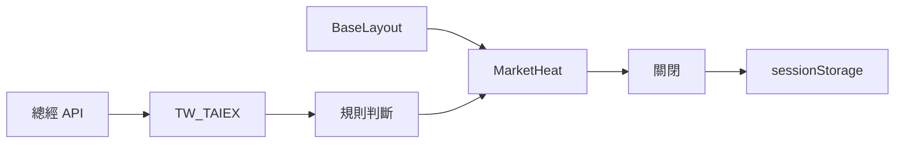

# 全站市場燃燒狀態條
讀取既有公開總經 API 的 TW_TAIEX 日線，連跌三個交易日優先，其次單日跌幅或漲幅達百分之三。排除 /palais。關閉依日期及訊號寫入 sessionStorage。資料不可用時隱藏。

## 開發方法
先加入規則測試，再實作共用版型元件。CSS 使用暖色火焰光暈與上升動畫，尊重 reduced-motion。資料沿用公開 API，無新增憑證。既有每頁載入事件支援 Astro 導航。
測試指令為 node node_modules/vitest/vitest.mjs run tests/market/marketHeat.test.ts。
