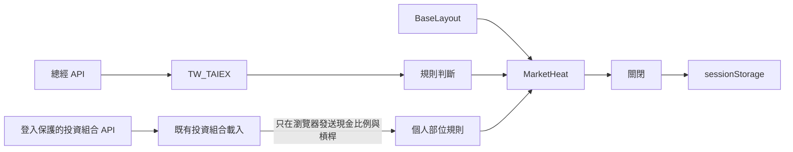

# 全站市場燃燒狀態條
讀取既有公開總經 API 的 TW_TAIEX 日線，連跌三個交易日優先，其次單日跌幅或漲幅達百分之三；加入登入者的個人投資部位訊號。排除 /palais。關閉依日期及訊號寫入 sessionStorage。資料不可用時隱藏。

## 開發方法
先加入位置判讀測試，再把登入者現有投資組合 API 回應中的現金比例與合併槓桿傳到狀態條；不新增公開 API、資料庫欄位或憑證。現金比例至少 70% 顯示「明哲保身」、至多 10% 顯示「進攻」；槓桿至少 1.1x 顯示「槓桿中」、至少 1.5x 顯示「發狂進攻」，槓桿狀態優先。未知資料不作推論。個人警示只在登入後瀏覽器取得組合快照時出現。

**測試：** `node node_modules/vitest/vitest.mjs run tests/market/marketHeat.test.ts`。需另以登入及登出狀態檢查個人警示不會出現在另一個使用者的未登入畫面。

### 開發方法（2026-11-19）
1. 狀態條本身使用公開端點，但帳戶組合端點有 `require_manage_users_request` 保護；因此個人比例不得送進公開狀態 API或共用快取。
2. 沿用已登入投資組合的既有載入，不另發重複請求。載入成功後只派送計算所需的現金比例與槓桿，登出／無權限重設時清除個人訊號。
3. 以測試固定 70% 現金、10% 現金、1.1x 與 1.5x 邊界，以及無資料時保持安靜；中英文訊息由同一個判讀函式生成。
4. 下次調整水位界線時，更新 `marketHeat.test.ts` 和本文；不可把個人欄位加進公開 status 回應。
