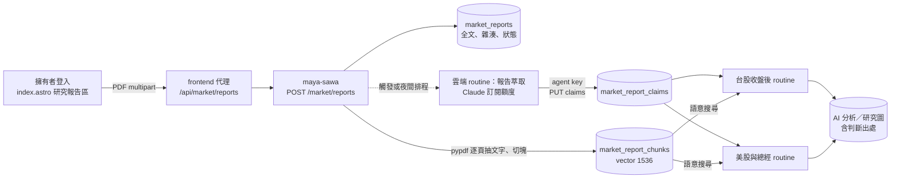

# 研究報告庫與 AI 分析改進計畫

2026-10-20 起草。這份計畫把外部研究報告（第一份是財經M平方〈全球 AI 供應鏈深度解析〉，9/15 訂閱報告，10/19 下載）接進市場儀表板，讓每次 AI 分析都會參考；同時修正分析「沿用前版、不再重新判斷」的問題。

## 目標

1. **登入後才能上傳報告**：首頁市場區新增「研究報告」區塊。擁有者上傳 PDF，系統抽出全文、切塊並轉成向量。
2. **AI 分析一定會參考報告**：
   - 從報告萃取一條條結構化「主張」（哪個產業、哪些代碼、哪項判斷、順風或逆風、資料截點、頁碼）。
   - 兩個排程寫總經與個股分析時都要讀主張、引用出處。
   - 遇到相反的主張必須正面回應。
3. **判斷要有出處、會重審**：每項判斷記錄是誰、哪一版、根據什麼寫的。有反向證據或定期時重新檢視，不再無限期沿用。
4. **用報告的框架補儀表板**：
   - 產業層地圖（上／中／下游 × 四大類）；
   - 營收 vs 庫存增速；
   - CSP 資本支出與 RPO。

## 現況（2026-10-20 查證）

| 項目 | 狀態 |
|---|---|
| pgvector | 正式 Postgres 已裝 `vector 0.8.4` |
| Embedding | maya-sawa 已有 `services/embedding_service.py`：OpenAI `text-embedding-3-small`、1536 維，prod 已設 `OPENAI_API_KEY` |
| 上傳大小 | ingress 上限：maya-sawa `1024m`，frontend `50m`。上傳經 frontend 代理，所以單檔上限訂為 **40 MB** |
| 擁有者驗證 | maya-sawa `require_manage_users_request`（Keycloak `manage-users`）；frontend 以 `marketAuthHeaders()` 帶 Bearer，代理模式同 `src/pages/api/market/automation.ts` |
| PDF 解析 | maya-sawa 尚無 PDF 套件，需新增 `pypdf`（純 Python，不需 poppler） |
| 分析歷史 | `maya_sawa_market_ai_analysis_revision` 保存每一版，GET 回傳最近 20 版 |
| 庫存 | 基本面分頁已有 Inventory 區塊（`market-fundamentals-inventory`），還沒有和營收增速對照 |
| 規則衝突 | 公開研究提示寫「不得沿用前一模型而不重新驗證」，排程 prompt 卻寫「三項判斷原則上沿用研究圖」。2408 南亞科的「賣」從 10/18 rev 5 起被 rev 6、7 照抄 |

## 架構

分工：

- **向量**：OpenAI embedding，便宜、即時，上傳當下完成。
- **主張萃取**：需要判讀，交給 Claude routine（用訂閱額度），不在 maya-sawa 內呼叫付費 LLM。

## 第 1 階段：報告庫（maya-sawa）

### 資料表

`maya_sawa_market_reports`

| 欄位 | 說明 |
|---|---|
| id | UUID |
| title, publisher, published_at | 上傳時填，可從 PDF metadata 預填 |
| received_at, uploaded_by | 上傳時間、Keycloak subject |
| sha256 | 檔案雜湊，**唯一**；重複上傳直接回傳既有報告 |
| page_count, text | 逐頁抽出的全文（以 `=====PAGE n=====` 分頁） |
| visibility | `public`／`owner`，預設 `public`（依擁有者決定：公開放自己要看的，不以是否付費區分） |
| status | `extracted` → `embedded` → `claims_pending` → `ready`；失敗為 `failed` 加原因 |
| pdf | 原檔（bytea）。只有擁有者能下載 |

`maya_sawa_market_report_chunks`：report_id、page、seq、text（約 800 字，跨段落不切斷句子）、embedding `vector(1536)`。建立 HNSW 索引。

`maya_sawa_market_report_claims`

| 欄位 | 說明 |
|---|---|
| id, report_id, page | 出處 |
| segment | 固定分類：`foundry`、`memory`、`packaging`、`abf`、`ccl_pcb`、`thermal`、`optical`、`odm`、`csp`、`macro`…（與第 6 階段產業層地圖共用） |
| codes | 受影響代碼陣列，例如 `["2408","000660-KR"]`；只講產業時為空 |
| dimension | `cycle`／`technology`／`delivery`／`macro`／`timing` |
| direction | `tailwind`／`neutral`／`headwind` |
| claim | 一句改寫後的主張（不貼原文長段落） |
| evidence | 報告裡的數據與期間，例如「記憶體三大廠毛利率約 80%（25H2 起）」 |
| as_of | 資料截點（不是報告下載日） |
| extracted_by, extracted_at | 哪個 routine／模型萃取 |

### API

| 方法 | 路徑 | 權限 |
|---|---|---|
| POST | `/market/reports`（multipart：file、title、publisher、published_at、visibility） | 擁有者 |
| GET | `/market/reports` | 公開（只列 visibility=public；擁有者看全部） |
| GET | `/market/reports/{id}` | 同上；`text` 與 PDF 下載只給擁有者 |
| DELETE | `/market/reports/{id}` | 擁有者（連同切塊與主張） |
| GET | `/market/reports/search?q=&code=&segment=&limit=` | 公開（只搜 public）；agent key 可搜全部 |
| GET | `/market/reports/claims?code=&segment=&since=` | 公開（只含 public 報告） |
| GET | `/market/reports/pending` | agent key：待萃取的報告與全文 |
| PUT | `/market/reports/{id}/claims` | agent key：整批取代該報告的主張，status → `ready` |

agent key 沿用 `X-Market-Agent-Key`（雲端環境已設好 network secret），範圍從「只能寫分析」擴大為「也能讀待萃取報告、寫主張」，`docs/MARKET_AGENT_KEY.md` 同步更新。

### 抽文字的邊界

- 掃描版 PDF（每頁抽不到文字）：status=`failed`，原因「沒有文字層，需要 OCR」。OCR 先不做。
- 圖表裡的數字常抽不出來（例如這份報告的台積電財測圖）。這是已知限制，主張萃取時以文字敘述為準，並在報告頁顯示「圖表內容未擷取」。
- 檔案上限 40 MB、只收 `application/pdf` 且檔頭為 `%PDF-`。

## 第 2 階段：上傳介面（index.astro）

- 市場區新增「研究報告」卡片，**只有擁有者登入時顯示上傳表單**；未登入只看到公開報告列表。
- 表單欄位：PDF、標題（預填檔名）、出版者、發布日、公開或只有自己。
- 上傳後顯示處理狀態：抽文字 → 向量化 → 等待萃取 → 完成（主張數），失敗時顯示原因。
- 報告列表：標題、出版者、發布日、頁數、主張數，展開看主張（依產業分組，標示順風或逆風與頁碼）。
- 個股的 AI 分析分頁新增「報告觀點」小節：列出該代碼與其產業的主張，與研究圖判斷方向相反的標紅。
- frontend 代理 `src/pages/api/market/reports.ts`：轉送 multipart 與 Bearer，不在 frontend 落地檔案。

## 第 3 階段：主張萃取 routine

- 新增雲端 routine「市場報告｜萃取主張」（Opus 5.5，環境 Default，沿用 network secret）：
  1. `GET /market/reports/pending`；
  2. 逐份讀全文，依固定分類輸出主張 JSON；
  3. `PUT /market/reports/{id}/claims`。
- 觸發：
  - 上傳成功後由 maya-sawa fire（需要 routine trigger token，同 `MARKET_ROUTINE_*_TOKEN` 的做法）；
  - 沒有 token 時，由每天 20:30（台北）的排程補做。
- 萃取規則：
  - 只寫報告明說的事，數字附期間與頁碼；
  - 推論用「報告認為」；
  - 不把報告觀點寫成事實。

## 第 4 階段：AI 分析參考報告

兩個市場 routine 的 prompt 與 `public/market-ai.md` 一起改：

1. 寫每檔前讀 `GET /market/reports/claims?code={code}` 與該代碼所屬產業的主張；需要細節時用 `search`。
2. 新增「報告觀點」段落：引用格式為「出版者 發布日〈標題〉p.頁碼」，只改寫、不長段引用。
3. **反向證據必須回應**：主張方向與目前判斷相反時，必須寫「維持或改變，以及理由」，不能略過。例如 2408 的「循環逆風」對上報告的「記憶體超級週期、DDR4 停產造成供給收斂」。
4. 總經評論讀 `segment=csp|macro` 的主張（CSP 資本支出、RPO、Token 用量），並與 FRED 等硬資料分開寫。

## 第 5 階段：判斷出處與重審

- 研究圖 JSON 的 `assessment.cycle|technology|delivery` 新增 `since`：`{revision, model, date, basis}`，記錄這個方向最早由哪一版、哪個模型、根據什麼資料寫下。
- 研究分頁顯示「此判斷自 10/18 rev 5（Opus）起沿用 2 天」。
- 統一規則，取代衝突的那句：
  - 三項判斷以研究圖為準；
  - 以下情況必須重審，並寫明維持或改變的理由：
    - 有新硬資料；
    - 有方向相反的新報告主張；
    - 判斷已沿用超過 30 天。
- **避免自我強化**：前一版只用來寫「相較前版」，不能當成證據引用；證據只能來自硬資料、研究圖來源與報告主張。
- 研究圖重審由較強的模型做（Opus），一般排程（Sonnet）只能標記「需要重審」，不能自行改研究圖。

## 第 6 階段：產業層地圖

- 共用分類表 `src/scripts/market/supplyChainSegments.ts`：代碼對應產業、層級（上／中／下游）與四大類（護城河最穩、短期爆發最強、長期斜率最陡、風險最大）。
- 目前持股的初始對應：

  | 類別 | 產業 | 代碼 |
  |---|---|---|
  | 護城河最穩 | 晶圓代工 | 2330 |
  | 護城河最穩 | 記憶體 | 2408、000660-KR |
  | 短期爆發最強 | 封測 | 3711、6187、6857-JP |
  | 短期爆發最強 | ASIC | 3443 |
  | 短期爆發最強 | CCL／PCB | 6213、3167 |
  | 長期斜率最陡 | 散熱 | 3017、8996、3324 |
  | 長期斜率最陡 | 光通訊 | 3081、6442、LITE-US、6524-JP |
  | 下游 | CSP | META-US |
  | 不在 AI 鏈 | — | 3008、3105 |

- 首頁顯示各層的持股數與目前結論分布（例如「光通訊 4 檔：買 4」），並標出沒有曝險的環節（ODM 組裝）。
- 分類只用在顯示與報告主張的比對，不影響結論。

## 第 7 階段：營收 vs 庫存增速

- 基本面分頁的 Inventory 區塊加上「營收年增 − 存貨年增」：
  - 正值代表營收跑得比庫存快，即報告說的正循環；
  - 連續兩季負值標示「庫存被動堆積」。
- 第 6 階段的產業層也顯示同一指標的中位數，對照報告「晶片層正循環、基建層被動堆積」的說法。
- 純計算抽到 `src/scripts/market/inventoryCycle.ts` 並先寫測試：處理季報缺值、存貨為 0、年增無前期。

## 第 8 階段：CSP 資本支出與 RPO

- 總經頁新增「AI 需求端」：META、MSFT、GOOGL、AMZN、ORCL 的季資本支出合計與年增、RPO 合計。
- 資料來源：SEC companyfacts（maya-sawa `overseas_financials` 已在抓 SEC 財報），tag 為 `PaymentsToAcquirePropertyPlantAndEquipment`、`RevenueRemainingPerformanceObligation`。
- 各公司會計年度不同，以日曆季對齊並標示原始期間。
- 這是報告長期結論的追蹤點：RPO 能不能接棒資本支出。

## 測試清單（TDD，先寫失敗測試）

| 階段 | 測試 |
|---|---|
| 1 | 以這份報告的文字（存成去識別的 fixture，只取幾頁）測逐頁抽取與頁碼；切塊不跨頁、不切斷句子；重複 sha256 回傳既有報告；非 PDF 與超過 40 MB 被拒；掃描版標 failed；非擁有者上傳 401／403；public／owner 可見範圍；刪除連帶刪除切塊與主張 |
| 1 | 向量搜尋：注入假 embedding 函式，驗證依距離排序、code 與 segment 過濾、owner 報告不出現在公開搜尋 |
| 1 | 主張 PUT：只有 agent key 能寫；欄位驗證（segment、dimension、direction 只能是列舉值，頁碼在範圍內）；整批取代 |
| 2 | 上傳表單只在擁有者登入時出現（純判斷抽成函式測）；狀態文字對照；主張依產業分組與反向標示 |
| 4–5 | 「反向主張」判定函式：研究圖方向與主張方向相反時列出；`since` 在方向不變時保留、改變時更新；沿用超過 30 天時標示需要重審 |
| 6 | 分類表涵蓋所有目前持股；未分類代碼歸到「未分類」而不是消失 |
| 7 | 營收與存貨年增差的邊界值（缺值、0、無前期） |
| 8 | SEC fixture：不同會計年度對齊到日曆季；缺 RPO 的公司不被當成 0 |

## 執行順序與部署

1. 第 1、2 階段一起做。maya-sawa 推 main、frontend 推 dev，部署後用這份 PDF 實際上傳驗收。
2. 第 3 階段：建立萃取 routine，跑一次這份報告，檢查主張品質。
3. 第 4、5 階段：改兩個市場 routine 的 prompt 與 `market-ai.md`，手動跑一次台股那輪，確認 2408 有回應報告主張。
4. 第 6、7、8 階段：儀表板補強。

## 需要擁有者處理

- routine trigger token：上傳後立即萃取需要 fire token。沒有 token 時改走夜間排程，最多延遲一天。
- 是否保存 PDF 原檔：預設保存（只有擁有者能下載）；不想存原檔時只留全文。
