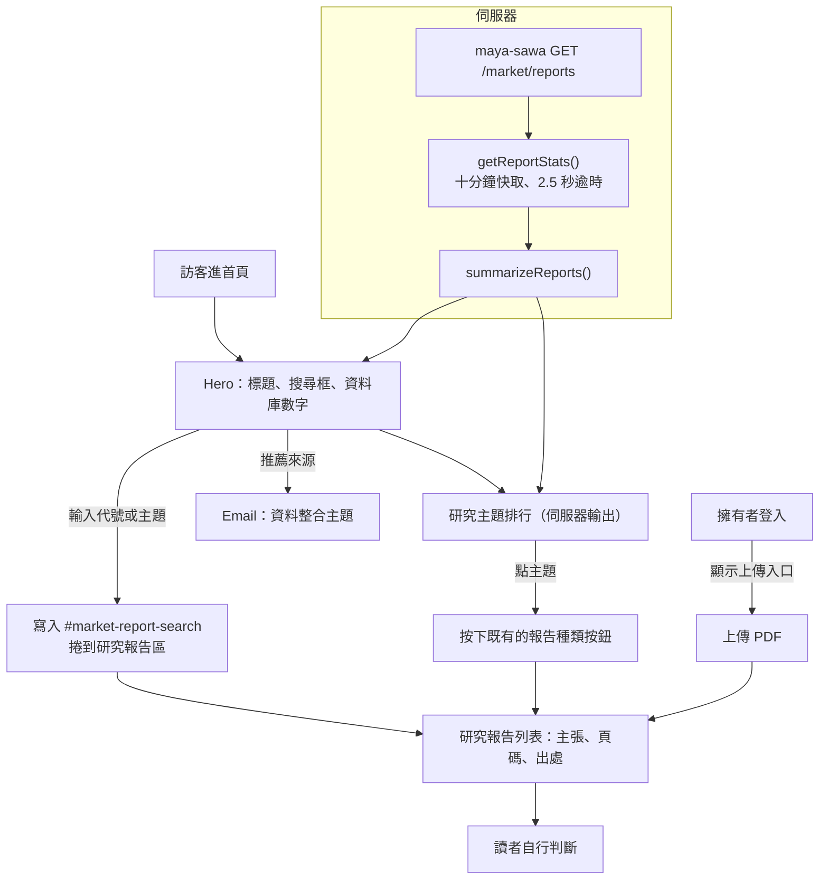

# 北極星指標與產品定位（2026-11-10）

這份文件記錄三個決定：用哪一個指標判斷產品有沒有進步、「券商報告版 OpenRouter」的構想怎麼取捨、首頁因此怎麼改。首頁版面細節見 [HOME_LAYOUT.md](HOME_LAYOUT.md)。

## 決定前看到的三個事實

1. **首頁承諾與產品不符。** 舊標題是「一起貢獻報告」，主按鈕連到報告區，但上傳表單只有擁有者看得到（`canUploadReports`，`src/scripts/market/reports.ts`）。訪客按了主按鈕後無事可做。
2. **供給是自動收集，不是社群上傳。** 報告來自公開 Telegram 頻道、頻道連到的網路文章、SEC EDGAR 與擁有者上傳的 PDF。這是閱讀端產品，瓶頸在讀者，不在報告數量。
3. **站上沒有任何量測。** Cookie 設定寫明統計 Cookie 未使用，也沒有事件紀錄。

## 北極星指標

採用 Y Combinator Startup School 的做法：只選一個主指標，它要代表使用者拿到價值、價值會重複發生、是結果而不是投入、每週看得出變化。找到產品市場契合之前看留存，不看營收或流量。

**北極星：每週回訪的研究讀者數。**
定義：一週內至少「打開一檔標的的研究或 AI 分析分頁」或「展開一份報告的主張」的不重複訪客，而且過去四週內也做過同樣的事。

| 候選 | 為什麼不選 |
|---|---|
| 上傳報告數 | 投入指標，而且只有擁有者能上傳 |
| 瀏覽量、Podcast 收聽 | 不代表讀者拿到研究價值 |
| 廣告或 Miner 營收 | 太早，Miner 尚未定價 |
| 被閱讀的主張數 | 接近，但一個人反覆點擊會灌水；列為次指標 |

次指標：第 1 週到第 4 週留存、每週被展開的主張數、每週新入庫且完成萃取的報告數、來源推薦與 Miner 的來信數。

**目前算不出這個指標。** 量測需要第一方事件紀錄（會動到 maya-sawa 與隱私說明），尚未實作。使用者還很少的階段，先直接找十位會讀台股供應鏈研究的人試用，手動記錄誰隔週回來。

## 「券商報告版 OpenRouter」的取捨

OpenRouter 能把所有主流模型放在同一個入口，是因為模型商本來就有公開的付費 API，也想要更多通路。券商研究相反：報告有著作權、只發給客戶、沒有公開 API；彭博、LSEG、FactSet、AlphaSense 都是逐家簽授權才做得到。公開散布券商 PDF 或大段摘要有侵權風險。站上公開給出「買／中立／賣」並放廣告，是否涉及投顧相關法規，需要請律師確認（尚未確認）。

所以**借形式，不照搬供給**。OpenRouter 真正的優勢有三個，對應到這個產品：

| OpenRouter | 這個產品 | 狀態 |
|---|---|---|
| 所有模型同一種 API 格式 | 每份文件變成同一種結構：標的、環節、順風或逆風、頁碼、日期、來源 | 已有（`MarketReport.claims`） |
| 用量排行榜 | 研究主題排行、順風比例；之後做觀點翻轉與來源命中率 | 主題排行已上首頁 |
| 供應商目錄 | 來源目錄：每個來源的更新頻率與主張數 | 未做 |

定位改為**「公開投資研究的統一入口」**，先只做台股 AI 與半導體供應鏈（現有研究分類的範圍）。可收錄的來源：公開資訊觀測站法說簡報、公司投資人關係頁、SEC EDGAR、央行與政府報告、券商自己公開的影片與週報、公開頻道。付費券商報告只收上傳者有權使用的，對外只顯示主張與出處連結，不提供原始檔。

## 首頁怎麼跟著改

- 搜尋框是主動作，直接驅動既有的報告搜尋與篩選，沒有第二套搜尋邏輯。
- 數字列與排行只顯示伺服器算出的真實數字；maya-sawa 逾時或失敗時整段不輸出，首頁其餘部分照常。
- 「上傳報告」只在擁有者登入後出現；訪客看到的是「推薦來源」。

## 開發方法

1. 先讀程式確認事實（誰能上傳、報告從哪來、有沒有量測），再決定指標與定位，不從文案反推。
2. 計算先寫測試：`tests/market/reportStats.test.ts` 先因模組不存在而失敗，再實作 `src/scripts/market/reportStats.ts`。計數規則與報告列表一致：沒有文字的失敗匯入不計、同一份 SEC 申報的多個區段算一份、「其他產業」計入總數但不進排行。
3. 首頁行為抽成 `src/scripts/home/heroSearch.ts` 並以 `tests/home/heroSearch.test.ts` 測試。實站檢查時發現語言切換沒有生效：`AppLang.onChange` 傳入的是 `{ code, qaLang }` 物件而不是字串。先把測試改成真實的資料形狀並確認失敗，再修正。
4. 版面契約測試隨定位一起改（`tests/seo/homeSeo.test.ts`、`tests/seo/communityPlatform.test.ts`、`tests/home/zones.test.ts`、`tests/home/spotifyEmbed.test.ts`）：這是刻意改變定位，不是為了通過而放寬。
5. `index.astro` 有六百行巢狀標記，搬區塊用腳本依行號重組，每個邊界先比對內容再搬，避免標籤錯位。
6. 伺服器端統計沿用 `src/services/server/marketBrief.ts` 的寫法，另加十分鐘快取：報告列表約 120 KB，而 maya-sawa 跑在一顆 vCPU 的節點上，不能每次載入首頁都重抓。
7. 本機沒有後端，檢視時把 `MAYA_SAWA_INTERNAL_URL` 指到正式站的公開唯讀端點，才能看到真實數字；桌面寬度、手機寬度、中英文、淺色主題各看一次。

測試指令：`node_modules/vitest/vitest.mjs run tests/market/reportStats.test.ts tests/home tests/seo`（Windows 沒有系統 Node 時的作法見 skill `tdd-workflow`）。

## 還沒做

- 北極星的量測（第一方事件、匿名回訪判斷、隱私說明更新）。
- 來源目錄頁、觀點翻轉、來源命中率。
- 「近 7 日」以外的時間區間排行；目前排行是全部累計。
- 投顧法規與著作權的法律確認。
