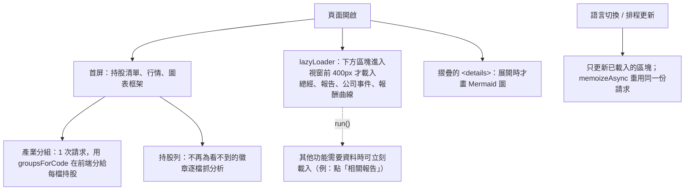

# 頁面載入預算：不要一次把整頁全部載入

## 規則

一個分頁開啟時，只載入「畫面上看得到的東西」所需的資料與繪圖。看不到的（摺疊區塊、頁面下方、還沒切到的分頁）等使用者靠近或展開時再載入。每個資料來源每頁只請求一次。

## 2026-11-01 的量測與處理

用同一個探針在實站量：長任務（`PerformanceObserver` `longtask`，`buffered: true`）、DOM 元素數、`fetch` 請求數與耗時。

| 分頁 | 量到的瓶頸 | 處理 |
|---|---|---|
| About | 每次切換語言重畫 34 張 Mermaid 圖，主執行緒卡約 4.5 秒；初次載入也一次全畫（長任務合計約 13 秒，含頭像請求） | `mermaidPlan.ts`：只畫可見且未畫過的圖，摺疊區塊展開時才畫；主題切換仍強制重畫；另一種語言在閒置時預先抓好 |
| Home | 載入時 70 多個 API 請求：每檔持股各抓一次分析徽章（38 次，徽章在持股面板被 CSS 隱藏）、每檔各抓一次產業分組（19 次），語言切換再重抓；總經、報告、公司事件（5 秒）、報酬曲線全部首屏就抓 | 持股面板不抓隱藏的徽章；產業分組 1 次請求；下方區塊改 `lazyLoader`；排程更新只更新已載入的區塊 |
| 全站（QA 機器人） | 同一個頭像請求 2 到 3 次，每次最久 15 秒 | 每個名字只請求一次，失敗才重試 |
| Work / Learn / API | 無長任務、請求少 | 不處理 |

## 開發方法

1. **先量再改。** 在實站載入頁面，等 6 到 9 秒，讀長任務與 `fetch` 清單；用「同一路徑出現幾次」找 N+1，用長任務的起點對照使用者動作找同步重活。
2. **區分「首屏需要」與「之後才需要」。** 看 CSS 是否把它隱藏（持股徽章）、是否在摺疊區塊或視窗外。
3. **純函式先行並測試。** `lazyLoader`／`memoizeAsync`（`tests/home/lazy.test.ts`）、`groupsForCode`、`prepareDiagrams`（`tests/about/mermaidPlan.test.ts`）。IntersectionObserver 以假物件注入。
4. **別讓延後載入弄壞依賴它的功能。** 例如「相關報告」按鈕要先載入報告再點篩選；排程計時器只更新已載入的區塊。
5. **改完再量一次**，把數字寫回上表。

## 已知缺口

- 通知中心每頁都抓 100 筆通知（約 0.2 到 3 秒），只為了未讀數；未改。
- About 的 HTML 約 8,600 個元素（履歷全文），尚未改成展開時才載入。
- Home 的 `/api/market/dashboard/events`（公司事件）與 `macro/nodes` 在伺服器端仍需 3 到 5 秒，只是不再擋住首屏。
