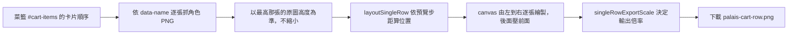
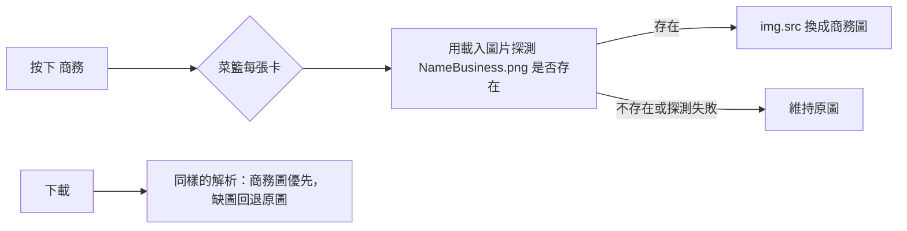

# Palais 菜籃：單排合併下載

group 頁的菜籃多了「下載」按鈕：把菜籃中的人依由左到右的順序合併成**單一 row** 的 PNG，不限人數、不換行。

## 版面規則

- 人物間距**比照菜籃預覽**：預覽的每張卡是 200px 寬的槽、圖高 300px、`margin-left: -100px`，所以每個人只往右前進 100px，也就是**身高的 1/3**，與圖寬無關。生成圖用同樣的步距（`SINGLE_ROW_STEP_RATIO = 100/300`），後面的人壓在前面，不裁切。
- 以原圖解析度合併（原圖約 3478 × 6423）：整排高度取最高那張的原始高度，較矮的放大到同高。只有整排會超過瀏覽器畫布上限（邊長 16000 px 或總像素 2 億）時才等比縮小，絕不放大。

## 開發方法

1. 版面計算抽成純函式 `src/scripts/palais/singleRow.ts`（`layoutSingleRow`、`singleRowExportScale`），先寫測試再實作：`tests/palais/singleRowLayout.test.ts`。
2. 畫面只負責抓圖、繪製與下載，位於 `src/pages/palais/group.astro` 的 `downloadCartRow()`。
3. 按鈕隨菜籃內容啟用或停用，菜籃收合時隱藏。
4. 2026-11-06 修正畫質：第一版為了避免畫布過大，把每個人縮到高度 400 再輸出，成品只有約 800 px 高，畫質很差。現改用原圖尺寸，並以測試鎖住（不得固定高度、倍率函式要吃整排寬高）。
5. 同次一併修正深色模式按鈕：`.btn` 在深色模式文字是近黑色，`is-outline` 底色透明所以看不見，改在 `global.css` 補 `is-outline`、`is-danger` 與停用狀態的規則。測試：`tests/palais/partyDarkMode.test.ts`。

## 測試

`npx vitest run tests/palais`（Windows 無系統 Node 時用 Codex 附的 node，見 workspace AGENTS.md）。

## 已知缺口

- 實際合併圖尚未在瀏覽器目視確認（build 與部署由 Jenkins）。
- 圖片來源需允許 CORS 才能匯出 canvas（與既有下載功能相同的來源）。
- 2026-11-06 第二次修正：第一版依「相鄰重疊 20%、兩側各切 10%」做，間距遠比預覽鬆（約 80% 圖寬），改為比照預覽步距。舊規則與裁切已移除。

## 商務圖按鈕

菜籃標題列的「商務」按鈕：按下後菜籃中的人改用 `${name}Business.png`，再按一次還原。**沒有商務圖的人維持原圖**。

- 只影響菜籃（預覽與下載）；人從菜籃移回隊伍或清空時會還原原圖。狀態記在 `localStorage`（`palais-cart-business`），重整後保持。
- 不直接把 `src` 換成商務網址：卡片圖片的 `onerror` 會把整張卡移除，圖片不存在會害人從畫面消失。所以先用探測確認存在才換。
- 邏輯在 `src/scripts/palais/businessImage.ts`（`peopleImageUrl`、`resolveImageUrl`），測試 `tests/palais/businessImage.test.ts`（含缺圖回退與探測失敗回退）。
- 已知缺口：目前 `WavoBusiness.png`、`MayaBusiness.png` 都不存在（404），尚未有實際商務圖可驗證畫面，只驗證了回退邏輯；實際商務圖上傳後請在部署後的菜籃確認。

