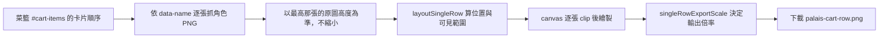

# Palais 菜籃：單排合併下載

group 頁的菜籃多了「下載」按鈕：把菜籃中的人依由左到右的順序合併成**單一 row** 的 PNG，不限人數、不換行。

## 版面規則

- 相鄰兩張重疊 20%（兩張同寬時；不同寬時各讓出自己寬度的 10%）。
- 每張圖被相鄰者蓋到的那一側，各被切掉自己寬度的 10%，所以接縫剛好對齊，沒有縫隙也沒有重複蓋到的帶狀區。
- 第一張只切右側，最後一張只切左側，中間每張兩側各切 10%。
- 以原圖解析度合併（原圖約 3478 × 6423）：整排高度取最高那張的原始高度，較矮的放大到同高。只有整排會超過瀏覽器畫布上限（邊長 16000 px 或總像素 2 億）時才等比縮小，絕不放大。

## 開發方法

1. 版面計算抽成純函式 `src/scripts/palais/singleRow.ts`（`layoutSingleRow`、`singleRowExportScale`），先寫測試再實作：`tests/palais/singleRowLayout.test.ts`。
2. 畫面只負責抓圖、clip、繪製與下載，位於 `src/pages/palais/group.astro` 的 `downloadCartRow()`。
3. 按鈕隨菜籃內容啟用或停用，菜籃收合時隱藏。
4. 2026-11-06 修正畫質：第一版為了避免畫布過大，把每個人縮到高度 400 再輸出，成品只有約 800 px 高，畫質很差。現改用原圖尺寸，並以測試鎖住（不得固定高度、倍率函式要吃整排寬高）。
5. 同次一併修正深色模式按鈕：`.btn` 在深色模式文字是近黑色，`is-outline` 底色透明所以看不見，改在 `global.css` 補 `is-outline`、`is-danger` 與停用狀態的規則。測試：`tests/palais/partyDarkMode.test.ts`。

## 測試

`npx vitest run tests/palais`（Windows 無系統 Node 時用 Codex 附的 node，見 workspace AGENTS.md）。

## 已知缺口

- 實際合併圖尚未在瀏覽器目視確認（build 與部署由 Jenkins）。
- 圖片來源需允許 CORS 才能匯出 canvas（與既有下載功能相同的來源）。
