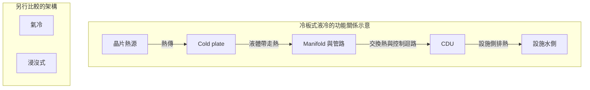

# Research 深度與技術圖審查

審查日期：2026-10-25（Asia/Taipei）。範圍是研究內容的深度、證據和圖的語義；不是重新發布 20 檔買賣建議。

本文件保存更新前的審查結果；後續依指引完成的 21 份內容更新、測試與剩餘缺口，請見 [本次實作紀錄](RESEARCH_UPDATE_2026-10-25.md)。

## 結論

目前可以作產業入門地圖，尚不足以作獨立投資判斷的研究底稿。
優點是能定位供應鏈、區分部分量產／驗證／規劃，且把研究保存成可追版本的紀錄。
主要缺口是：箭頭意義混雜、關鍵主張缺直接文件、幾乎沒有同口徑競爭比較、沒有完整技術到獲利的因果橋，以及沒有可操作的反證流程。
增加更多名詞或圖節點不會解決這些問題。

已提供可沿用的[公開品質準則與更新 Prompt](../public/research-guide.md)，並把入口接到 Research 和 AI writing guide。

## 實際讀了什麼

1. 線上 `GET /tymultiverse/api/market/dashboard/research`，再逐一讀取 20 個 `analysis/{code}?productType=research` 的完整 content。
2. 全部 20 筆為 revision 1、asOf=2026-10-18，與當前 repository 的同名種子 JSON 逐欄相同。這代表尚未有不同於種子的持久更新，不代表其中每一句都錯。
   再對照即時 dashboard：目前 20 個標的中 19 個有研究，`009811 統一美國50` 缺紀錄；研究清單中的 `000660-KR` 是保留的歷史研究，不能把「有 20 筆」誤當成全部目前標的已覆蓋。009811 雖在 API 標為 stock，[證交所商品頁](https://www.twse.com.tw/zh/ETFortune/etfInfo/009811)確認它是國外股票 ETF，應按指數、持倉及基金結構研究，不套單一公司的製程護城河。更新時以最新公開說明書為準。
3. 讀取 `researchMap.ts`、`loadMarketResearch`、後端 `validate_research_content`、`market-ai.md` 與頁面可見 prompt。
4. 另讀共用 `ResearchZone.tsx`、`PowerRackDiagram.tsx` 與本地 `companyProductMapping.json`。此映射可能被執行期遠端資料替換；沒有把本地供應商清單當成已核實的線上最新清單。
5. 公開 API 快照保存在 workspace `.local-evidence/research-audit-20261025.json`，不含帳戶部位或憑證；未寫入線上研究紀錄。

上述 20 筆的來源表沒有將技術節點／箭頭對應到具體文件頁碼，多為本站價格／財報 API 或 MOPS、EDINET、SEC、公司 IR 首頁。
價格 API 能支持交易資料，不支持某技術已量產；IR 首頁也不能直接支持特定節點的時程。
共同 basis 還寫「模型知識截至 2026-06，需最新法說／年報覆核」，與讀者可能理解的 10/18 已覆核技術狀態有落差。

## 我採用的判準及來源界線

採用公開的 [CFA 產業與競爭分析](https://www.cfainstitute.org/insights/professional-learning/refresher-readings/2026/industry-and-competitive-analysis)、[CFA 研究報告要素](https://www.cfainstitute.org/sites/default/files/-/media/documents/support/research-challenge/challenge/rc-equity-research-report-essentials.pdf)、Morgan Stanley Investment Management / Counterpoint Global 的 [Measuring the Moat](https://www.morganstanley.com/im/publication/insights/articles/article_measuringthemoat.pdf) 與 [Market Share](https://www.morganstanley.com/im/publication/insights/articles/article_marketshare.pdf)。

重點是產業邊界、競爭優勢能否反映到經濟結果、估值與反方。具體執行步驟由本專案自行設計。
[高盛的公開 GIR 介紹](https://www.goldmansachs.com/what-we-do/research)僅足以確認其重視基本面、預測和模型，不能據此宣稱拿到了高盛內部 SOP。

## 最重要的五個問題

### 1. 很多箭頭沒有可判讀的語義

- **奇鋐 3017**：`氣冷 → 水冷板 → manifold → CDU / 浸沒式`。這混合替代散熱方式、迴路零件和整套系統。讀者可能誤以為同一條必然的技術升級路線。
- **穩懋 3105**：`GaAs HBT → GaN on SiC → 光電元件`。目前圖沒有說箭頭代表時間、公司投資順序、製程依賴還是替代；不能由連線推定它們同源演進。
- **湖北 6524-JP**：`導線端子 → 光隔離器` 比較像事業組合的串接，不足以表示技術演化或協同。
- **Meta**：`推薦／廣告排序 → Llama → AI 助理` 沒有分清營收來源、模型能力與產品。模型存在不等於廣告增量收入已被驗證。

應先指定圖的視角，把平行路線分支，每條關鍵邊加關係標籤；不是把節點名稱換得更專業。

### 2. 有明確的架構過度概括風險

本地電源圖固定畫「800VDC → 48VDC」，並把 DC PDU / DC-DC 合成同一個區塊。
這可以是某個參考設計的示意，但不能當所有 800V 機櫃的通用架構。
NVIDIA 2025-10-13 的[官方技術文章](https://developer.nvidia.com/blog/building-the-800-vdc-ecosystem-for-efficient-scalable-ai-factories/)也討論 Kyber 的 800V→12V 轉換路徑。
因此應標參考設計／日期，分開配電、保護、轉換與備援，再標公司產品證據；不能把「有相關產品」畫成特定機櫃已採用。
這是架構表達的問題，不是判定哪一家供應商產品不存在。

散熱方面，[OCP Cold Plate 專案](https://www.opencompute.org/projects/cooling-environments/cold-plate/)的系統範圍涵蓋冷板到 CDU。
更好的圖會標熱與液體的路徑，以及廠商實際交付哪個零件；浸沒式另列成替代架構。

### 3. 技術「領先」目前難以被檢驗

- 台積電列了製程及封裝名稱，缺同條件 PPA、設計／量產狀態及有效產能，亦缺技術到收入和資本效率的橋。
- Advantest 寫「高階 SoC 與 HBM 領先」，缺測試平台、並行測試、功耗、測試時間、成本及競爭口徑。
- 聯茂用 M7/M8/M9 名稱，缺產品型號、頻率與材料性能條件、平台認證及銷售組合。等級名稱不足以直接做廠商排名。

台積電[2026 技術論壇公告](https://pr.tsmc.com/system/files/newspdf/attachment/49337b40ff139d51d533076cf7a945b30e107e07/2026%20Tech%20Symposium%20%28E%29_Final_wmn.pdf)已呈現多條製程與封裝發展軌道。
它可作更新入口，但仍要再查截止研究日的最新法說，不能用早期規劃冒充現在量產狀態。
Advantest 的[2025 Investors Guide](https://www.advantest.com/document/en/investors/ir-library/investors-guide/Investors_Guide_2504E.pdf)也把產品組合、測試流程與競爭環境分開。
這些官方材料足以讓下一輪研究比單純的名詞鏈更深入。

### 4. 公司營收強勁，不能單獨證明某項技術已商業化

例如一家公司總營收和毛利率上升，可能來自舊產品、匯率、組合、客戶補庫存或產能利用率。
目前多筆 delivery 用公司整體營收去支持特定新技術，缺產品占比、客戶認證、出貨或管理層可追溯說明。
聯亞「CPO／CW」、萬潤「CoWoS／SoIC」、高力「CDU／SOFC」都應把技術分支與收入貢獻拆開驗證。

### 5. 三軸計票有證據與估值盲點

現有規則「兩項順風且無逆風→買」是專案自己的營運偏向規則，不是機構研究方法。
循環順風與交貨成長可能是同一需求事件的兩個表象；技術順風又可能只是管理層願景。
三個勾選不能當三份獨立證據。更不能從營運偏多直接推出現價具有正風險報酬。

**建議**：保留三軸作產業／營運評估，在投資評等層另外檢查估值、隱含預期、資本投入和反方情境。
本次只把這個界線寫入指南，沒有變更既有評等公式或替使用者重下買賣結論。

## 逐筆修訂清單

共同項目：20 筆都需要主張對應的直接文件及至少一個實質反方。下表列個別最應補的部分；「待核實」不等於判定該技術不存在。

| 紀錄 | 目前圖的主要不足 | 下一輪優先補證據／修圖 |
| --- | --- | --- |
| 2330 台積電 | 前段製程與先進封裝混在路線圖；演進、互補未分清 | 分製程／2.5D／3D／光子軌道；最新平台時程、PPA 條件、有效產能及財務傳導 |
| 2408 南亞科 | 1B 爬坡標推論，但缺證明；技術與商品供需未連結 | 公司原始製程說明、DDR5 組合、良率／利用率、位元供需及 ASP 情境；HBM 不可一概外推 |
| 3008 大立光 | 鏡片數、潛望式、玻塑、光圈混成線性演進 | 分設計維度；客戶機種／認證、光學性能與良率、每機用量及產品組合 |
| 3017 奇鋐 | 氣冷、零件、CDU、浸沒式串成路線 | 分架構與供貨角色；熱阻／壓降／可靠度、驗證、液冷產品實際營收貢獻 |
| 3081 聯亞 | DFB／EML、CW、CPO 的角色差異不足；6 吋推論進觀察清單 | 分磊晶／雷射架構／部署架構；功率、良率、認證及擴產原文；確認可受益含量 |
| 3105 穩懋 | GaAs、GaN、光電分支被串成單一技術鏈 | 分材料、平台及終端；驗證光通訊收入暴露，不能以產業標籤當主營受益 |
| 3167 大量 | 鑽孔到半導體設備缺具體製程步驟 | 確認設備型號、工序、精度／產能、客戶驗收與收入認列；替代設備比較 |
| 3324 雙鴻 | 冷板、CDU、設施系統層級未拆 | 產品／系統責任邊界、認證、效率與可靠度、客戶組合和售後成本 |
| 3443 創意 | N2、HBM4、UCIe 的公司特定狀態缺直接證據 | IP／介面能力、tape-out 與量產分別核實；NRE／turnkey 收入和客戶集中風險 |
| 3711 日月光 | FOCoS／2.5D／面板級沒有清楚架構分類 | 公司產品定義、認證／量產、先進封裝收入與 capex，及與代工廠互補／競爭 |
| 6187 萬潤 | 把 CoWoS／SoIC 概念當設備環節 | 寫實際工序及設備能力、交機驗收、客戶依賴；區分整體 CoWoS capex 與公司可取得市場 |
| 6213 聯茂 | 只有材料等級名稱，缺比較口徑 | 型號、Dk/Df／頻率／方法、玻纖／銅箔、平台認證和同業產品對照 |
| 6442 光聖 | MPO、光纖陣列、CPO 供貨界線不明 | 公司產品目錄、連接器／纖陣列角色、插入損耗／可靠度、認證與收入組合 |
| 6524-JP 湖北 | 端子→光隔離器是事業組合，不足以證明演進 | 分電容元件／光元件，查官方 IR 的產品組合、終端市場與機會成本 |
| 6857-JP Advantest | 平台、測試能力與 SLT 混合；缺交貨驗證 | 分 SoC／memory／SLT；並行數與測試效率、裝機利用率、最新原廠接單／銷售資料 |
| 8996 高力 | 熱交換器→CDU 與 SOFC 分支的經濟關聯不足 | 區分零件與整套 CDU，查功率／可靠度、客戶認證、應用別營收與風險 |
| LITE-US Lumentum | EML／CW／CPO／OCS 不同層級未充分拆開 | 光源／模組／光交換分軌；lane rate、架構替代、認證、產能及分部營收 |
| META-US Meta | 推薦、Llama、agent、自研晶片未連到可測收益 | 分廣告／模型／基礎設施；轉換率、使用量、推論成本、capex 與可量化反方 |
| 000660-KR SK 海力士 | HBM 代際進度、1c 狀態含待核實推論 | 原廠公告與最新法說；量產／認證／出貨、堆疊良率與有效產能、供需及資本投入 |
| TXF 台指期 | 把一組科技趨勢當成指數整體技術優勢 | 用權重×成分盈餘／估值敏感度建傳導；區分市場廣度、利率／外匯、基差與轉倉 |

建議批次：先進封裝與測試 → 光通訊 → 散熱／電源 → 材料／設備 → 其他公司 → 指數整合。
同族群共用產業假設及技術定義，但每家公司仍要分開核實客戶、產品與收入，不能整段複製。
另補 009811 缺失紀錄：以基金／指數方法、成分權重、費用、追蹤差異及曝險為主，不能從持股公司的技術優勢直接推導基金本身有護城河。

## 一個更清楚的圖示意

以下只示範「熱路徑」與「替代架構」分開畫，不表示任一持股已具備所有能力，也不是量產或供應商名單的證據。

正式個股研究要在相鄰證據表加入每個關鍵角色的公司產品、成熟度、KPI 與來源，並說明這張簡圖省略的回水、泵浦及控制細節。

## 本次交付與後續界線

- 公開 `research-guide.md`：原則、證據帳、產業問題、六項驗收門檻、完整 AI prompt、相容 JSON 範本。
- Research 分頁可找到指南，AI analysis 的既有 prompt 明確要求先讀它；`market-ai.md` 同步連結。
- 保留目前資料格式及既有評等邏輯；未把未核實的新技術狀態寫進種子或線上 DB。
- 文件／整合測試檢查入口可發現、範本可解析及指南引用；**測試通過不代表六項研究品質門檻由程式自動驗證**。
- 下一個 AI 應依 prompt 先做一個族群的證據完整示範，再按相同口徑逐批更新；無法取得原始來源時保留草稿與缺口。
