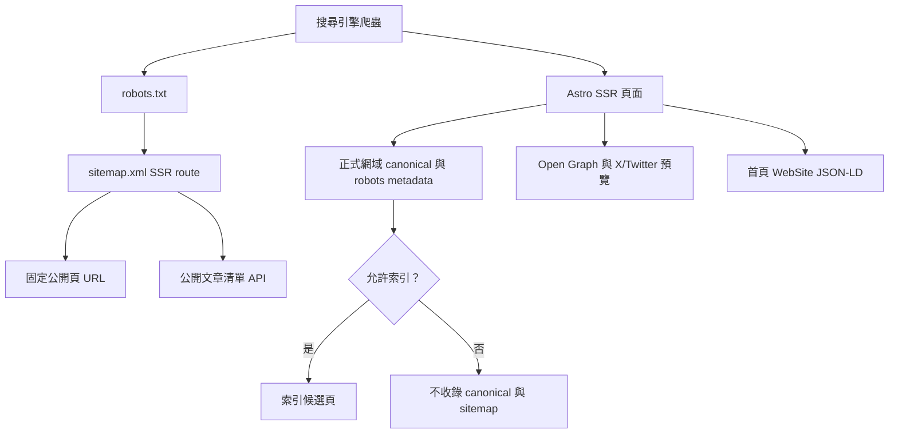

# 技術 SEO 與索引策略

## 範圍

- 正式網域固定為 `https://tymultiverse.cc`。所有共用版型頁面輸出正式網域 canonical；canonical 會移除 query/hash，避免追蹤參數與 About 語言參數形成重複 URL。
- 公開入口（首頁、關於、知識庫、學習中心、API 規格與已發布知識文章）可以索引。登入、管理、個人工作區、遊戲模組、錯誤頁與服務故障頁輸出 `noindex`；不在 sitemap 列出。
- Sitemap 由 SSR route 產生，因 Astro sitemap integration 無法列出 SSR 動態路由。固定公開頁即使文章服務暫時離線仍會輸出；文章資料可用時再附上符合 slug 格式的公開文章 URL。
- `robots.txt` 指向 sitemap 並減少 API 路徑的爬取。機器可讀的籌碼摘要與 `llms.txt` 保持可被明確請求，但透過 `X-Robots-Tag` 避免成為搜尋結果頁。
- 共用 head 提供描述、canonical、Open Graph、X/Twitter 大型分享卡片與可縮放 viewport。首頁使用 `WebSite` JSON-LD 指定「TY 市場研究室」站名；沒有編造公司地址、評論、價格或金融服務資格。
- 分享預覽圖來源為 `public/assets/og-market-lab.svg`，部署使用 1200×630 PNG。修改圖稿後用專案 Sharp 重新輸出 `public/assets/og-market-lab.png`。

## 爬取與輸出流程



## 開發方法

1. 先盤點 Astro 輸出模式、共用 head、公開與登入後路由，以及既有 SEO 測試。本站使用 Node adapter 與 SSR；官方 sitemap integration 不會列出 SSR 動態路由，因此 sitemap 改由明確的 endpoint 產生。
2. 先新增 `tests/seo/technicalSeo.test.ts`，確認正式 canonical、query 清除、noindex、XML escape/去重、SSR 文章收錄與分享 metadata；先執行測試並確認在缺少 helper 時失敗，再實作。
3. SEO 主機名只從程式碼中的正式網域常數取得，不讀取任意 Host header，也不需要憑證或其他 secret。公開文章清單失敗時保留固定 sitemap 頁面。
4. 部署前跑 SEO 測試與全套 Vitest；上線後先確認 `/robots.txt`、`/sitemap.xml`、首頁 head、公開文章與一個 noindex 頁，再用 Search Console URL Inspection 及 sitemap 提交確認 Google 實際抓取結果。搜尋引擎重抓與排名需要時間，不以 metadata 存在作為索引成功的證據。
5. 下次增加 SSR 公開路由時，先決定它是否可被索引；可索引頁需有可讀的伺服器輸出、描述與 canonical，並同步納入 sitemap；登入／管理頁則設 `indexable={false}`。

## 驗證

- 測試：`tests/seo/technicalSeo.test.ts`、`tests/seo/sitemap.test.ts`、`tests/seo/homeSeo.test.ts`、`tests/seo/homeLayout.test.ts`、`tests/lang/literalCoverage.test.ts`。
- 命令（Windows，從前端專案目錄）：

  ```powershell
  $node = Get-ChildItem "$env:LOCALAPPDATA\OpenAI\Codex\bin\*\node.exe" | Select-Object -First 1 -ExpandProperty FullName
  & $node node_modules\vitest\vitest.mjs run tests/seo tests/lang/literalCoverage.test.ts
  ```

- 目前尚未由 Search Console 驗證索引狀態，也未取得真實使用者 Core Web Vitals 報告；發布 sitemap 只會提供抓取線索，不保證收錄或排名。
